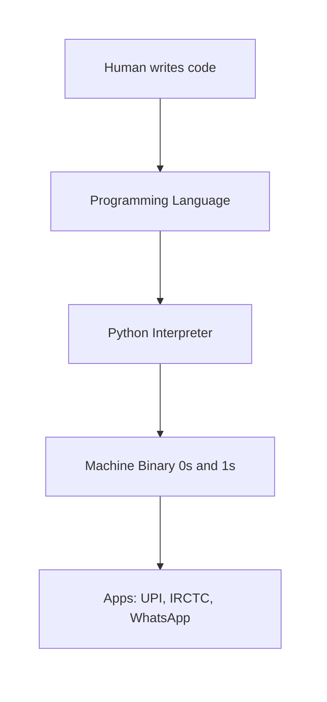
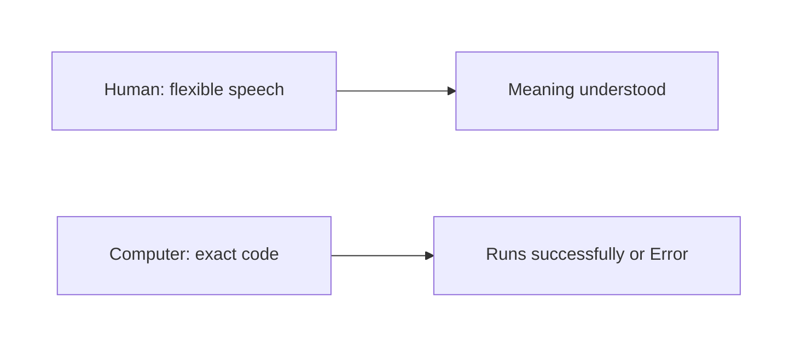
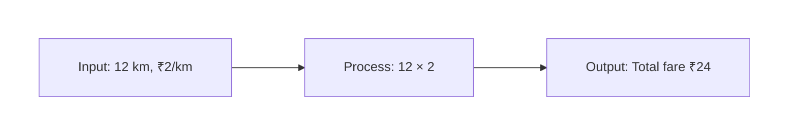
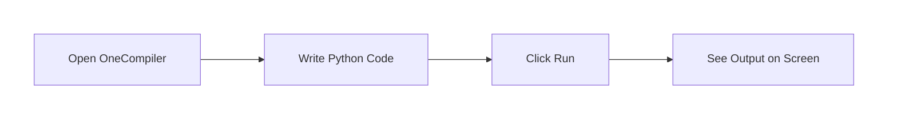
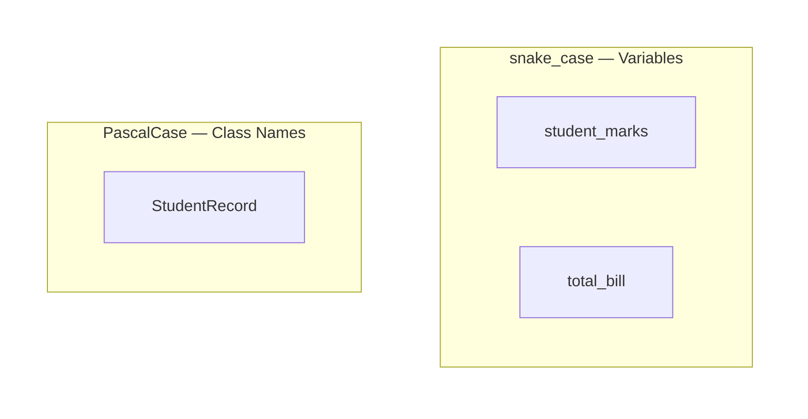
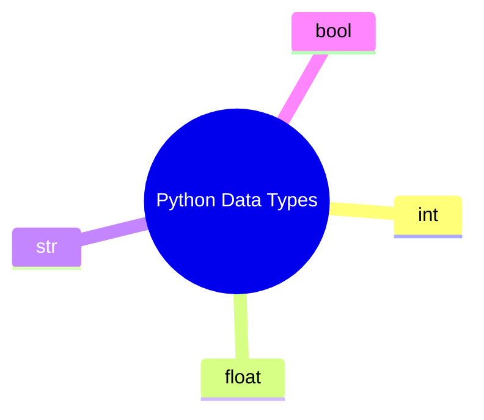
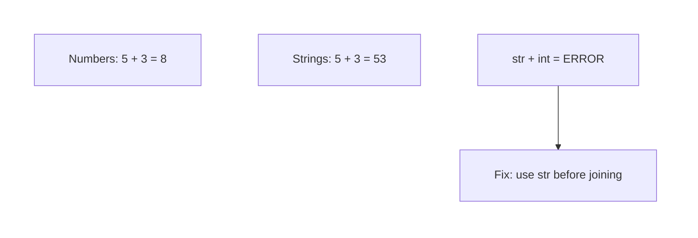
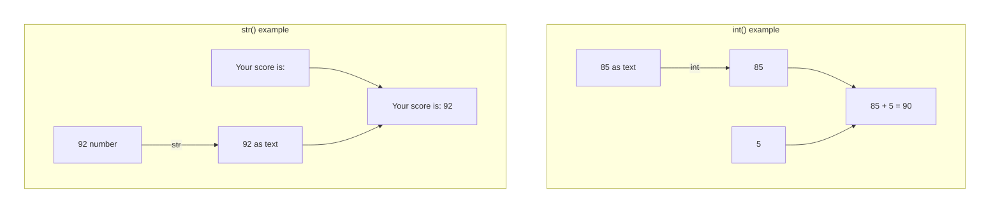

<style>
/* Fenced code: light panel, dark text */
pre[class*="language-"],
.markdown-body pre,
pre {
  background: #f1f5f9 !important;
  border: 1px solid #e2e8f0 !important;
  border-radius: 8px !important;
  color: #0f172a !important;
}

pre code,
.markdown-body pre code {
  background: transparent !important;
  color: #1e293b !important;
  opacity: 1 !important;
}

/* Syntax highlighting on light background (hljs / Prism / pygments) */

pre code .hljs-keyword,
pre code .hljs-selector-tag,
pre code .hljs-selector-class,
pre code .hljs-section { color: #5b21b6 !important; }

pre code .hljs-string,
pre code .hljs-regexp,
pre code .hljs-addition { color: #0f766e !important; }

pre code .hljs-number,
pre code .hljs-literal { color: #b45309 !important; }

pre code .hljs-built_in,
pre code .hljs-title.function_,
pre code .hljs-title.class_,
pre code .hljs-function,
pre code .hljs-title { color: #1d4ed8 !important; }

pre code .hljs-variable,
pre code .hljs-template-variable,
pre code .hljs-attr,
pre code .hljs-name,
pre code .hljs-params { color: #0f172a !important; }

pre code .hljs-type { color: #0369a1 !important; }

pre code .hljs-meta,
pre code .hljs-doctag { color: #475569 !important; }

pre code .token.keyword { color: #5b21b6 !important; }
pre code .token.string { color: #0f766e !important; }
pre code .token.number { color: #b45309 !important; }
pre code .token.function { color: #1d4ed8 !important; }
pre code .token.operator,
pre code .token.punctuation { color: #334155 !important; }
pre code .token.parameter,
pre code .token.property { color: #0f172a !important; }

/* F-strings / template literals: `{var}` must stay dark (fixes white/lost contrast on light bg) */
pre code .hljs-subst,
pre code .hljs-template-variable,
.markdown-body pre code .hljs-subst,
.markdown-body pre code .hljs-template-variable {
  color: #0f172a !important;
}

pre code .hljs-string .hljs-subst,
pre code .hljs-string .hljs-subst *,
pre code .hljs-string .hljs-variable,
pre code .hljs-string .hljs-built_in,
pre code .hljs-string .hljs-keyword,
.markdown-body pre code .hljs-string .hljs-subst,
.markdown-body pre code .hljs-string .hljs-subst * {
  color: #0f172a !important;
}

/* Prism-style interpolation */
pre code .token.interpolation,
pre code .token.interpolation-punctuation,
pre code .token.string .token.punctuation,
pre code .language-python .token.string .token,
pre code .token.string .token.builtin {
  color: #0f172a !important;
}

/* VS Code TextMate-style meta.embedded / source inside string */
pre code span[class*="embedded"],
pre code span[class*="interp"] {
  color: #0f172a !important;
}

/* Pygments: String.Interpol (f-string `{…}` regions) */
pre code .si {
  color: #0f172a !important;
}

/* Comments (all common highlighters) */
.hljs-comment,
.hljs-quote,
span[class*="hljs-comment"],
.token.comment,
.token.prolog,
.token.doctype,
.token.cdata,
.highlight .c,
.highlight .c1,
.highlight .cm,
.highlight .cp,
.highlight .cs,
.markdown-body pre code span.line > span[class*="block-comment"],
.markdown-body pre code span.line > span[class*="line-comment"] {
  color: #334155 !important;
  opacity: 1 !important;
}

/* Inline backticks in body text */
:not(pre) > code,
.markdown-body :not(pre) > code {
  color: #0f172a !important;
  background: rgba(30, 41, 59, 0.08) !important;
  opacity: 1 !important;
}

/* Mermaid edge labels (True / False): stop the text being clipped */
.edgeLabel,
span.edgeLabel,
.edgeLabel p,
foreignObject,
svg .label {
  overflow: visible !important;
}

span.edgeLabel,
.edgeLabel p {
  display: inline-block !important;
  box-sizing: content-box !important;
  padding: 6px 12px !important;
  line-height: 1.45 !important;
  background: #ffffff !important;
  border-radius: 4px;
  font-size: 20px !important;
}

/* Presentation type scale */
body,
.markdown-body,
div[markdown] {
  font-size: 24px !important;
  line-height: 1.55 !important;
}

h1,
.markdown-body h1 {
  font-size: 44px !important;
  line-height: 1.2 !important;
}

h2,
.markdown-body h2 {
  font-size: 34px !important;
  line-height: 1.25 !important;
}

h3,
.markdown-body h3,
h4,
.markdown-body h4 {
  font-size: 28px !important;
  line-height: 1.3 !important;
}

p,
li,
td,
th,
.markdown-body p,
.markdown-body li,
.markdown-body td,
.markdown-body th,
div[markdown] p,
div[markdown] li,
div[markdown] td,
div[markdown] th {
  font-size: 24px !important;
  line-height: 1.55 !important;
}

pre,
pre code,
.markdown-body pre,
.markdown-body pre code {
  font-size: 20px !important;
  line-height: 1.5 !important;
}

:not(pre) > code,
.markdown-body :not(pre) > code {
  font-size: 22px !important;
}

svg text,
.mermaid text,
.edgeLabel,
span.edgeLabel,
.edgeLabel p {
  font-size: 20px !important;
}
</style>

<div markdown="1" style="color: #0f172a; border-left: 5px solid #1e40af; background: linear-gradient(135deg, #f4f7fb 0%, #eef2f8 100%); padding: 14px 18px; margin: 18px 0; border-radius: 0 10px 10px 0; box-shadow: 0 1px 2px rgba(0,0,0,0.04);">

# **Python Basics — Introduction to Programming, Python, Variables & Data Types**

Brief points from the lecture notes, in the same order.

</div>

<div markdown="1" style="color: #0f172a; border-left: 5px solid #2563eb; background: #eff6ff; padding: 14px 18px; margin: 18px 0; border-radius: 0 10px 10px 0; box-shadow: 0 1px 2px rgba(0,0,0,0.04);">

## **What You Will Learn in This Lesson**

- First step into programming — no prior coding needed
- What a **programming language** is, and how it solves problems with step-by-step logic
- Meet **Python** — write and run first programs on an **online compiler**
- Store information with **variables**
- Organise data with **data types**
- By the end: explain how a computer follows instructions, write small programs, identify number / text / true-false

### A Real-Life Story — Why Programming Is Needed

- Small hotel, tasty food, dining full, long queue, bills written by hand
- Each bill is slow — names, quantities, and prices added manually
- Queue grows; some customers leave
- No clear daily totals, popular dishes, or old records
- **Billing system:** tap dish + quantity → instant bill → faster queue → sales saved automatically
- Programming languages exist to handle repetitive tasks quickly and accurately


</div>

<div markdown="1" style="color: #0f172a; border-left: 5px solid #7c3aed; background: #f5f3ff; padding: 14px 18px; margin: 18px 0; border-radius: 0 10px 10px 0; box-shadow: 0 1px 2px rgba(0,0,0,0.04);">

## **What Is a Programming Language?**

- **Official:** Formal set of rules and symbols to write instructions a computer can execute
- **Simple:** How humans talk to computers — step-by-step, exact
- **Example:** Washing machine buttons — specific presses in order, not “please wash nicely”
- Without programming languages → no billing systems, websites, or automation



### Why Do We Use Programming Languages?

- Computers do not understand English or Hindi directly — they understand **binary** (0s and 1s)
- A programming language is a **translator** between human thinking and machine execution
- UPI, IRCTC, WhatsApp, shopping apps — all run on code

### How Programming Solves Real-Life Problems

- Break any real-world task into **small, clear steps**
- IRCTC: source + destination → trains → payment → ticket = **logic in code**
- Teaches organised thinking — studies, jobs, daily decisions

### Human Language vs Computer Instructions

| Human Language | Computer Instructions |
|----------------|----------------------|
| Flexible — “That’s wonderful” can mean many things | Strict — must be exact |
| We fill gaps from context | Does only what is written |
| Can change mid-sentence | Runs line by line unless told otherwise |
| Mistakes often forgiven | One spelling or punctuation error can stop the program |

- **Official:** Computer instructions = precise, unambiguous commands
- **Simple:** Like giving directions to someone who has never been to your city
- Human: *“Meet me around 5 pm near the bus stand”* — a friend understands
- Computer: `print(Hello)` vs `print("Hello")` → **SyntaxError**
- Keywords in English (`print`, `if`, `else`); everyday text can live in quotes: `name = "Hello"`



### Common Doubts About Programming

- **Need maths?** — Basic arithmetic is enough; logic matters more
- **Will the computer understand English?** — Keywords in English; everyday text can live in quotes
- **Mistakes?** — Normal. Errors help you learn what went wrong

</div>

<div markdown="1" style="color: #0f172a; border-left: 5px solid #0d9488; background: #f0fdfa; padding: 14px 18px; margin: 18px 0; border-radius: 0 10px 10px 0; box-shadow: 0 1px 2px rgba(0,0,0,0.04);">

## **The Input → Process → Output Model**

- Every program follows this flow — design the solution before writing code
- **Official:** IPO = receive data → operate on it → produce a result
- **Simple:** Take something in, do something, give something back
- **Example:** Kirana billing — scan items (**input**) → GST total (**process**) → print bill (**output**)

### Breaking Down the Three Steps

| Step | What Happens | Everyday Example | Programming Example |
|------|--------------|------------------|---------------------|
| **Input** | Data enters | kg of rice needed | `quantity = 5` |
| **Process** | Logic / calculation | price × quantity | `total = price * quantity` |
| **Output** | Result shown | printed bill | `print(total)` |


### Activity: Design a Bus Fare Calculator (On Paper)

- Distance = 12 km, Rate = ₹2/km
- **Input** → **Process** (12 × 2) → **Output** (Total fare: ₹24)
- Also try: 3 notebooks × ₹45; hours left before 6 PM if now 2 PM
- This step-by-step thinking = **algorithm design**



### Activity: IPO for a Simple Greeting

1. **Input:** Name (for example, "Ananya")
2. **Process:** Combine the name with a greeting
3. **Output:** "Hello, Ananya!"
- Later: the same logic with variables and `print()`

</div>

<div markdown="1" style="color: #0f172a; border-left: 5px solid #be123c; background: linear-gradient(135deg, #fff1f2 0%, #ffe4e6 100%); padding: 14px 18px; margin: 18px 0; border-radius: 0 10px 10px 0; box-shadow: 0 1px 2px rgba(0,0,0,0.04);">

## **Part 2**

</div>

<div markdown="1" style="color: #0f172a; border-left: 5px solid #b45309; background: #fffbeb; padding: 14px 18px; margin: 18px 0; border-radius: 0 10px 10px 0; box-shadow: 0 1px 2px rgba(0,0,0,0.04);">

## **Introduction to Python**

- Programming and step-by-step thinking are in place. Next tool: **Python**
- **Official:** High-level, general-purpose language — readable syntax; used in software, data, and automation
- **Simple:** Instructions that almost read like English
- **Example:** Automatic scooter — easy to start, good for beginners

### Why Python Is Beginner-Friendly

- **Clean, readable syntax** — more logic, less memorising symbols
- Used by Google, Netflix, ISRO
- Short programs, easy to read
- Core language for **AI/ML and data analytics**
- Versatile — web backends, automation, APIs

### How to Run Python Code (Online vs Local)

- **OneCompiler** (and similar) — write and run in the browser, no download
- Local install comes in a later session
- Early lessons: an online compiler is enough for `print()`, variables, and data types


### Where Python Is Used

- **Web development** — websites and web applications
- **Data analysis** — sales, exam results, surveys
- **AI and Machine Learning** — chatbots and recommendations
- **Automation** — bulk email, renaming files, reports

</div>

<div markdown="1" style="color: #0f172a; border-left: 5px solid #c2410c; background: #fff7ed; padding: 14px 18px; margin: 18px 0; border-radius: 0 10px 10px 0; box-shadow: 0 1px 2px rgba(0,0,0,0.04);">

## **Writing and Running Python Code**

- Need a place to **write** (editor) and a way to **execute** (interpreter or online compiler)

### What Is a Code Editor / Online Compiler?

- **Official:** Editor = write and edit files; online compiler = run in the browser, no local install
- **Simple:** Editor = notebook; compiler = the Run button
- **Example:** Like Google Docs for code — type, click Run, see the result

### Getting Started with OneCompiler

1. Open [https://onecompiler.com/](https://onecompiler.com/)
2. Click **Python**
3. Sign up or sign in (save and share with the instructor)
4. Type in the **editor**
5. Click **Run** — output appears below or beside
6. **Save** your work

### Your First Python Program

```python
# This is my very first Python program
# Comments start with # — Python ignores these lines
print("Hello, World!")  # This line displays a greeting on the screen
```

- `#` = **comment** — Python skips it
- `print()` = shows output
- `"Hello, World!"` = **string**
- Runs **top to bottom**



### Common Beginner Mistakes

- Forgot to click **Run**
- Wrong spelling or case: `Print` / `PRINT` ≠ `print`
- Curly quotes from WhatsApp or Word — use straight `" "`
- Not saving work

### Activity: Print Your Name and City

```python
# Display my name on line 1
print("Ravi Kumar")

# Display my city on line 2
print("Mysuru")
```

- Each `print()` = one line
- The first `print()` finishes before the second starts

</div>

<div markdown="1" style="color: #0f172a; border-left: 5px solid #4f46e5; background: #eef2ff; padding: 14px 18px; margin: 18px 0; border-radius: 0 10px 10px 0; box-shadow: 0 1px 2px rgba(0,0,0,0.04);">

## **Python Syntax, Comments & Naming Style**

- Three building blocks before more programs: **syntax**, **comments**, and **names**

### What Is Syntax?

- **Official:** Grammar rules so Python can read and run the code
- **Simple:** Spelling, punctuation, and structure — one wrong character can stop the program
- **Example:** OMR sheet — one mark in the wrong place invalidates the answer
- **Case-sensitive:** `print()` works; `Print()` / `PRINT()` error
- Straight quotes `"` or `'` — not curly quotes
- Runs **top to bottom**
- Brackets, colons, and indentation must match Python’s rules


### What Is a Comment?

- **Official:** A note Python ignores — written for humans
- **Simple:** A sticky note on the code
- **Example:** Pencil notes in a textbook margin — helpful, not graded
- Comments start with `#`
- **Full-line comment** sits on its own line
- **Inline comment** comes after code on the same line

```python
# This is a full-line comment — Python skips this entirely
print("Hello, World!")  # This is an inline comment

# Store the student's marks for later use
exam_marks = 85
print(exam_marks)
```

### Naming Style in Python — snake_case & PascalCase

| Style | Looks Like | Used For | Example |
|-------|------------|----------|---------|
| **snake_case** | lowercase + underscores | Variables, functions | `student_marks`, `total_bill` |
| **PascalCase** | Each word capitalised | Class names (later) | `StudentRecord`, `BusTicket` |

- Variables: **snake_case** from day one
- **PascalCase** is for class names later — recognise it, do not use it for simple variables yet
- No spaces: `my name` is invalid; `my_name` is correct
- Cannot start with a number: `1score` is invalid; `score1` is valid

```python
student_name = "Anita"
total_marks = 92
bus_fare = 24.50
print(student_name)
print(total_marks)
print(bus_fare)
```



### Activity: Add Comments to Your Code

- One full-line comment at the top, plus one inline comment on `print()`

```python
# My first program — prints a greeting message
print("Hello, World!")  # Shows greeting on the screen
```

</div>

<div markdown="1" style="color: #0f172a; border-left: 5px solid #047857; background: #ecfdf5; padding: 14px 18px; margin: 18px 0; border-radius: 0 10px 10px 0; box-shadow: 0 1px 2px rgba(0,0,0,0.04);">

## **Variables — Storing Values in Your Program**

- Fixed text cannot calculate a percentage or a bill — need **variables**
- **Official:** Named reference that holds a value in memory
- **Simple:** Labelled box — name on the box, value inside
- **Example:** Ration shop bag labelled “Rice — 5 kg” → name `rice`, value `5`


### Creating Variables and Assigning Values

```python
age = 21
name = "Kavya"
math_score = 88
print(age)
print(name)
print(math_score)
```

- `=` means **assignment** (store), not mathematical equality
- Text must be in quotes
- `print(age)` shows the **value**, not the word “age”

### Changing a Variable (Reassignment)

```python
balance = 1000
balance = balance - 250
print(balance)  # 750
```

- A variable can **change**
- The old value is replaced by the new value

### Variable Naming Rules

- Letters, numbers, underscores — **cannot start with a number** (`score1` works, `1score` does not)
- **Case-sensitive:** `Age` and `age` are different
- Descriptive names: `student_marks` is clearer than `x`
- No spaces — use underscores
- Do not use reserved words: `print`, `if`, `else`, `True`, `False`
- Variables: **snake_case**. **PascalCase** is for class names later

### Using print() with Variables

```python
product_name = "Notebook"
product_price = 45
quantity = 3
total_cost = product_price * quantity
print(product_name)
print(product_price)
print(quantity)
print(total_cost)  # 135
```

- Store once, reuse in calculations
- Change the price in one place only

### Activity: Personal Information Card

```python
my_name = "Suresh"
my_age = 20
favourite_subject = "Physics"
print(my_name)
print(my_age)
print(favourite_subject)
```

### Activity: Kirana Bill Calculation

- 2 kg sugar @ ₹42/kg + 1 L oil @ ₹120

```python
sugar_kg = 2
sugar_rate = 42
oil_litres = 1
oil_rate = 120
sugar_cost = sugar_kg * sugar_rate
oil_cost = oil_litres * oil_rate
total_bill = sugar_cost + oil_cost
print(total_bill)  # 204
```

</div>

<div markdown="1" style="color: #0f172a; border-left: 5px solid #6d28d9; background: linear-gradient(135deg, #f5f3ff 0%, #ede9fe 100%); padding: 14px 18px; margin: 18px 0; border-radius: 0 10px 10px 0; box-shadow: 0 1px 2px rgba(0,0,0,0.04);">

## **Part 3**

</div>

<div markdown="1" style="color: #0f172a; border-left: 5px solid #1d4ed8; background: #eff6ff; padding: 14px 18px; margin: 18px 0; border-radius: 0 10px 10px 0; box-shadow: 0 1px 2px rgba(0,0,0,0.04);">

## **Data Types — What Kind of Information Are You Storing?**

- Age = number, name = text, passed exam = true/false
- Python needs the **type** so it handles the value correctly
- **Official:** Kind of value a variable holds, and which operations are valid
- **Simple:** Kitchen labels — rice (numbers), oil (decimals), spice packets (text)
- **Example:** Aadhaar form — Age expects a number, Name expects text

### Basic Python Data Types

| Data Type | Python Name | What It Holds | Example |
|-----------|-------------|---------------|---------|
| **Integer** | `int` | Whole numbers | `25`, `0`, `-10` |
| **Float** | `float` | Decimals | `3.14`, `99.5` |
| **String** | `str` | Text in quotes | `"Hello"`, `'Bengaluru'` |
| **Boolean** | `bool` | True / False | `True`, `False` |


### Examples of Each Data Type

```python
students_in_class = 35       # int
temperature = 36.6           # float
student_name = "Manjunath"   # str
is_passed = True             # bool — capital T / F
print(students_in_class)
print(temperature)
print(student_name)
print(is_passed)
```

- Python detects the type from how you write the value
- `"85"` is **text**, not a number
- `True` / `False` — capital first letter



### Checking Data Types with type()

```python
age = 22
height = 5.8
name = "Divya"
is_student = True
print(type(age))         # <class 'int'>
print(type(height))      # <class 'float'>
print(type(name))        # <class 'str'>
print(type(is_student))  # <class 'bool'>
```

- Use `type()` when the program behaves unexpectedly

### How Different Data Types Behave in Operations

**Numbers**

```python
apples = 5
oranges = 3
print(apples + oranges)  # 8
price = 99
gst = 0.18
print(price + (price * gst))  # 116.82
```

**Strings**

```python
first_name = "Raj"
last_name = "Kumar"
print(first_name + last_name)        # RajKumar
print(first_name + " " + last_name)  # Raj Kumar
print("-" * 20)
```

- `"5" + "3"` → `"53"` (join), not `8`
- `5 + 3` → `8`
- `"Score: " + 85` → **error**



### Type Conversion

| Function | Converts To | Example |
|----------|-------------|---------|
| `int()` | Integer | `int("42")` → `42` |
| `float()` | Float | `float("3.14")` → `3.14` |
| `str()` | String | `str(85)` → `"85"` |
| `bool()` | Boolean | `bool(1)` → `True` |

```python
marks_text = "85"
marks_number = int(marks_text)
print(marks_number + 5)  # 90

score = 92
print("Your score is: " + str(score))

print(int(149.99))  # 149 — cuts the decimal, does not round
```

- Convert **before** mixing types

### Common Type Conversion Errors

```python
# print("Score: " + 85)
# TypeError — fix: print("Score: " + str(85))

# print(int("hello"))
# ValueError — only use int() on numeric text like "85"
```

- **TypeError** — mixed incompatible types; convert first
- **ValueError** — the text is not a number



### Activity: Type Detective

```python
my_age = 19
my_height = 5.7
my_name = "Lakshmi"
is_enrolled = True
print(type(my_age))
print(type(my_height))
print(type(my_name))
print(type(is_enrolled))
```

### Activity: Bus Fare with Type Conversion

- Distance as text `"15"`, rate `2.5`

```python
distance_text = "15"
rate_per_km = 2.5
distance = float(distance_text)
total_fare = distance * rate_per_km
print("Total bus fare: Rs. " + str(total_fare))  # 37.5
```

</div>

<div markdown="1" style="color: #0f172a; border-left: 5px solid #1e40af; background: linear-gradient(135deg, #f4f7fb 0%, #eef2f8 100%); padding: 14px 18px; margin: 18px 0; border-radius: 0 10px 10px 0; box-shadow: 0 1px 2px rgba(0,0,0,0.04);">

## **Key Takeaways**

- A **programming language** gives precise instructions — machines do not guess
- Every program: **Input → Process → Output**
- **Python** — start on OneCompiler; follow **syntax**, use **# comments**, name variables in **snake_case**
- Types: **int**, **float**, **str**, **bool** — check with `type()`; convert with `int()`, `float()`, `str()`
- Next: user input, more calculations, and conditions

</div>

<div markdown="1" style="color: #0f172a; border-left: 5px solid #475569; background: #f8fafc; padding: 14px 18px; margin: 18px 0; border-radius: 0 10px 10px 0; box-shadow: 0 1px 2px rgba(0,0,0,0.04);">

## **Important Commands, Libraries & Terminologies**

| Term / Command | What It Does |
|----------------|--------------|
| Programming Language | Rules for writing computer instructions |
| Python | Beginner-friendly, high-level language |
| OneCompiler | Free online compiler (no local install) |
| Variable | Named container (`name = "Ravi"`) |
| Assignment (`=`) | Stores a value (not maths equality) |
| `print()` | Displays output |
| `#` | Comment — Python ignores it |
| Syntax | Grammar of valid Python |
| snake_case | Variables: `student_marks` |
| PascalCase | Classes: `StudentRecord` |
| `int` / `float` / `str` / `bool` | Whole / decimal / text / True-False |
| `type()` | Returns the data type |
| `int()` / `float()` / `str()` | Type conversion |
| IPO | Input → Process → Output |
| Algorithm | Step-by-step procedure |
| Concatenation | Join strings with `+` |
| Type Conversion | Change one type to another |

</div>
