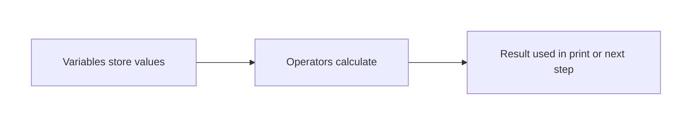
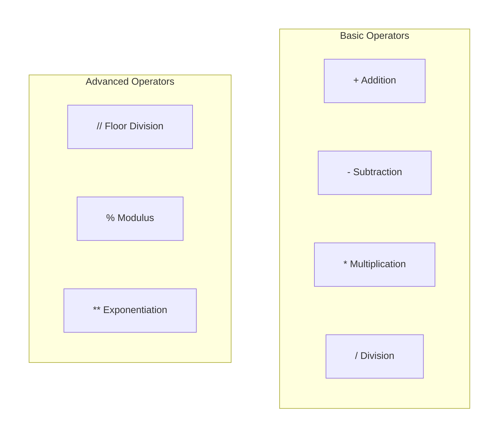
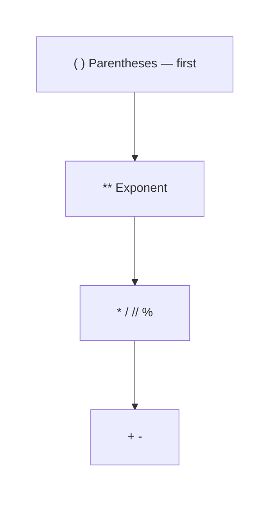
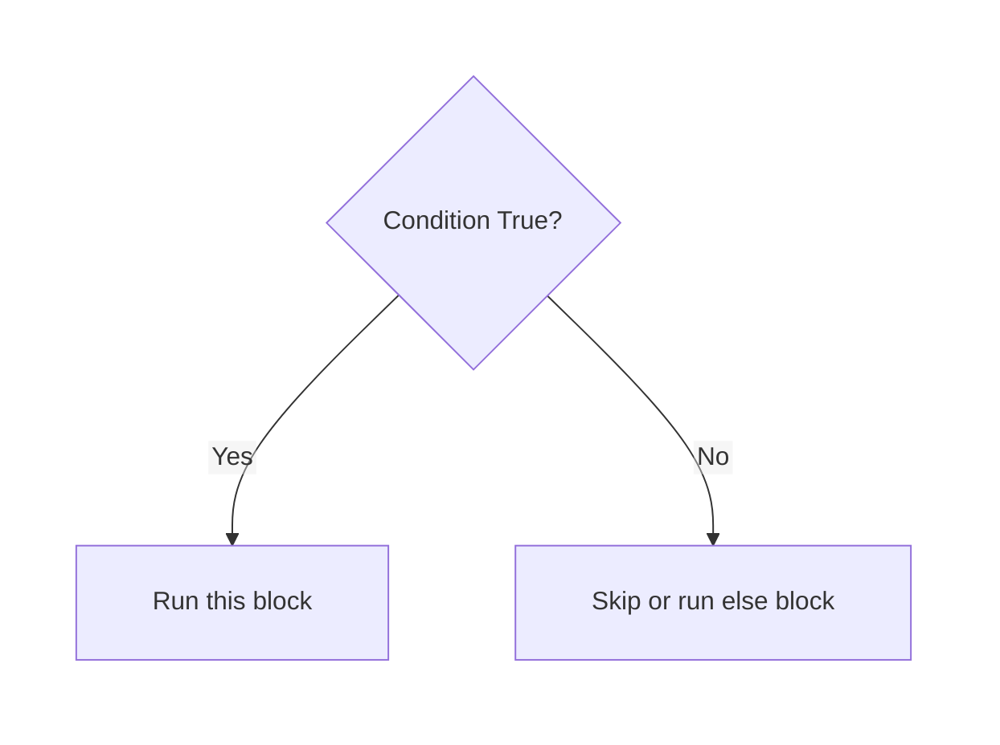
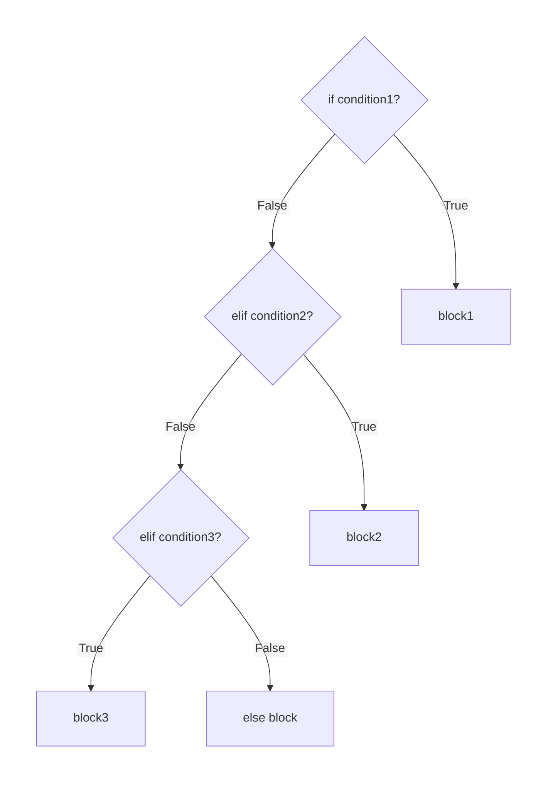
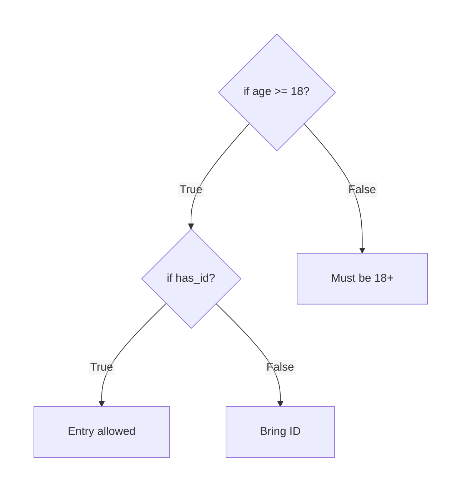
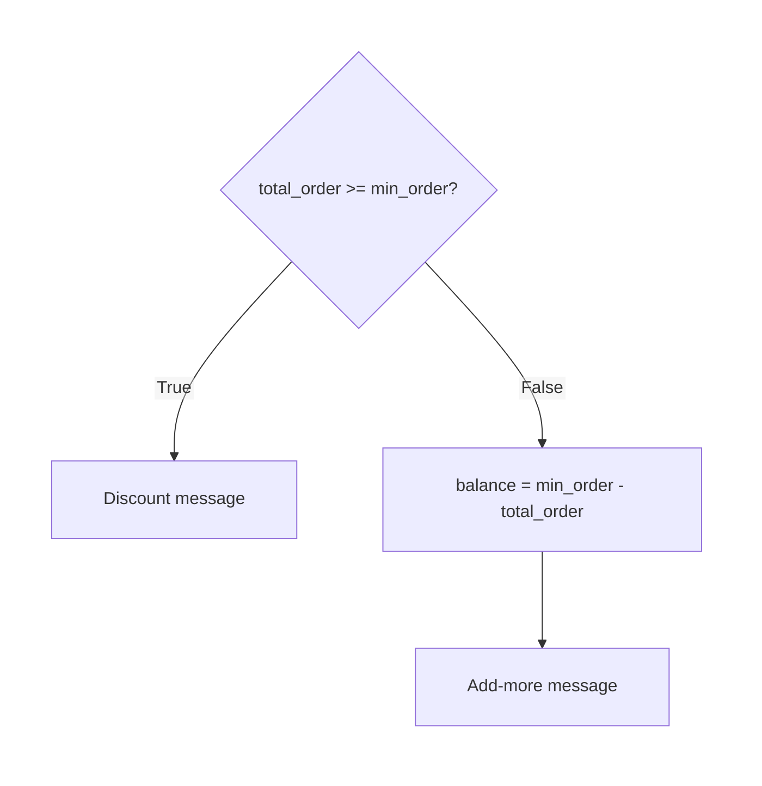

<style>
/* Fenced code: light panel, dark text */
pre[class*="language-"],
.markdown-body pre,
pre {
  background: #f1f5f9 !important;
  border: 1px solid #e2e8f0 !important;
  border-radius: 8px !important;
  color: #0f172a !important;
}

pre code,
.markdown-body pre code {
  background: transparent !important;
  color: #1e293b !important;
  opacity: 1 !important;
}

/* Syntax highlighting on light background (hljs / Prism / pygments) */

pre code .hljs-keyword,
pre code .hljs-selector-tag,
pre code .hljs-selector-class,
pre code .hljs-section { color: #5b21b6 !important; }

pre code .hljs-string,
pre code .hljs-regexp,
pre code .hljs-addition { color: #0f766e !important; }

pre code .hljs-number,
pre code .hljs-literal { color: #b45309 !important; }

pre code .hljs-built_in,
pre code .hljs-title.function_,
pre code .hljs-title.class_,
pre code .hljs-function,
pre code .hljs-title { color: #1d4ed8 !important; }

pre code .hljs-variable,
pre code .hljs-template-variable,
pre code .hljs-attr,
pre code .hljs-name,
pre code .hljs-params { color: #0f172a !important; }

pre code .hljs-type { color: #0369a1 !important; }

pre code .hljs-meta,
pre code .hljs-doctag { color: #475569 !important; }

pre code .token.keyword { color: #5b21b6 !important; }
pre code .token.string { color: #0f766e !important; }
pre code .token.number { color: #b45309 !important; }
pre code .token.function { color: #1d4ed8 !important; }
pre code .token.operator,
pre code .token.punctuation { color: #334155 !important; }
pre code .token.parameter,
pre code .token.property { color: #0f172a !important; }

/* F-strings / template literals: `{var}` must stay dark (fixes white/lost contrast on light bg) */
pre code .hljs-subst,
pre code .hljs-template-variable,
.markdown-body pre code .hljs-subst,
.markdown-body pre code .hljs-template-variable {
  color: #0f172a !important;
}

pre code .hljs-string .hljs-subst,
pre code .hljs-string .hljs-subst *,
pre code .hljs-string .hljs-variable,
pre code .hljs-string .hljs-built_in,
pre code .hljs-string .hljs-keyword,
.markdown-body pre code .hljs-string .hljs-subst,
.markdown-body pre code .hljs-string .hljs-subst * {
  color: #0f172a !important;
}

/* Prism-style interpolation */
pre code .token.interpolation,
pre code .token.interpolation-punctuation,
pre code .token.string .token.punctuation,
pre code .language-python .token.string .token,
pre code .token.string .token.builtin {
  color: #0f172a !important;
}

/* VS Code TextMate-style meta.embedded / source inside string */
pre code span[class*="embedded"],
pre code span[class*="interp"] {
  color: #0f172a !important;
}

/* Pygments: String.Interpol (f-string `{…}` regions) */
pre code .si {
  color: #0f172a !important;
}

/* Comments (all common highlighters) */
.hljs-comment,
.hljs-quote,
span[class*="hljs-comment"],
.token.comment,
.token.prolog,
.token.doctype,
.token.cdata,
.highlight .c,
.highlight .c1,
.highlight .cm,
.highlight .cp,
.highlight .cs,
.markdown-body pre code span.line > span[class*="block-comment"],
.markdown-body pre code span.line > span[class*="line-comment"] {
  color: #334155 !important;
  opacity: 1 !important;
}

/* Inline backticks in body text */
:not(pre) > code,
.markdown-body :not(pre) > code {
  color: #0f172a !important;
  background: rgba(30, 41, 59, 0.08) !important;
  opacity: 1 !important;
}

/* Mermaid edge labels (True / False): stop the text being clipped */
.edgeLabel,
span.edgeLabel,
.edgeLabel p,
foreignObject,
svg .label {
  overflow: visible !important;
}

span.edgeLabel,
.edgeLabel p {
  display: inline-block !important;
  box-sizing: content-box !important;
  padding: 6px 12px !important;
  line-height: 1.45 !important;
  background: #ffffff !important;
  border-radius: 4px;
}
</style>

<div markdown="1" style="color: #0f172a; border-left: 5px solid #1e40af; background: linear-gradient(135deg, #f4f7fb 0%, #eef2f8 100%); padding: 14px 18px; margin: 18px 0; border-radius: 0 10px 10px 0; box-shadow: 0 1px 2px rgba(0,0,0,0.04);">

# **Python Building Blocks — Operators and Conditional Statements**

Instructor notes. Brief points to teach from. Diagrams and images stay at original size. About two code snippets per concept.

</div>

<div markdown="1" style="color: #0f172a; border-left: 5px solid #2563eb; background: #eff6ff; padding: 14px 18px; margin: 18px 0; border-radius: 0 10px 10px 0; box-shadow: 0 1px 2px rgba(0,0,0,0.04);">

## **What You Will Learn**

- Already know: variables, data types, `print()`, type conversion
- Next: **operators** for calculations and **conditionals** for decisions
- Arithmetic operators, **precedence**, bills / marks / area
- `if`, `elif`, `else`, comparison operators, **indentation**

</div>

<div markdown="1" style="color: #0f172a; border-left: 5px solid #7c3aed; background: #f5f3ff; padding: 14px 18px; margin: 18px 0; border-radius: 0 10px 10px 0; box-shadow: 0 1px 2px rgba(0,0,0,0.04);">

## **Why Programs Need Operators**

- A billing app must **calculate**, not only store a price
- **Official:** an operator is a symbol that performs an operation on operands
- **Simple:** maths and logic symbols that tell Python to calculate or compare
- **Example:** kirana shop ₹42 × 2 kg = ₹84 — same job as `*`
- Without operators the program can only store and show; with them it **processes** data




- Already used: `balance - 250`, `price * quantity`, `first_name + " " + last_name`

</div>

<div markdown="1" style="color: #0f172a; border-left: 5px solid #0d9488; background: #f0fdfa; padding: 14px 18px; margin: 18px 0; border-radius: 0 10px 10px 0; box-shadow: 0 1px 2px rgba(0,0,0,0.04);">

## **Arithmetic Operators**

| Operator | Name | Example | Result |
|----------|------|---------|--------|
| `+` | Addition | `10 + 3` | `13` |
| `-` | Subtraction | `10 - 3` | `7` |
| `*` | Multiplication | `10 * 3` | `30` |
| `/` | Division (always float) | `10 / 3` | `3.333...` |
| `//` | Floor division | `10 // 3` | `3` |
| `%` | Modulus (remainder) | `10 % 3` | `1` |
| `**` | Exponentiation | `2 ** 3` | `8` |


- `/` when you need an exact decimal; `//` when you need complete groups
- `% 2` remainder `0` → even; `1` → odd


```python
math_marks = 78
science_marks = 82
total_marks = math_marks + science_marks   # 160
marks_needed = 100 - math_marks            # 22
notebook_cost = 45 * 4                     # 180
print(total_marks)
print(marks_needed)
print(notebook_cost)
```

```python
sweets_per_student = 20 / 4    # 5.0 — float even when exact
full_boxes = 17 // 5           # 3 full boxes
leftover_apples = 17 % 5       # 2 leftover
print(5 ** 2)                  # 25
print(type(sweets_per_student))
```



- **Activity — predict then run:** `a = 15`, `b = 4`, then `+` `-` `*` `/` `//` `%` `**`

</div>

<div markdown="1" style="color: #0f172a; border-left: 5px solid #b45309; background: #fffbeb; padding: 14px 18px; margin: 18px 0; border-radius: 0 10px 10px 0; box-shadow: 0 1px 2px rgba(0,0,0,0.04);">

## **Operators with Numbers and Variables**

- **Official:** an expression is values + variables + operators that produce one result
- **Simple:** a maths line in code, e.g. `price * quantity`
- Change the variable and the output updates without rewriting the formula
- `int * float` gives a **float** (`12 * 2.5` → `30.0`)
- `"Total: " + 255` → **TypeError** — fix with `"Total: " + str(255)`

```python
rice_kg = 3
rice_rate = 55
dal_kg = 1
dal_rate = 90
total_bill = rice_kg * rice_rate + dal_kg * dal_rate  # 255
print(total_bill)
```

```python
wallet = 500
wallet = wallet - 120
wallet = wallet + 50
print(wallet)  # 430
```

- **Activity: pocket money** — start `1000`, subtract `150` and `80`, add `200` → `970`

</div>

<div markdown="1" style="color: #0f172a; border-left: 5px solid #c2410c; background: #fff7ed; padding: 14px 18px; margin: 18px 0; border-radius: 0 10px 10px 0; box-shadow: 0 1px 2px rgba(0,0,0,0.04);">

## **Operator Precedence**

- Python does **not** always go left to right — same idea as BODMAS
- Same priority → left to right
- Parentheses `()` force the order

| Priority | Operators |
|----------|-----------|
| 1 Highest | `**` |
| 2 | `*`, `/`, `//`, `%` |
| 3 Lowest | `+`, `-` |




- Without brackets: `internal + final_exam / 2` divides first — wrong average
- Correct: `(internal + final_exam) / 2`

```python
print(10 + 2 * 3)      # 16
print((10 + 2) * 3)    # 36
print(2 * 3 ** 2)      # 18
print(20 // 3 % 2)     # 0
```

```python
internal = 25
final_exam = 68
average = (internal + final_exam) / 2   # 46.5
print(average)
```

- **Activity — predict:** `5 + 10 * 2`, `(5 + 10) * 2`, `100 - 20 / 4`, `2 ** 3 + 1`, `2 ** (3 + 1)`

</div>

<div markdown="1" style="color: #0f172a; border-left: 5px solid #4f46e5; background: #eef2ff; padding: 14px 18px; margin: 18px 0; border-radius: 0 10px 10px 0; box-shadow: 0 1px 2px rgba(0,0,0,0.04);">

## **Real Problems with Operators**


- **Marks:** add three subjects, then divide by 3 for the average
- **Kirana bill:** sugar 2 kg @ ₹48, biscuits 3 @ ₹15, oil 1 L @ ₹130 → `271`
- **Area:** rectangle `12 * 8` = `96`; circle `3.14 * 7 ** 2` = `153.86` — `**` runs before `*`

```python
physics, chemistry, biology = 42, 38, 45
total_marks = physics + chemistry + biology   # 125
average_marks = total_marks / 3               # 41.66...
print(total_marks)
print(average_marks)
```

```python
final_bill = 2 * 48 + 3 * 15 + 1 * 130   # 271
print(final_bill)
```

- **Activity: tiffin order** — 2 meals @ ₹80 + 1 water @ ₹20 → `180`

</div>

<div markdown="1" style="color: #0f172a; border-left: 5px solid #be123c; background: linear-gradient(135deg, #fff1f2 0%, #ffe4e6 100%); padding: 14px 18px; margin: 18px 0; border-radius: 0 10px 10px 0; box-shadow: 0 1px 2px rgba(0,0,0,0.04);">

## **Part 2 — Decisions**

Calculation is not enough. Next: pass/fail, vote age, senior ticket.

</div>

<div markdown="1" style="color: #0f172a; border-left: 5px solid #047857; background: #ecfdf5; padding: 14px 18px; margin: 18px 0; border-radius: 0 10px 10px 0; box-shadow: 0 1px 2px rgba(0,0,0,0.04);">

## **Why Programs Need Decisions**

- **Official:** a conditional runs a block only when the condition is **True**
- **Simple:** “if this happens, then do that”
- **Example:** cinema — under 12 → child ticket; else adult price




| Real Life | Python |
|-----------|--------|
| If it rains, take an umbrella | `if is_raining:` |
| If marks ≥ 35, pass | `if marks >= 35:` |
| If balance is low, warn | `if balance < 100:` |

</div>

<div markdown="1" style="color: #0f172a; border-left: 5px solid #1d4ed8; background: #eff6ff; padding: 14px 18px; margin: 18px 0; border-radius: 0 10px 10px 0; box-shadow: 0 1px 2px rgba(0,0,0,0.04);">

## **The `if` Statement**

- One check, one action
- Colon `:` then a **4-space** indent
- Lines outside the indent always run
- Missing `:` → **SyntaxError**; missing indent → **IndentationError**

```python
age = 20
if age >= 18:
    print("You are eligible to vote.")
print("Thank you for checking.")  # always runs
```

```python
marks = 28
if marks >= 35:
    print("Congratulations! You have passed.")  # skipped — False
print("Result processing complete.")
```

- **Activity:** `is_raining = True` → print “Carry an umbrella today.”

</div>

<div markdown="1" style="color: #0f172a; border-left: 5px solid #a21caf; background: #faf5ff; padding: 14px 18px; margin: 18px 0; border-radius: 0 10px 10px 0; box-shadow: 0 1px 2px rgba(0,0,0,0.04);">

## **`if`–`else`**

- True → first block; False → `else` block
- Exactly **one** block runs

```python
marks = 42
if marks >= 35:
    print("Pass")
else:
    print("Fail")
```

```python
number = 17
if number % 2 == 0:
    print("even")
else:
    print("odd")
```

- **Activity: low balance** — `balance = 350`; warn if below `500`, else “Balance is healthy.”

</div>

<div markdown="1" style="color: #0f172a; border-left: 5px solid #0f766e; background: #f0fdfa; padding: 14px 18px; margin: 18px 0; border-radius: 0 10px 10px 0; box-shadow: 0 1px 2px rgba(0,0,0,0.04);">

## **`if`–`elif`–`else`**

- More than two outcomes
- Top to bottom; **first True wins**
- One `if`, many `elif`, one `else`
- Put **higher ranges first** — otherwise 90+ can match a lower band




```python
marks = 78
if marks >= 90:
    print("Grade: A")
elif marks >= 75:
    print("Grade: B")   # matches — stops
elif marks >= 60:
    print("Grade: C")
elif marks >= 35:
    print("Grade: D")
else:
    print("Grade: F — Fail")
```

```python
signal = "yellow"
if signal == "red":
    print("Stop.")
elif signal == "yellow":
    print("Slow down and get ready.")
elif signal == "green":
    print("Go.")
else:
    print("Invalid signal.")
```

</div>

<div markdown="1" style="color: #0f172a; border-left: 5px solid #475569; background: #f8fafc; padding: 14px 18px; margin: 18px 0; border-radius: 0 10px 10px 0; box-shadow: 0 1px 2px rgba(0,0,0,0.04);">

## **Comparison Operators**

- Always return **True** or **False**
- `=` stores a value; `==` checks equality
- `if marks = 50:` → **SyntaxError** — use `==`
- Strings are **case-sensitive**: `"Hello" == "hello"` is **False**

| Operator | Meaning | Example |
|----------|---------|---------|
| `==` | Equal | `5 == 5` → True |
| `!=` | Not equal | `5 != 3` → True |
| `>` `<` | Greater / less | `10 > 3` → True |
| `>=` `<=` | Greater/less or equal | `10 >= 10` → True |


```python
a = 10
b = 20
print(a == 10)   # True
print(a == b)    # False
print(a != b)    # True
print(b > a)     # True
print(a >= 10)   # True
```

```python
entered = "Hello"
if entered == "hello":
    print("Match")
else:
    print("No match — case matters")
```

</div>

<div markdown="1" style="color: #0f172a; border-left: 5px solid #0369a1; background: #f0f9ff; padding: 14px 18px; margin: 18px 0; border-radius: 0 10px 10px 0; box-shadow: 0 1px 2px rgba(0,0,0,0.04);">

## **Indentation Controls the Block**

- **4 spaces** per level
- `elif` and `else` align with their `if`
- Less indent = outside the block
- Nested `if` is indented one more level (8 spaces)

```python
marks = 50
if marks >= 35:
    print("Pass")
    print("Well done!")
print("Program finished.")  # always
```

```python
age = 20
has_id = True
if age >= 18:
    if has_id:
        print("Entry allowed.")
    else:
        print("Please bring your ID card.")
else:
    print("You must be 18 or older.")
```



</div>

<div markdown="1" style="color: #0f172a; border-left: 5px solid #7c2d12; background: #fff7ed; padding: 14px 18px; margin: 18px 0; border-radius: 0 10px 10px 0; box-shadow: 0 1px 2px rgba(0,0,0,0.04);">

## **Apply Conditionals to Real Problems**

- **Eligibility:** attendance ≥ 75 **and** marks ≥ 35 — check attendance first
- **Largest of three:** `a >= b and a >= c`, then `elif` for `b`, else `c`
- **Discount tiers:** ≥ 5000 → 20%; ≥ 2000 → 10%; ≥ 1000 → 5%; else none
- **Calculate, then decide:** operators first, then `if` / `else` for the message

```python
attendance = 80
marks = 42
if attendance >= 75:
    if marks >= 35:
        print("Eligible for final exam.")
    else:
        print("Marks too low. Not eligible.")
else:
    print("Attendance too low. Not eligible.")
```

```python
user_name = "Anita"
total_order = 800
min_order = 1000
if total_order >= min_order:
    print("Hurray " + user_name + ", 10% discount applied!")
else:
    balance = min_order - total_order
    print("Dear " + user_name + ", add Rs." + str(balance) + " more to qualify.")
```



- **Activity: movie tickets** — under 12 → ₹100; 60+ → ₹120; else ₹180
- **Activity: report card** — total and average with operators, then pass/fail with `if`

</div>

<div markdown="1" style="color: #0f172a; border-left: 5px solid #1e40af; background: linear-gradient(135deg, #f4f7fb 0%, #eef2f8 100%); padding: 14px 18px; margin: 18px 0; border-radius: 0 10px 10px 0; box-shadow: 0 1px 2px rgba(0,0,0,0.04);">

## **Key Takeaways**

- **Operators** calculate: `+` `-` `*` `/` `//` `%` `**`
- **Precedence:** `**` then `*` `/` `//` `%` then `+` `-`; use `()`
- **`if` / `elif` / `else`** — only the matching True block runs
- **`==`** compares; **`=`** assigns
- **Indentation (4 spaces)** defines the block

### Quick Reference

| Term / Symbol | What It Does |
|---------------|--------------|
| Operator | Symbol that performs an operation |
| `+` `-` `*` `/` | Add, subtract, multiply, divide (float) |
| `//` `%` `**` | Floor divide, remainder, power |
| Expression | Values + variables + operators → one result |
| Precedence | Which operation runs first |
| `()` | Force order |
| `if` / `elif` / `else` | Decision blocks |
| `==` `!=` `>` `<` `>=` `<=` | Comparisons → True/False |
| Indentation | 4 spaces group a block |
| SyntaxError / IndentationError | Missing colon / wrong indent |

</div>
