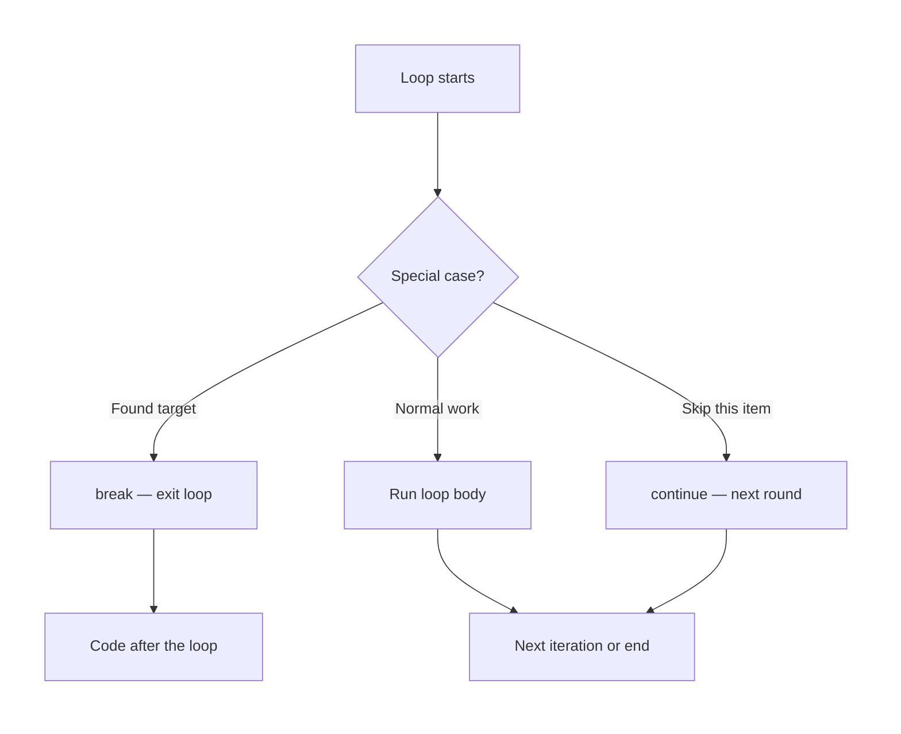
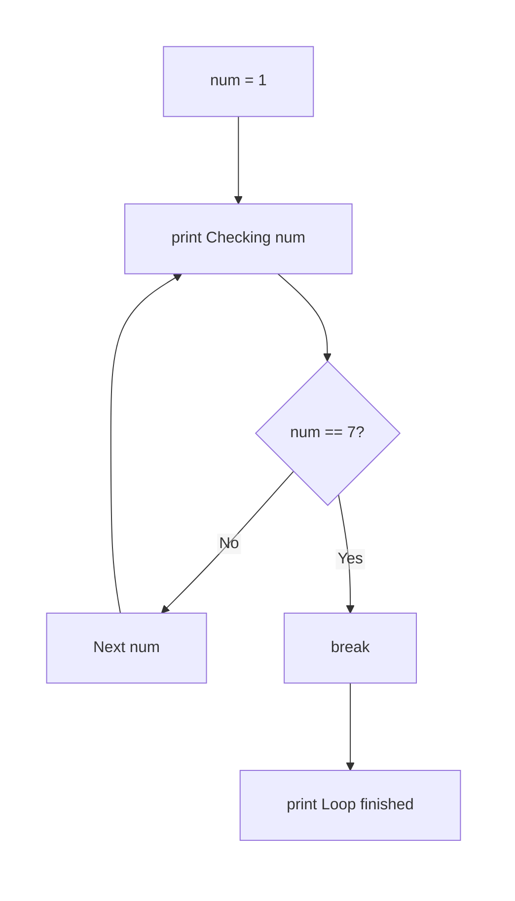
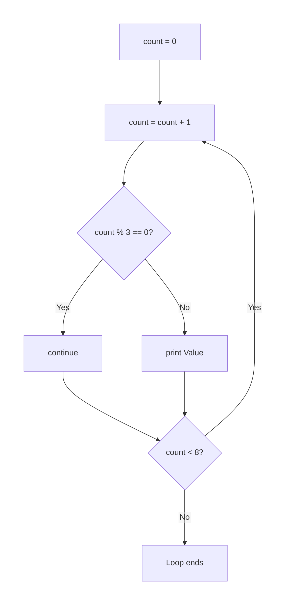
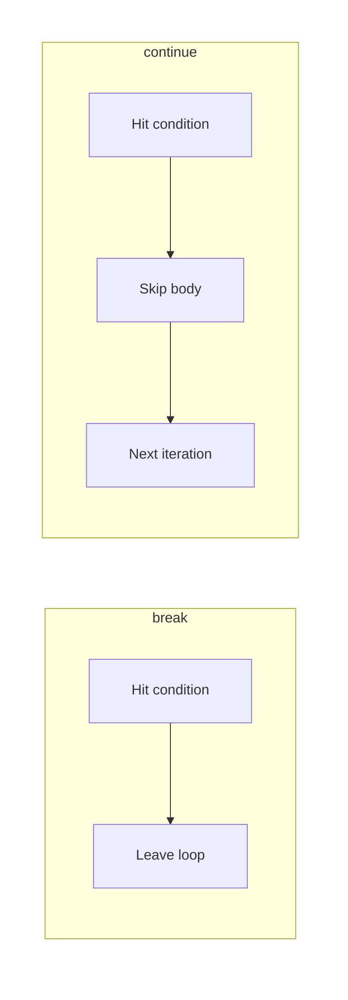
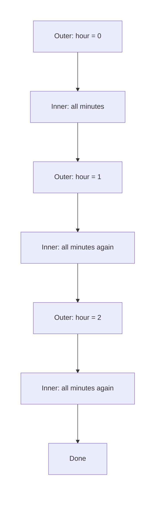
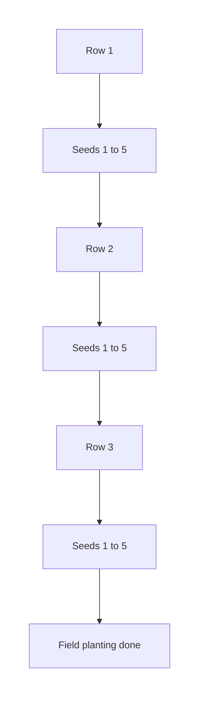

<style>
/* Fenced code: light panel, dark text */
pre[class*="language-"],
.markdown-body pre,
pre {
  background: #f1f5f9 !important;
  border: 1px solid #e2e8f0 !important;
  border-radius: 8px !important;
  color: #0f172a !important;
}

pre code,
.markdown-body pre code {
  background: transparent !important;
  color: #1e293b !important;
  opacity: 1 !important;
}

/* Syntax highlighting on light background (hljs / Prism / pygments) */

pre code .hljs-keyword,
pre code .hljs-selector-tag,
pre code .hljs-selector-class,
pre code .hljs-section { color: #5b21b6 !important; }

pre code .hljs-string,
pre code .hljs-regexp,
pre code .hljs-addition { color: #0f766e !important; }

pre code .hljs-number,
pre code .hljs-literal { color: #b45309 !important; }

pre code .hljs-built_in,
pre code .hljs-title.function_,
pre code .hljs-title.class_,
pre code .hljs-function,
pre code .hljs-title { color: #1d4ed8 !important; }

pre code .hljs-variable,
pre code .hljs-template-variable,
pre code .hljs-attr,
pre code .hljs-name,
pre code .hljs-params { color: #0f172a !important; }

pre code .hljs-type { color: #0369a1 !important; }

pre code .hljs-meta,
pre code .hljs-doctag { color: #475569 !important; }

pre code .token.keyword { color: #5b21b6 !important; }
pre code .token.string { color: #0f766e !important; }
pre code .token.number { color: #b45309 !important; }
pre code .token.function { color: #1d4ed8 !important; }
pre code .token.operator,
pre code .token.punctuation { color: #334155 !important; }
pre code .token.parameter,
pre code .token.property { color: #0f172a !important; }

/* F-strings / template literals: `{var}` must stay dark (fixes white/lost contrast on light bg) */
pre code .hljs-subst,
pre code .hljs-template-variable,
.markdown-body pre code .hljs-subst,
.markdown-body pre code .hljs-template-variable {
  color: #0f172a !important;
}

pre code .hljs-string .hljs-subst,
pre code .hljs-string .hljs-subst *,
pre code .hljs-string .hljs-variable,
pre code .hljs-string .hljs-built_in,
pre code .hljs-string .hljs-keyword,
.markdown-body pre code .hljs-string .hljs-subst,
.markdown-body pre code .hljs-string .hljs-subst * {
  color: #0f172a !important;
}

/* Prism-style interpolation */
pre code .token.interpolation,
pre code .token.interpolation-punctuation,
pre code .token.string .token.punctuation,
pre code .language-python .token.string .token,
pre code .token.string .token.builtin {
  color: #0f172a !important;
}

/* VS Code TextMate-style meta.embedded / source inside string */
pre code span[class*="embedded"],
pre code span[class*="interp"] {
  color: #0f172a !important;
}

/* Pygments: String.Interpol (f-string `{…}` regions) */
pre code .si {
  color: #0f172a !important;
}

/* Comments (all common highlighters) */
.hljs-comment,
.hljs-quote,
span[class*="hljs-comment"],
.token.comment,
.token.prolog,
.token.doctype,
.token.cdata,
.highlight .c,
.highlight .c1,
.highlight .cm,
.highlight .cp,
.highlight .cs,
.markdown-body pre code span.line > span[class*="block-comment"],
.markdown-body pre code span.line > span[class*="line-comment"] {
  color: #334155 !important;
  opacity: 1 !important;
}

/* Inline backticks in body text */
:not(pre) > code,
.markdown-body :not(pre) > code {
  color: #0f172a !important;
  background: rgba(30, 41, 59, 0.08) !important;
  opacity: 1 !important;
}

/* Mermaid edge labels (True / False): stop the text being clipped */
.edgeLabel,
span.edgeLabel,
.edgeLabel p,
foreignObject,
svg .label {
  overflow: visible !important;
}

span.edgeLabel,
.edgeLabel p {
  display: inline-block !important;
  box-sizing: content-box !important;
  padding: 6px 12px !important;
  line-height: 1.45 !important;
  background: #ffffff !important;
  border-radius: 4px;
  font-size: 20px !important;
}

/* Presentation type scale */
body,
.markdown-body,
div[markdown] {
  font-size: 24px !important;
  line-height: 1.55 !important;
}

h1,
.markdown-body h1 {
  font-size: 44px !important;
  line-height: 1.2 !important;
}

h2,
.markdown-body h2 {
  font-size: 34px !important;
  line-height: 1.25 !important;
}

h3,
.markdown-body h3,
h4,
.markdown-body h4 {
  font-size: 28px !important;
  line-height: 1.3 !important;
}

p,
li,
td,
th,
.markdown-body p,
.markdown-body li,
.markdown-body td,
.markdown-body th,
div[markdown] p,
div[markdown] li,
div[markdown] td,
div[markdown] th {
  font-size: 24px !important;
  line-height: 1.55 !important;
}

pre,
pre code,
.markdown-body pre,
.markdown-body pre code {
  font-size: 20px !important;
  line-height: 1.5 !important;
}

:not(pre) > code,
.markdown-body :not(pre) > code {
  font-size: 22px !important;
}

svg text,
.mermaid text,
.edgeLabel,
span.edgeLabel,
.edgeLabel p {
  font-size: 20px !important;
}
</style>

<div markdown="1" style="color: #0f172a; border-left: 5px solid #1e40af; background: linear-gradient(135deg, #f4f7fb 0%, #eef2f8 100%); padding: 14px 18px; margin: 18px 0; border-radius: 0 10px 10px 0; box-shadow: 0 1px 2px rgba(0,0,0,0.04);">

# **Understanding break, continue, and Nested Loops**

Instructor notes. Brief points to teach from. Diagrams and images stay at original size. About two code snippets per concept.

</div>

<div markdown="1" style="color: #0f172a; border-left: 5px solid #475569; background: #f8fafc; padding: 14px 18px; margin: 18px 0; border-radius: 0 10px 10px 0; box-shadow: 0 1px 2px rgba(0,0,0,0.04);">

## **Session 3 Quick Recap — Loops and `range()`**

*Mastering Control Flow: Conditional and Loop in Python*

- **Loops** repeat a block without copy-paste — **`while`** until a condition fails; **`for`** over a known count
- **`while`:** start value, stop condition, **update** each round — missing update → infinite loop
- **`for`** + **`range()`** when you know how many times; `range()` stops **before** `stop`
- **`range(start, stop, step)`** — negative step counts down; accumulator pattern for sums and factorial
- **Today:** finer control inside loops — **`break`**, **`continue`**, **nested loops**

</div>

<div markdown="1" style="color: #0f172a; border-left: 5px solid #2563eb; background: #eff6ff; padding: 14px 18px; margin: 18px 0; border-radius: 0 10px 10px 0; box-shadow: 0 1px 2px rgba(0,0,0,0.04);">

## **What You Will Learn**

- Already know: `while`, `for`, `range()`, start / stop / update
- Next: finer control — **`break`**, **`continue`**, **nested loops**
- Exit early, skip one round, outer + inner cycles
- Alarm-clock timing and **field-and-seed** planting

</div>

<div markdown="1" style="color: #0f172a; border-left: 5px solid #7c3aed; background: #f5f3ff; padding: 14px 18px; margin: 18px 0; border-radius: 0 10px 10px 0; box-shadow: 0 1px 2px rgba(0,0,0,0.04);">

## **Why loops need early control**

- Full bus route visits every stop — real life often stops early or skips one item
- Keys in bag 2 → **stop** searching remaining bags
- Broken biscuit packet → **skip** it, keep checking
- Alarm: for **each hour**, count **every minute**

| Real need | Tool |
|-----------|------|
| Stop the whole loop early | `break` |
| Skip one item, keep going | `continue` |
| Repeat inside another repeat | Nested loops |

- **Official:** loop control changes flow from **inside** the body
- **Simple:** `break` = stop now; `continue` = skip this round; nested = for each outer, finish all inner



</div>

<div markdown="1" style="color: #0f172a; border-left: 5px solid #0d9488; background: #f0fdfa; padding: 14px 18px; margin: 18px 0; border-radius: 0 10px 10px 0; box-shadow: 0 1px 2px rgba(0,0,0,0.04);">

## **Purpose of `break`**

- Goal already met → remaining rounds waste time / print junk
- **Official:** terminate the **innermost** loop; continue after that loop
- **Simple:** emergency exit door of the loop
- **Example:** find the oil brand on the shelf → stop scanning other bottles


- Search and stop; abort countdown on safety fail; clearer than one giant condition
- Write `break`, not `break()` — does **not** end the whole program

</div>

<div markdown="1" style="color: #0f172a; border-left: 5px solid #b45309; background: #fffbeb; padding: 14px 18px; margin: 18px 0; border-radius: 0 10px 10px 0; box-shadow: 0 1px 2px rgba(0,0,0,0.04);">

## **Demonstrate `break`**

```python
for num in range(1, 11):
    if num == 5:
        break
    print(num)   # 1 2 3 4
```

| Part | Role |
|------|------|
| Loop | `for` or `while` |
| `if` | When to exit early |
| `break` | Stop that loop now |
| Code after loop | Runs after exit |

```python
for num in range(1, 15):
    print("Checking:", num)
    if num == 7:
        print("Found 7 — stopping the loop.")
        break
print("Loop finished. Program continues here.")
```

- Numbers 8–14 never visited



**First multiple of 13** — search-and-stop (without `break`, later multiples overwrite)

```python
found = 0
for num in range(1, 101):
    if num % 13 == 0:
        found = num
        break
print("First multiple of 13 is:", found)   # 13
```

</div>

<div markdown="1" style="color: #0f172a; border-left: 5px solid #c2410c; background: #fff7ed; padding: 14px 18px; margin: 18px 0; border-radius: 0 10px 10px 0; box-shadow: 0 1px 2px rgba(0,0,0,0.04);">

## **`break` with `while` and `if`**

- Plan up to 12 months; **real** stop = goal ₹2000 — clearer with `if` + `break`

```python
balance = 0
month = 1
monthly_saving = 400

while month <= 12:
    balance = balance + monthly_saving
    print("Month", month, "→ balance Rs.", balance)
    if balance >= 2000:
        print("Goal reached early. Stopping the loop.")
        break
    month = month + 1

print("Final balance: Rs.", balance)
```

- After month 5, balance = 2000 → `break`; months 6–12 never run

</div>

<div markdown="1" style="color: #0f172a; border-left: 5px solid #be123c; background: linear-gradient(135deg, #fff1f2 0%, #ffe4e6 100%); padding: 14px 18px; margin: 18px 0; border-radius: 0 10px 10px 0; box-shadow: 0 1px 2px rgba(0,0,0,0.04);">

## **Purpose of `continue`**

- Ignore **one** round; loop keeps going
- **Official:** skip rest of **current** iteration; go to next
- **Simple:** skip this item, move to the next
- **Example:** blank answer sheet → skip for now, check the rest


| Statement | Effect |
|-----------|--------|
| `break` | Exit the loop completely |
| `continue` | Skip rest of **this** round |
| Neither | Finish body, then next round |

- Code **below** `continue` is skipped that round
- **`while` trap:** update **after** `continue` → infinite loop

</div>

<div markdown="1" style="color: #0f172a; border-left: 5px solid #047857; background: #ecfdf5; padding: 14px 18px; margin: 18px 0; border-radius: 0 10px 10px 0; box-shadow: 0 1px 2px rgba(0,0,0,0.04);">

## **Apply `continue` (and vs `break`)**

**Odds only**

```python
for num in range(1, 11):
    if num % 2 == 0:
        continue
    print(num)   # 1 3 5 7 9
```

**`while` + `continue` — update first**

```python
count = 0
while count < 8:
    count = count + 1   # UPDATE before continue
    if count % 3 == 0:
        continue
    print("Value:", count)   # 1 2 4 5 7 8
```




**Skip multiples of 4 when printing squares**

```python
for num in range(1, 13):
    if num % 4 == 0:
        continue
    square = num * num
    print(num, "squared =", square)
```

**Activity:** print 1–30, skip multiples of 10

```python
for num in range(1, 31):
    if num % 10 == 0:
        continue
    print(num)
```

**Side by side**

```python
print("Using break:")
for num in range(1, 8):
    if num == 5:
        break
    print(num)   # 1 2 3 4

print("Using continue:")
for num in range(1, 8):
    if num == 5:
        continue
    print(num)   # 1 2 3 4 6 7
```




**Predict:** `break` at 3 → `1 2`; `continue` at 3 → `1 2 4 5`

</div>

<div markdown="1" style="color: #0f172a; border-left: 5px solid #1d4ed8; background: #eff6ff; padding: 14px 18px; margin: 18px 0; border-radius: 0 10px 10px 0; box-shadow: 0 1px 2px rgba(0,0,0,0.04);">

## **Why nested loops — alarm clock**

- Two levels: each outer step needs a full **inner** cycle
- **Official:** inner loop completes once per outer iteration
- **Simple:** for every outer item, finish all inner items
- Hours = outer; minutes = inner

| Situation | Outer | Inner |
|-----------|-------|-------|
| Alarm clock | Each hour | Each minute |
| Classroom | Each row | Each seat |
| Farm | Each field row | Each seed |
| Timetable | Each day | Each subject slot |

- Total iterations ≈ outer × inner (3 × 4 = 12)
- Hour 0 → minutes; hour 1 → minutes again; hour 2 → again




</div>

<div markdown="1" style="color: #0f172a; border-left: 5px solid #a21caf; background: #faf5ff; padding: 14px 18px; margin: 18px 0; border-radius: 0 10px 10px 0; box-shadow: 0 1px 2px rgba(0,0,0,0.04);">

## **Nested loop syntax — outer and inner**

- Inner indented **one level deeper** than outer
- Inner **restarts from the beginning** for every new outer value
- Wrong indent → two separate loops, not nested

```python
for outer in range(1, 4):
    for inner in range(1, 3):
        print("outer =", outer, "| inner =", inner)   # 3 × 2 = 6
```

| Outer | Inner | Prints |
|-------|-------|--------|
| 1 | 1, 2 | two lines |
| 2 | 1, 2 | two lines |
| 3 | 1, 2 | two lines |

**Classroom seats**

```python
for row in range(1, 4):
    print("--- Starting row", row, "---")
    for seat in range(1, 5):
        print("Row", row, "Seat", seat)   # 3 × 4 = 12
```

</div>

<div markdown="1" style="color: #0f172a; border-left: 5px solid #4f46e5; background: #eef2ff; padding: 14px 18px; margin: 18px 0; border-radius: 0 10px 10px 0; box-shadow: 0 1px 2px rgba(0,0,0,0.04);">

## **Nested `range` — start, stop, step**

- Outer = major cycles; inner = sub-steps; steps can differ

**Alarm with step minutes**

```python
for hour in range(0, 3):
    for minute in range(0, 60, 20):
        print("Alarm check →", hour, ":", minute)
# (0,0)(0,20)(0,40)(1,0)…(2,40)
```

**Different steps**

```python
for group in range(1, 4):
    print("Group", group)
    for item in range(2, 9, 2):
        print("  Item number:", item)   # 2 4 6 8 each group
```

**Activity:** hours 1–2; minutes 50, 55

```python
for hour in range(1, 3):
    for minute in range(50, 56, 5):
        print("Time", hour, ":", minute)   # 4 lines
```

</div>

<div markdown="1" style="color: #0f172a; border-left: 5px solid #0f766e; background: #f0fdfa; padding: 14px 18px; margin: 18px 0; border-radius: 0 10px 10px 0; box-shadow: 0 1px 2px rgba(0,0,0,0.04);">

## **Multiple ranges — grids and pairs**

**Multiplication grid**

```python
for row in range(1, 4):
    for col in range(1, 5):
        product = row * col
        print(row, "x", col, "=", product)
    print("----")
```

**Inner stop depends on outer**

```python
for a in range(1, 4):
    for b in range(1, a + 1):
        print("Pair:", a, b)
```

**Activity:** sum 1–4 per group — reset accumulator **inside** outer

```python
for group in range(1, 4):
    total = 0
    for num in range(1, 5):
        total = total + num
    print("Group", group, "sum =", total)   # each 10
```

- `total = 0` outside both loops → totals keep growing — common bug

</div>

<div markdown="1" style="color: #0f172a; border-left: 5px solid #0d9488; background: #f0fdfa; padding: 14px 18px; margin: 18px 0; border-radius: 0 10px 10px 0; box-shadow: 0 1px 2px rgba(0,0,0,0.04);">

## **Field and seed planting**

- Outer = walk to next **row**; inner = plant each **seed** in that row


```python
field_rows = 3
seeds_per_row = 5

for row in range(1, field_rows + 1):
    print("Walking to field row", row)
    for seed in range(1, seeds_per_row + 1):
        print("  Planting seed", seed, "in row", row)
    print("Row", row, "complete.\n")
# 3 × 5 = 15 plantings
```



**Step instead of continue** — odd positions only

```python
for row in range(1, 3):
    for position in range(1, 6, 2):
        print("Row", row, "→ seed at position", position)   # 1 3 5
```

**Activity:** 4×3 then 2×6 — same total (12), different shape

```python
rows = 4
seeds = 3
for r in range(1, rows + 1):
    for s in range(1, seeds + 1):
        print("R", r, "S", s)
```

**`break` / `continue` in nested** — affect **innermost** only

```python
for outer in range(1, 4):
    print("Outer starts:", outer)
    for inner in range(1, 6):
        if inner == 3:
            break
        print("  Inner:", inner)   # 1 2 each outer; outer still continues
```

```python
for outer in range(1, 3):
    for inner in range(1, 5):
        if inner == 2:
            continue
        print("outer", outer, "inner", inner)
```

| Problem | Fix |
|---------|-----|
| Stops too early | Check `if` guarding `break` |
| One value missing | Check `continue` filter |
| `while` + `continue` forever | Update **above** `continue` |
| Flat nested output | Indent inner under outer |
| Wrong group totals | `total = 0` inside outer |
| Thought `break` stopped all | Only innermost exits |

**Trace:** `(1,1)(1,3)(2,1)(2,3)` when `continue` on `b == 2`

</div>

<div markdown="1" style="color: #0f172a; border-left: 5px solid #1e40af; background: linear-gradient(135deg, #f4f7fb 0%, #eef2f8 100%); padding: 14px 18px; margin: 18px 0; border-radius: 0 10px 10px 0; box-shadow: 0 1px 2px rgba(0,0,0,0.04);">

## **Key Takeaways**

- **`break`** — exit innermost loop now (search-and-stop, early goals)
- **`continue`** — skip one round; in `while`, update **before** `continue`
- **Nested loops** — inner completes for each outer (alarm, seats, field)
- **`range(start, stop, step)`** still controls each nesting level
- `break` / `continue` do **not** stop an outer loop by themselves

### Quick Reference

| Term | What it does |
|------|----------------|
| `break` | Exit innermost enclosing loop |
| `continue` | Skip rest of current iteration |
| Nested / outer / inner | Loop inside loop; major vs sub cycle |
| Early exit / skip iteration | Stop early / ignore one round |
| `range(start, stop, step)` | Independent counting per level |
| Innermost rule | `break`/`continue` affect only the loop that contains them |
| Combination / pair iteration | Visit all pairs from two ranges |

</div>
