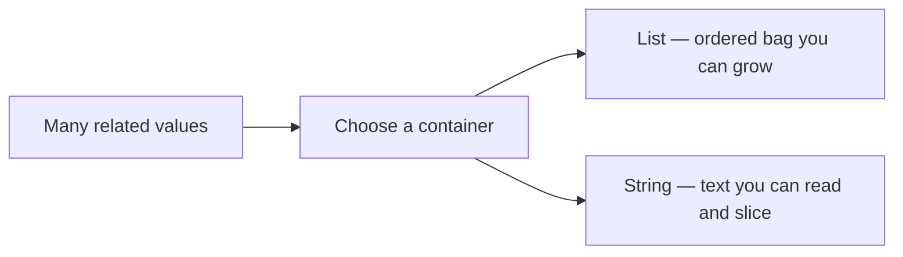
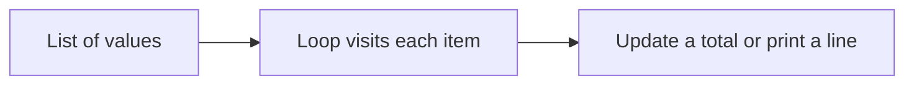

# Data Structures in Python — Lists & Strings

## What You Will Learn in This Lesson

You have already learnt how to **repeat actions** with **`while`** and **`for`**, and how to steer loops from the inside using **`break`**, **`continue`**, and **nested loops**. Your programs can count, search, skip values, and handle multi-level tasks — but so far you mostly work with **one value at a time** in a single variable.

In this lesson, you will learn how Python stores **many values together**. You will work with **lists** and **strings** — an ordered row you can grow, and text you can read character by character. Other containers come in a later lesson.

By the end, you will be able to:

- Create a **list**, store mixed types in it, and measure it with **`len()`**
- Access list items with **indexing** and **negative indexing**
- Iterate through every list item with a loop, including a reverse walk
- Add one item at the end with **`append()`**, and remove the last item with **`pop()`**
- Index and slice a **string**, and loop through its characters
- Explain why a string cannot be changed in place, and build a new string with **concatenation**

---

## Why Programs Need Data Structures

A single variable is like one tiffin box — it holds **one** lunch. Real programs need shelves and name boards that hold **many** related items.

- A kirana shop bill has many item names and prices, not one product.
- A festival snack counter lists several items in a fixed serving order.
- A railway board shows a city name as a row of letters, not as one solid block.

- **Official Definition:** A **data structure** is a way of organising and storing data so that it can be accessed and modified efficiently.
- **In Simple Words:** A data structure is a smart container that holds many values in a useful shape.
- **Real-Life Example:** A **school bag** holds books in order (a list). A **name badge** holds fixed text (a string). You can add another book to the bag. You do not scratch one letter off the badge — you print a new one.




You already know how to **loop** over numbers. Lists and strings give you something richer to loop over — and a clear way to **find** one item by its position.

---

## Part 1 — Lists

When you need an ordered bag of items that you can change later, Python gives you a **list**.

- **Official Definition:** A **list** is a mutable, ordered sequence of elements enclosed in square brackets `[]`, where each element has an index starting from `0`.
- **In Simple Words:** A list is a numbered row of boxes. You can add an item at the end, and you can read any box by its number.
- **Real-Life Example:** A **vegetable shopping list** on your phone — tomato, onion, potato — in order, and you can add "coriander" at the end.

### Creating a List and Storing Multiple Elements

```python
# Create a list of canteen snacks
snacks = ["biscuit", "samosa", "tea", "cake"]  # Four items in one list
print(snacks)  # Show the full list
print(type(snacks))  # Confirm the data type is list
```

**How the code works:**

- Square brackets `[]` create the list.
- Items are separated by commas.
- One variable name (`snacks`) now holds **four** values together.
- **Why lists help:** Without a list, you would need `snack1`, `snack2`, `snack3`… — hard to manage when the count grows.

### Mixed Data Types and Length

A list can hold **different types** in the same container — numbers, text, and even `True`/`False`.

```python
# One student record stored as a mixed list
student = ["Ananya", 18, True, 87.5]  # name, age, is_passed, average marks
print(student)  # Print all values
print(len(student))  # Count how many elements are stored
```

**How the code works:**

- `"Ananya"` is a **string**, `18` is an **integer**, `True` is a **boolean**, `87.5` is a **float**.
- **`len()`** returns the number of elements — here `4`.
- **Common doubt:** Does `len()` count characters inside the name? No — for a list it counts **items**, not letters inside a string item.

### Indexing — Access One Element

Python numbers list positions from the **left**, starting at **0**.

| Index | 0 | 1 | 2 | 3 |
|-------|---|---|---|---|
| Value | biscuit | samosa | tea | cake |


```python
# Access items by index
snacks = ["biscuit", "samosa", "tea", "cake"]  # Same snack list
print(snacks[0])  # First item — index 0
print(snacks[2])  # Third item — index 2
print(snacks[3])  # Last item — index 3
```

**How the code works:**

- `snacks[0]` is always the **first** element.
- The last index is **`len(list) - 1`**.
- **Common error:** Using `snacks[4]` on a 4-item list raises **IndexError** because valid indexes are `0` to `3`.

### Iteration — Visit Every Element with a Loop

You already know `for` loops. Lists are a natural partner for them.

```python
# Print every snack with its position
snacks = ["biscuit", "samosa", "tea", "cake"]  # Snack list
index = 0  # Start counting from 0
for item in snacks:  # Visit each element one by one
    print("Index", index, "→", item)  # Show index and value together
    index = index + 1  # Move to the next index number
```

**How the code works:**

- `for item in snacks` assigns each list value to `item` in order.
- A separate `index` counter helps print positions.
- You can also use `for i in range(len(snacks)):` and then `snacks[i]`.

The same walk can use the index from `range` directly.

```python
# Visit every snack by index
snacks = ["biscuit", "samosa", "tea", "cake"]  # Snack list
for i in range(len(snacks)):  # i is 0, 1, 2, 3
    print("Index", i, "→", snacks[i])  # Open the box at that index
```

**How the code works:**

- `len(snacks)` is `4`, so `range` produces `0`, `1`, `2`, and `3`.
- `snacks[i]` reads the value at that position.
- The printed lines match the counter version: index `0` is biscuit, and index `3` is cake.

A `while` loop walks the same list when you want the stop check written out.

```python
# Walk the snack list with while
snacks = ["biscuit", "samosa", "tea", "cake"]  # Snack list
i = 0  # Start at the first index
while i < len(snacks):  # Continue while i is still a valid index
    print(snacks[i])  # Current snack
    i = i + 1  # Move one box to the right
```

**How the code works:**

- The loop prints biscuit, samosa, tea, then cake.
- When `i` becomes `4`, it is no longer less than `len(snacks)`, so the loop stops.
- If `i = i + 1` is missing, `i` stays `0` and the loop never ends.

### Negative Indexing and Reverse Iteration

Negative indexes count from the **right**.

| Negative index | -4 | -3 | -2 | -1 |
|----------------|----|----|----|----|
| Value | biscuit | samosa | tea | cake |

- `-1` is always the **last** item.
- `-2` is the second-last item.

```python
# Use negative indexes and walk the list backwards
snacks = ["biscuit", "samosa", "tea", "cake"]  # Snack list
print(snacks[-1])  # Last item
print(snacks[-2])  # Second-last item

# Reverse iteration using negative step in range
for i in range(len(snacks) - 1, -1, -1):  # Start at last index, stop before -1, step -1
    print(snacks[i])  # Print from end to start
```

**How the code works:**

- `snacks[-1]` is a quick way to get the latest or last value without calculating length.
- `range(len(snacks) - 1, -1, -1)` starts at the last valid index and moves left.
- The reverse loop prints cake, tea, samosa, then biscuit.
- **Why negative indexing helps:** You often need "the last bill item" or "the latest score" without knowing the list length by heart.

### Changing Lists — `append()` and `pop()`

Lists are **mutable** — you can change them after creation. In this lesson you grow a list with **`append()`** and shrink it from the end with **`pop()`**.


```python
# Build a market basket step by step
basket = ["rice", "dal"]  # Start with two items
basket.append("oil")  # Add oil at the end
print(basket)  # ['rice', 'dal', 'oil']
print(len(basket))  # Now 3 items
print(basket[-1])  # The new last item is oil
```

**How the code works:**

- `append` grows the list by **one** item.
- `"rice"` stays at index `0`, and `"dal"` stays at index `1`. `"oil"` becomes index `2`.
- `len()` grows by one because one element was added.

You can also start from an empty list. The first `append()` places the item at index `0`.

```python
# Start from an empty basket
plate = []  # No items yet
print(len(plate))  # 0
plate.append("dosa")  # First item
print(plate)  # ['dosa']
print(len(plate))  # 1
```

**How the code works:**

- `[]` is a real list. It is empty, not a missing name.
- After one `append()`, the length is `1` and the only index is `0`.

### `pop()` — Remove the Last Item

**`pop()`** removes the **last** item and **returns** it. The list shrinks by one. Think of it as the reverse of `append()`.

```python
# Remove the last item from the basket
basket = ["rice", "dal", "oil"]  # Three items
removed = basket.pop()  # Take off the last item
print(removed)      # oil — the value that was removed
print(basket)       # ['rice', 'dal']
print(len(basket))  # 2
print(basket[-1])   # dal — new last item
```

**How the code works:**

- `basket.pop()` deletes the last box and gives that value back.
- You can store the returned value in a variable, or ignore it if you only need to shrink the list.
- After `pop()`, indexes of the remaining items stay the same from the left.
- **Common error:** Calling `pop()` on an **empty** list raises **IndexError**.
- More list tools (`insert`, `extend`, `remove`, and `pop(index)`) come again in the built-in functions lesson. Today, end-of-list change means **`append()`** and **`pop()`**.

| Action | What it does | Length |
|--------|--------------|--------|
| `append(x)` | Adds `x` at the end | Grows by 1 |
| `pop()` | Removes and returns the last item | Shrinks by 1 |

### Replacing One Item in a List

Besides adding or removing at the end, you can **replace** the value at a known index. The list length stays the same.

```python
# Change one dish on the order slip
order = ["tea", "samosa", "idli"]  # Three items on the slip
print(order[1])  # samosa — index 1
order[1] = "vada"  # Replace samosa with vada at the same index
print(order)  # ['tea', 'vada', 'idli']
print(len(order))  # Still 3 — no new box was added
```

**How the code works:**

- `order[1] = "vada"` overwrites index `1`. Index `0` and index `2` stay as they were.
- **`append()`** adds a new box. **`pop()`** removes the last box. **Index assignment** edits a box that already exists.
- **Common doubt:** Can a list hold the old and new value together at index `1`? No — the new value replaces the old one.

### Summing Values Stored in a List

Loops and lists work well together when every subject mark sits in one row.

```python
# Add every subject mark stored in one list
marks = [78, 85, 92]  # Three subject marks
total = 0  # Running total starts at zero
for mark in marks:  # Visit 78, then 85, then 92
    total = total + mark  # Add the current mark to the total
print(total)  # 255
print(len(marks))  # 3 items — len still counts items, not the sum
```

**How the code works:**

- After the first round, `total` is `78`. After the second, `163`. After the third, `255`.
- The list `marks` is never edited here — the loop only **reads** each value.
- This pattern appears in bills, attendance counts, and simple report cards.



### Activity: Your Weekend Plan List

1. Create a list called `weekend` with three plans (for example: `"market"`, `"temple"`, `"movie"`).
2. Print the first and last plans using indexes (`0` and `-1`).
3. Use `append()` to add one more plan, then print `len(weekend)`.
4. Use `pop()` once, print the removed plan, then print the list again.
5. Loop to print every remaining plan from first to last.

One worked version:

```python
# Weekend plans in order
weekend = ["market", "temple", "movie"]  # Three plans
print(weekend[0])  # First plan
print(weekend[-1])  # Last plan before the new one
weekend.append("park")  # Add one plan at the end
print(len(weekend))  # 4
removed = weekend.pop()  # Remove the last plan
print(removed)  # park
print(weekend)  # ['market', 'temple', 'movie']
for plan in weekend:  # Visit every remaining plan
    print(plan)
```

**Expected output:**

- `market`
- `movie`
- `4`
- `park`
- `['market', 'temple', 'movie']`
- `market`
- `temple`
- `movie`

---

You can now grow and walk a list. The next part treats text the same way — as an ordered row you can index and loop through.

---

## Part 2 — Strings

You have used strings as single values like `"Ananya"`. Now treat a string as a **sequence** you can index and slice — similar to a list of characters, but with special rules.

- **Official Definition:** A **string** is an immutable sequence of characters enclosed in quotes (`'...'` or `"..."`).
- **In Simple Words:** A string is a line of text where every letter (and space) has a position number.
- **Real-Life Example:** The name **Mumbai** on a railway board — each letter sits in its own slot from left to right.


### Indexing Characters in a String

```python
# Index letters in a city name
city = "Mumbai"  # Six characters
print(city[0])  # First character — M
print(city[3])  # Fourth character — b
print(city[-1])  # Last character — i
print(len(city))  # Length is 6
```

**How the code works:**

- Indexes work like lists: start at `0` from the left, `-1` from the right.
- Spaces and punctuation also count as characters if present.
- **Common error:** `city[6]` on `"Mumbai"` causes **IndexError** because valid indexes are `0` to `5`.

### Characters at Even Positions

"Even positions" usually means indexes `0, 2, 4, ...` — every second character starting from the first. This is still a loop over the string. It simply steps by 2.

```python
# Print characters at even indexes
word = "RAINBOW"  # Sample word
for i in range(0, len(word), 2):  # Start 0, stop at length, step 2
    print("Index", i, "→", word[i])  # Show even-position characters
```

**How the code works:**

- `range(0, len(word), 2)` visits only even indexes.
- For `"RAINBOW"`, you get `R` (0), `I` (2), `B` (4), `W` (6).
- A plain loop without a step visits every character, including the odd indexes.

```python
# Print every character, one by one
word = "RAINBOW"  # Same word
for ch in word:  # ch becomes R, A, I, N, B, O, W
    print(ch)  # One character per line
```

**How the code works:**

- `for ch in word` does not ask you to write the indexes.
- Every letter is printed once, from `R` through `W`.
- Use the index form when the position matters. Use `for ch in word` when you only need each character.

### Immutability and Concatenation

Strings cannot be changed **in place**. To "change" text, you build a **new** string.

- **Official Definition:** **Immutability** means an object's value cannot be altered after it is created.
- **In Simple Words:** You cannot edit one letter inside a string the way you replace one item in a list.
- **Real-Life Example:** A printed **bus ticket** with a wrong seat number is not erased with a pen in the system — you issue a **new** ticket.


```python
# Strings cannot be edited by index assignment
name = "rama"  # Original string
# name[0] = "R"  # This would cause TypeError — do not uncomment
# Correct approach: build a new string
name = "R" + name[1:]  # New string with capital R
print(name)  # Rama

# Concatenation joins strings
first = "Good"  # First word
second = "Morning"  # Second word
greeting = first + " " + second  # Join with a space
print(greeting)  # Good Morning
print(len(greeting))  # 12 — letters plus the space
```

**How the code works:**

- `+` between strings **concatenates** (joins) them.
- Assigning back to `name` replaces the whole variable with a new string object. The old `"rama"` is not edited.
- `"Good"` has 4 characters, the space has 1, and `"Morning"` has 7. The length is `12`.
- **Common doubt:** If strings are immutable, why can I write `name = name + "!"`? Because you create a **new** string and point `name` to it — you do not edit the old one.

### String Slicing

**Slicing** extracts a part of a string using `string[start:stop]` or `string[start:stop:step]`.

- `start` is included.
- `stop` is **excluded** (same idea as `range`).
- `step` controls the jump size.

```python
# Slice parts of a phrase
phrase = "PythonBasics"  # Sample text
print(phrase[0:6])  # Python — indexes 0 to 5
print(phrase[6:])  # Basics — from index 6 to the end
print(phrase[:6])  # Python — from start up to (not including) 6
print(phrase[-6:])  # Basics — last six characters
print(phrase[::2])  # PtoBsc — every second character from start to end
print(phrase[::-1])  # scisaBnohtyP — full reverse
```

**How the code works:**

- Omitting `start` means "from the beginning."
- Omitting `stop` means "till the end."
- `step` of `2` picks even-style jumps; `step` of `-1` reverses the string.
- Slicing never crashes for out-of-range edges the way a single bad index can — it simply returns what fits.
- A slice is a new string. `phrase` itself is still `"PythonBasics"`.

### Activity: Clean a Name Badge

1. Store a full name in a string variable in lowercase, with a space between the two parts. For example: `"ananya rao"`.
2. Print characters at even indexes.
3. Print a slice of only the first name (choose a suitable `start:stop`).
4. Build a short line by joining a word in front of the name, then print that new string and `len()` of it.

One worked version:

```python
# A lowercase name badge
full = "ananya rao"  # Ten characters, including the space
for i in range(0, len(full), 2):  # Even indexes only
    print("Index", i, "→", full[i])
print(full[0:6])  # First name — indexes 0 to 5
line = "Hello" + " " + full  # A new string
print(line)  # Hello ananya rao
print(len(line))  # 16
print(full)  # ananya rao — the original is unchanged
```

**Expected lines for the slice, the join, and the lengths:**

- `full[0:6]` prints `ananya`
- `line` prints `Hello ananya rao`
- `len(line)` prints `16`
- `full` still prints `ananya rao`

Even indexes of `"ananya rao"` are `0 a`, `2 a`, `4 y`, `6` (the space), and `8 a`.

Lists are ordered rows you can grow and edit. Strings use the same index idea on **characters**, but the text itself stays locked until you build a new string.

---

## Lists and Strings Side by Side

Both are ordered, and both start numbering at `0`. The difference is what you are allowed to change.

| Question | List | String |
|----------|------|--------|
| What is one element? | Any value you stored | One character |
| How do you read a position? | `items[index]` | `text[index]` |
| How do you read the last item? | `items[-1]` | `text[-1]` |
| How do you measure it? | `len(items)` counts elements | `len(text)` counts characters |
| How do you visit each part? | `for item in items` | `for ch in text` |
| Can you replace one position? | Yes — `append()` / `pop()` / assign | No. Build a new string with `+` |
| How do you take a part? | Read one index | Slice with `start:stop` or `start:stop:step` |

Use a list when the row may grow, such as a basket that gains one more item. Use a string when the value is text you want to read, slice, or join.

### Activity: Predict Before You Run

Read this program on paper first. Write the output lines, then run the code to check.

```python
# Snacks, a join, and a slice
items = ["tea", "milk"]  # Two drinks in the list
items.append("water")  # Third drink at the end
print(items[0])  # First drink
print(items[-1])  # Last drink after append
print(len(items))  # How many drinks
label = "Bus" + " " + "Stop"  # Three pieces of text joined
print(label)  # Full label text
print(len(label))  # Character count including the space
print(label[0:3])  # First three characters
```

**Expected output:**

- `tea`
- `water`
- `3`
- `Bus Stop`
- `8`
- `Bus`

**How the reasoning works:**

- `"Bus"` has 3 characters, the space has 1, and `"Stop"` has 4 — `len(label)` is `8`.
- The slice `[0:3]` includes indexes `0`, `1`, and `2` only, which spell `Bus`.
- `append("water")` does not change `"tea"` at index `0`; it adds a new last item.

---

## Debugging Lists and Strings

| Problem | Likely Cause | Fix |
|---------|--------------|-----|
| `IndexError` on a list | Index `4` used on a 4-item list | Valid indexes are `0` to `len(list) - 1` |
| `IndexError` on a string | Index equal to the length | On `"Mumbai"`, the last index is `5`, not `6` |
| Slice is shorter than expected | The stop index is excluded | `phrase[0:6]` keeps indexes `0` through `5` |
| `TypeError` when assigning a character | A string cannot be edited in place | Build a new string with `+` and a slice |
| `while` loop never ends | Index not increased | Put `i = i + 1` inside the loop |
| Two words stuck together | The space was not concatenated | Write `first + " " + second` |
| Length of a list looks like a letter count | `len(list)` counts items | `len(student)` is `4`, not the letters in `"Ananya"` |
| `IndexError` on `pop()` | The list is empty | Only call `pop()` when `len(list)` is greater than `0` |

---

## Key Takeaways

- **Lists** store ordered collections you can grow and shrink — use indexing, negative indexing, loops, `len()`, **`append()`** to add at the end, and **`pop()`** to remove the last item.
- A `for` loop or a `while` loop can visit every list item. A reverse `range` walks the same list from the last index back to the first.
- **Strings** are immutable text sequences — use indexing, even-position access, concatenation, and slicing. You cannot replace one character inside the existing string.
- Slicing uses `start:stop:step`. The stop index is excluded. A step of `-1` reverses the text into a new string.
- In upcoming lessons you will meet other ways to store many values, and more ready-made tools for lists and text. The indexing and looping from this lesson stay the way you walk an ordered row.

---

## Important Commands, Libraries & Terminologies

| Term / Command | What It Does |
|----------------|--------------|
| **Data structure** | Organised way to store and access multiple related values |
| **List (`[]`)** | Mutable ordered collection; supports indexing |
| **Index** | Position of an element; starts at `0` from the left |
| **Negative index** | Position counted from the right; `-1` is the last element |
| **`len(list)`** | Number of elements in a list |
| **`len(string)`** | Number of characters in a string, including spaces |
| **`append(x)`** | Add one item at the end of a list |
| **`pop()`** | Remove and return the last item of a list |
| **Item assignment on a list** | `items[i] = value` replaces one element without changing length |
| **`for item in list`** | Visit each list element from left to right |
| **`for ch in string`** | Visit each character from left to right |
| **Reverse iteration** | `range(len(items) - 1, -1, -1)` walks indexes from last to first |
| **String** | Immutable sequence of characters |
| **Immutability** | The value cannot be altered after it is created |
| **Concatenation (`+`)** | Join two strings into a new string |
| **Slice `[start:stop:step]`** | Extract a portion of a string; `stop` is excluded |
| **`IndexError`** | Raised when a single index is outside the valid positions |
| **`TypeError` on item assignment** | Raised when code tries to replace a character inside an existing string |
