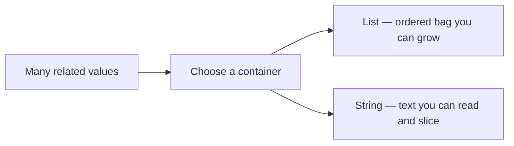
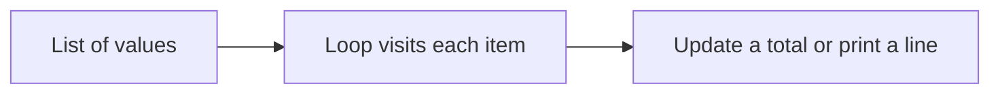

<style>
/* Fenced code: light panel, dark text */
pre[class*="language-"],
.markdown-body pre,
pre {
  background: #f1f5f9 !important;
  border: 1px solid #e2e8f0 !important;
  border-radius: 8px !important;
  color: #0f172a !important;
}

pre code,
.markdown-body pre code {
  background: transparent !important;
  color: #1e293b !important;
  opacity: 1 !important;
}

/* Syntax highlighting on light background (hljs / Prism / pygments) */

pre code .hljs-keyword,
pre code .hljs-selector-tag,
pre code .hljs-selector-class,
pre code .hljs-section { color: #5b21b6 !important; }

pre code .hljs-string,
pre code .hljs-regexp,
pre code .hljs-addition { color: #0f766e !important; }

pre code .hljs-number,
pre code .hljs-literal { color: #b45309 !important; }

pre code .hljs-built_in,
pre code .hljs-title.function_,
pre code .hljs-title.class_,
pre code .hljs-function,
pre code .hljs-title { color: #1d4ed8 !important; }

pre code .hljs-variable,
pre code .hljs-template-variable,
pre code .hljs-attr,
pre code .hljs-name,
pre code .hljs-params { color: #0f172a !important; }

pre code .hljs-type { color: #0369a1 !important; }

pre code .hljs-meta,
pre code .hljs-doctag { color: #475569 !important; }

pre code .token.keyword { color: #5b21b6 !important; }
pre code .token.string { color: #0f766e !important; }
pre code .token.number { color: #b45309 !important; }
pre code .token.function { color: #1d4ed8 !important; }
pre code .token.operator,
pre code .token.punctuation { color: #334155 !important; }
pre code .token.parameter,
pre code .token.property { color: #0f172a !important; }

/* F-strings / template literals: `{var}` must stay dark (fixes white/lost contrast on light bg) */
pre code .hljs-subst,
pre code .hljs-template-variable,
.markdown-body pre code .hljs-subst,
.markdown-body pre code .hljs-template-variable {
  color: #0f172a !important;
}

pre code .hljs-string .hljs-subst,
pre code .hljs-string .hljs-subst *,
pre code .hljs-string .hljs-variable,
pre code .hljs-string .hljs-built_in,
pre code .hljs-string .hljs-keyword,
.markdown-body pre code .hljs-string .hljs-subst,
.markdown-body pre code .hljs-string .hljs-subst * {
  color: #0f172a !important;
}

/* Prism-style interpolation */
pre code .token.interpolation,
pre code .token.interpolation-punctuation,
pre code .token.string .token.punctuation,
pre code .language-python .token.string .token,
pre code .token.string .token.builtin {
  color: #0f172a !important;
}

/* VS Code TextMate-style meta.embedded / source inside string */
pre code span[class*="embedded"],
pre code span[class*="interp"] {
  color: #0f172a !important;
}

/* Pygments: String.Interpol (f-string `{…}` regions) */
pre code .si {
  color: #0f172a !important;
}

/* Comments (all common highlighters) */
.hljs-comment,
.hljs-quote,
span[class*="hljs-comment"],
.token.comment,
.token.prolog,
.token.doctype,
.token.cdata,
.highlight .c,
.highlight .c1,
.highlight .cm,
.highlight .cp,
.highlight .cs,
.markdown-body pre code span.line > span[class*="block-comment"],
.markdown-body pre code span.line > span[class*="line-comment"] {
  color: #334155 !important;
  opacity: 1 !important;
}

/* Inline backticks in body text */
:not(pre) > code,
.markdown-body :not(pre) > code {
  color: #0f172a !important;
  background: rgba(30, 41, 59, 0.08) !important;
  opacity: 1 !important;
}

/* Mermaid edge labels (True / False): stop the text being clipped */
.edgeLabel,
span.edgeLabel,
.edgeLabel p,
foreignObject,
svg .label {
  overflow: visible !important;
}

span.edgeLabel,
.edgeLabel p {
  display: inline-block !important;
  box-sizing: content-box !important;
  padding: 6px 12px !important;
  line-height: 1.45 !important;
  background: #ffffff !important;
  border-radius: 4px;
}
</style>

<div markdown="1" style="color: #0f172a; border-left: 5px solid #1e40af; background: linear-gradient(135deg, #f4f7fb 0%, #eef2f8 100%); padding: 14px 18px; margin: 18px 0; border-radius: 0 10px 10px 0; box-shadow: 0 1px 2px rgba(0,0,0,0.04);">

# **Data Structures in Python — Lists & Strings**

Instructor notes. Brief points to teach from. Diagrams and images stay at original size. About two code snippets per concept.

**Teach lists in this order:** create → index → `len()` → change (`append` / `pop` / replace) → loop.

</div>

<div markdown="1" style="color: #0f172a; border-left: 5px solid #475569; background: #f8fafc; padding: 14px 18px; margin: 18px 0; border-radius: 0 10px 10px 0; box-shadow: 0 1px 2px rgba(0,0,0,0.04);">

## **Quick Recap — Break, Continue, Nested Loops**

- Already know: `while`, `for`, `range()`, **`break`**, **`continue`**, nested loops
- So far: mostly **one value** in one variable
- **Today:** store **many values** — **lists** and **strings**
- Later lessons: sets, tuples, dictionaries

</div>

<div markdown="1" style="color: #0f172a; border-left: 5px solid #2563eb; background: #eff6ff; padding: 14px 18px; margin: 18px 0; border-radius: 0 10px 10px 0; box-shadow: 0 1px 2px rgba(0,0,0,0.04);">

## **What You Will Learn**

| Part | Build-up order |
|------|----------------|
| **Lists** | Create → index → `len()` → `append()` / `pop()` / replace → loop |
| **Strings** | Index → slice → immutability + join → loop |

- Mixed types in one list; negative index for the last item
- Strings cannot be edited in place — build a **new** string with `+`

</div>

<div markdown="1" style="color: #0f172a; border-left: 5px solid #7c3aed; background: #f5f3ff; padding: 14px 18px; margin: 18px 0; border-radius: 0 10px 10px 0; box-shadow: 0 1px 2px rgba(0,0,0,0.04);">

## **Why Programs Need Data Structures**

- One variable = one tiffin box; real work needs many related items
- Kirana bill, snack counter, railway board letters
- **Official:** data structure = organise/store data for access and change
- **Simple:** smart container for many values
- **Example:** school bag (list) vs printed name badge (string)




</div>

<div markdown="1" style="color: #0f172a; border-left: 5px solid #be123c; background: linear-gradient(135deg, #fff1f2 0%, #ffe4e6 100%); padding: 14px 18px; margin: 18px 0; border-radius: 0 10px 10px 0; box-shadow: 0 1px 2px rgba(0,0,0,0.04);">

## **Part 1 — Lists**

Ordered bag you can change later.

- **Official:** mutable ordered sequence in `[]`, indexes from `0`
- **Simple:** numbered row of boxes; add at the end; read by number
- **Example:** vegetable list — tomato, onion, potato; add coriander

**Teaching path today**

1. Create the list  
2. Read one box with indexing  
3. Measure with `len()`  
4. Change with `append()` / `pop()` / replace  
5. Visit every item with a loop  

</div>

<div markdown="1" style="color: #0f172a; border-left: 5px solid #0d9488; background: #f0fdfa; padding: 14px 18px; margin: 18px 0; border-radius: 0 10px 10px 0; box-shadow: 0 1px 2px rgba(0,0,0,0.04);">

## **Step 1 — Create a List**

```python
snacks = ["biscuit", "samosa", "tea", "cake"]
print(snacks)
print(type(snacks))
```

- `[]` + commas; one name holds many values
- Without a list: `snack1`, `snack2`… hard to grow
- Order is kept — first written item sits at the left

**Mixed types are allowed**

```python
student = ["Ananya", 18, True, 87.5]
print(student)
```

- String, int, boolean, float can share one list
- Still one container — four separate boxes

</div>

<div markdown="1" style="color: #0f172a; border-left: 5px solid #b45309; background: #fffbeb; padding: 14px 18px; margin: 18px 0; border-radius: 0 10px 10px 0; box-shadow: 0 1px 2px rgba(0,0,0,0.04);">

## **Step 2 — Indexing (Read One Item)**

Python numbers positions from the **left**, starting at **`0`**.

| Index | 0 | 1 | 2 | 3 |
|-------|---|---|---|---|
| Value | biscuit | samosa | tea | cake |


```python
snacks = ["biscuit", "samosa", "tea", "cake"]
print(snacks[0])    # biscuit — first
print(snacks[2])    # tea — third
print(snacks[3])    # cake — last by positive index
```

- `snacks[0]` is always the first element
- Valid indexes for 4 items: `0`, `1`, `2`, `3`
- `snacks[4]` → **IndexError**

</div>

<div markdown="1" style="color: #0f172a; border-left: 5px solid #0369a1; background: #f0f9ff; padding: 14px 18px; margin: 18px 0; border-radius: 0 10px 10px 0; box-shadow: 0 1px 2px rgba(0,0,0,0.04);">

## **Step 3 — Length with `len()`**

```python
student = ["Ananya", 18, True, 87.5]
print(len(student))   # 4
```

- **`len(list)`** counts **elements** (boxes), not letters inside a string item
- Last valid index = **`len(list) - 1`**
- Common doubt: `len(student)` is `4`, not the letter count of `"Ananya"`

**Negative indexing — count from the right**

| Negative index | -4 | -3 | -2 | -1 |
|----------------|----|----|----|----|
| Value | biscuit | samosa | tea | cake |

```python
snacks = ["biscuit", "samosa", "tea", "cake"]
print(snacks[-1])   # cake — last
print(snacks[-2])   # tea — second-last
```

- `-1` is always the last item — useful after you know `len()`
- Teach after length so students see why `-1` and `len - 1` point to the same box

</div>

<div markdown="1" style="color: #0f172a; border-left: 5px solid #047857; background: #ecfdf5; padding: 14px 18px; margin: 18px 0; border-radius: 0 10px 10px 0; box-shadow: 0 1px 2px rgba(0,0,0,0.04);">

## **Step 4 — Change the List (`append()`, `pop()`, Replace)**

Lists are **mutable** — you can change them after creation.


**`append()` — add one item at the end**

```python
basket = ["rice", "dal"]
basket.append("oil")
print(basket)       # ['rice', 'dal', 'oil']
print(len(basket))  # 3
print(basket[-1])   # oil
```

- Older indexes stay the same; new item becomes the last box
- `len()` grows by one

**Start from an empty list**

```python
plate = []
print(len(plate))      # 0
plate.append("dosa")
print(plate)           # ['dosa']
print(len(plate))      # 1
```

**`pop()` — remove the last item (returns it)**

```python
basket = ["rice", "dal", "oil"]
removed = basket.pop()
print(removed)      # oil
print(basket)       # ['rice', 'dal']
print(len(basket))  # 2
```

- Reverse of `append()` — shrinks from the end
- Empty list + `pop()` → **IndexError**
- `insert` / `extend` / `remove` / `pop(index)` return in a later built-ins lesson

**Replace one box** (length unchanged)

```python
order = ["tea", "samosa", "idli"]
order[1] = "vada"
print(order)       # ['tea', 'vada', 'idli']
print(len(order))  # still 3
```

| Action | What changes | Length |
|--------|--------------|--------|
| `append(x)` | Adds a **new** box at the end | Grows by 1 |
| `pop()` | Removes and returns the **last** box | Shrinks by 1 |
| `items[i] = value` | Overwrites one **existing** box | Same |

</div>

<div markdown="1" style="color: #0f172a; border-left: 5px solid #c2410c; background: #fff7ed; padding: 14px 18px; margin: 18px 0; border-radius: 0 10px 10px 0; box-shadow: 0 1px 2px rgba(0,0,0,0.04);">

## **Step 5 — Loop Through a List**

Now that you can create, index, measure, and change — visit **every** item.

**`for item in list` — values only**

```python
snacks = ["biscuit", "samosa", "tea", "cake"]
index = 0
for item in snacks:
    print("Index", index, "→", item)
    index = index + 1
```

**`for i in range(len(list))` — when position matters**

```python
snacks = ["biscuit", "samosa", "tea", "cake"]
for i in range(len(snacks)):
    print("Index", i, "→", snacks[i])
```

**`while` — stop check written out**

```python
snacks = ["biscuit", "samosa", "tea", "cake"]
i = 0
while i < len(snacks):
    print(snacks[i])
    i = i + 1
```

- Forget `i = i + 1` → infinite loop
- Use `for item in list` when you only need values; use `range(len(...))` when you need indexes

**Reverse walk**

```python
for i in range(len(snacks) - 1, -1, -1):
    print(snacks[i])   # cake → tea → samosa → biscuit
```

**Useful pattern — sum values in a list**

```python
marks = [78, 85, 92]
total = 0
for mark in marks:
    total = total + mark
print(total)       # 255
print(len(marks))  # 3 — len counts items, not the sum
```



</div>

<div markdown="1" style="color: #0f172a; border-left: 5px solid #1d4ed8; background: #eff6ff; padding: 14px 18px; margin: 18px 0; border-radius: 0 10px 10px 0; box-shadow: 0 1px 2px rgba(0,0,0,0.04);">

## **Activity — Weekend Plan List**

Uses the full path: create → index → append → `len()` → `pop()` → loop.

```python
weekend = ["market", "temple", "movie"]
print(weekend[0])
print(weekend[-1])
weekend.append("park")
print(len(weekend))      # 4
removed = weekend.pop()
print(removed)           # park
print(weekend)           # ['market', 'temple', 'movie']
for plan in weekend:
    print(plan)
```

- First / last **before** append; grow then shrink; loop prints remaining three

</div>

<div markdown="1" style="color: #0f172a; border-left: 5px solid #be123c; background: linear-gradient(135deg, #fff1f2 0%, #ffe4e6 100%); padding: 14px 18px; margin: 18px 0; border-radius: 0 10px 10px 0; box-shadow: 0 1px 2px rgba(0,0,0,0.04);">

## **Part 2 — Strings**

Text as a sequence — like a list of characters, with special rules.

- **Official:** immutable sequence of characters in quotes
- **Simple:** every letter/space has a position
- **Example:** **Mumbai** on a railway board — one slot per letter


**Teaching path today**

1. Index + `len()`  
2. Slice a part  
3. Immutability + concatenation  
4. Loop through characters  

</div>

<div markdown="1" style="color: #0f172a; border-left: 5px solid #a21caf; background: #faf5ff; padding: 14px 18px; margin: 18px 0; border-radius: 0 10px 10px 0; box-shadow: 0 1px 2px rgba(0,0,0,0.04);">

## **Step 1 — String Indexing and `len()`**

Same index idea as lists — one **character** per position.

```python
city = "Mumbai"
print(city[0])     # M
print(city[3])     # b
print(city[-1])    # i
print(len(city))   # 6
```

- Indexes start at `0`; `-1` is the last character
- Spaces and punctuation count in `len()` if present
- `city[6]` → **IndexError** (valid indexes are `0` to `5`)

</div>

<div markdown="1" style="color: #0f172a; border-left: 5px solid #0f766e; background: #f0fdfa; padding: 14px 18px; margin: 18px 0; border-radius: 0 10px 10px 0; box-shadow: 0 1px 2px rgba(0,0,0,0.04);">

## **Step 2 — String Slicing**

- `start` included; **`stop` excluded** (like `range`)
- Optional `step`

```python
phrase = "PythonBasics"
print(phrase[0:6])    # Python
print(phrase[6:])     # Basics
print(phrase[:6])     # Python
print(phrase[-6:])    # Basics
print(phrase[::2])    # PtoBsc
print(phrase[::-1])   # reverse
```

- Slice = **new** string; original unchanged
- Out-of-range edges soft — unlike a single bad index
- Teach slice **before** “changing” text so students can use `name[1:]` cleanly next

</div>

<div markdown="1" style="color: #0f172a; border-left: 5px solid #4f46e5; background: #eef2ff; padding: 14px 18px; margin: 18px 0; border-radius: 0 10px 10px 0; box-shadow: 0 1px 2px rgba(0,0,0,0.04);">

## **Step 3 — Immutability and Concatenation**


- **Official:** immutable = cannot alter after creation
- **Simple:** cannot edit one letter like a list item
- **Example:** wrong seat on a printed ticket → issue a **new** ticket

```python
name = "rama"
# name[0] = "R"   # TypeError — leave commented
name = "R" + name[1:]
print(name)   # Rama
```

```python
first = "Good"
second = "Morning"
greeting = first + " " + second
print(greeting)        # Good Morning
print(len(greeting))   # 12
```

- `+` builds a **new** string; assigning back replaces the variable
- Must join the space on purpose, or words stick together
- String methods (`upper`, …) wait for a later lesson

</div>

<div markdown="1" style="color: #0f172a; border-left: 5px solid #c2410c; background: #fff7ed; padding: 14px 18px; margin: 18px 0; border-radius: 0 10px 10px 0; box-shadow: 0 1px 2px rgba(0,0,0,0.04);">

## **Step 4 — Loop Through a String**

**Every character**

```python
word = "RAINBOW"
for ch in word:
    print(ch)
```

**Even indexes only** (`0, 2, 4, …`)

```python
word = "RAINBOW"
for i in range(0, len(word), 2):
    print("Index", i, "→", word[i])   # R I B W
```

- `for ch in word` when you only need each character
- Index form when the **position** matters
- Loop comes last — after index, slice, and join are clear

</div>

<div markdown="1" style="color: #0f172a; border-left: 5px solid #1d4ed8; background: #eff6ff; padding: 14px 18px; margin: 18px 0; border-radius: 0 10px 10px 0; box-shadow: 0 1px 2px rgba(0,0,0,0.04);">

## **Activity — Clean a Name Badge**

```python
full = "ananya rao"
for i in range(0, len(full), 2):
    print("Index", i, "→", full[i])
print(full[0:6])                 # ananya
line = "Hello" + " " + full
print(line)                      # Hello ananya rao
print(len(line))                 # 16
print(full)                      # original unchanged
```

- Even indexes → slice → join → `len()` — original string stays locked

</div>

<div markdown="1" style="color: #0f172a; border-left: 5px solid #7c3aed; background: #f5f3ff; padding: 14px 18px; margin: 18px 0; border-radius: 0 10px 10px 0; box-shadow: 0 1px 2px rgba(0,0,0,0.04);">

## **Lists and Strings Side by Side**

| Question | List | String |
|----------|------|--------|
| One element? | Any stored value | One character |
| Read a position? | `items[index]` | `text[index]` |
| Last item? | `items[-1]` | `text[-1]` |
| Measure? | `len(items)` → elements | `len(text)` → characters |
| Visit each? | `for item in items` | `for ch in text` |
| Replace one position? | Yes (`append` / `pop` / assign) | No — build a new string with `+` |
| Take a part? | Read one index | Slice `[start:stop:step]` |

</div>

<div markdown="1" style="color: #0f172a; border-left: 5px solid #475569; background: #f8fafc; padding: 14px 18px; margin: 18px 0; border-radius: 0 10px 10px 0; box-shadow: 0 1px 2px rgba(0,0,0,0.04);">

## **Predict Before You Run**

```python
items = ["tea", "milk"]
items.append("water")
print(items[0])
print(items[-1])
print(len(items))
label = "Bus" + " " + "Stop"
print(label)
print(len(label))
print(label[0:3])
```

**Expected:** `tea` · `water` · `3` · `Bus Stop` · `8` · `Bus`

</div>

<div markdown="1" style="color: #0f172a; border-left: 5px solid #1e40af; background: linear-gradient(135deg, #f4f7fb 0%, #eef2f8 100%); padding: 14px 18px; margin: 18px 0; border-radius: 0 10px 10px 0; box-shadow: 0 1px 2px rgba(0,0,0,0.04);">

## **Key Takeaways · Quick Reference**

- **Lists:** create → index → `len()` → `append()` / `pop()` / replace → loop
- **Strings:** index → slice → join (immutable) → loop
- Slice stop is excluded; step `-1` reverses
- Upcoming: other containers; a later lesson revisits more list tools (`insert`, `extend`, `pop(index)`, …)

| Term | What it does |
|------|----------------|
| List `[]` | Mutable ordered collection |
| Index / negative index | From left (`0`) / from right (`-1`) |
| `len(list)` / `len(string)` | Elements / characters |
| `append(x)` | Add one item at end |
| `pop()` | Remove and return last item |
| Item assignment | `items[i] = value` replaces one box |
| String | Immutable character sequence |
| Slice `[start:stop:step]` | Copy a portion; stop excluded |
| Concatenation `+` | Join into a new string |

</div>
