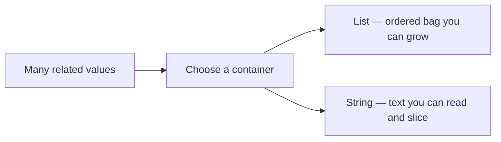

<style>
/* Fenced code: light panel, dark text */
pre[class*="language-"],
.markdown-body pre,
pre {
  background: #f1f5f9 !important;
  border: 1px solid #e2e8f0 !important;
  border-radius: 8px !important;
  color: #0f172a !important;
}

pre code,
.markdown-body pre code {
  background: transparent !important;
  color: #1e293b !important;
  opacity: 1 !important;
}

/* Syntax highlighting on light background (hljs / Prism / pygments) */

pre code .hljs-keyword,
pre code .hljs-selector-tag,
pre code .hljs-selector-class,
pre code .hljs-section { color: #5b21b6 !important; }

pre code .hljs-string,
pre code .hljs-regexp,
pre code .hljs-addition { color: #0f766e !important; }

pre code .hljs-number,
pre code .hljs-literal { color: #b45309 !important; }

pre code .hljs-built_in,
pre code .hljs-title.function_,
pre code .hljs-title.class_,
pre code .hljs-function,
pre code .hljs-title { color: #1d4ed8 !important; }

pre code .hljs-variable,
pre code .hljs-template-variable,
pre code .hljs-attr,
pre code .hljs-name,
pre code .hljs-params { color: #0f172a !important; }

pre code .hljs-type { color: #0369a1 !important; }

pre code .hljs-meta,
pre code .hljs-doctag { color: #475569 !important; }

pre code .token.keyword { color: #5b21b6 !important; }
pre code .token.string { color: #0f766e !important; }
pre code .token.number { color: #b45309 !important; }
pre code .token.function { color: #1d4ed8 !important; }
pre code .token.operator,
pre code .token.punctuation { color: #334155 !important; }
pre code .token.parameter,
pre code .token.property { color: #0f172a !important; }

/* F-strings / template literals: `{var}` must stay dark (fixes white/lost contrast on light bg) */
pre code .hljs-subst,
pre code .hljs-template-variable,
.markdown-body pre code .hljs-subst,
.markdown-body pre code .hljs-template-variable {
  color: #0f172a !important;
}

pre code .hljs-string .hljs-subst,
pre code .hljs-string .hljs-subst *,
pre code .hljs-string .hljs-variable,
pre code .hljs-string .hljs-built_in,
pre code .hljs-string .hljs-keyword,
.markdown-body pre code .hljs-string .hljs-subst,
.markdown-body pre code .hljs-string .hljs-subst * {
  color: #0f172a !important;
}

/* Prism-style interpolation */
pre code .token.interpolation,
pre code .token.interpolation-punctuation,
pre code .token.string .token.punctuation,
pre code .language-python .token.string .token,
pre code .token.string .token.builtin {
  color: #0f172a !important;
}

/* VS Code TextMate-style meta.embedded / source inside string */
pre code span[class*="embedded"],
pre code span[class*="interp"] {
  color: #0f172a !important;
}

/* Pygments: String.Interpol (f-string `{…}` regions) */
pre code .si {
  color: #0f172a !important;
}

/* Comments (all common highlighters) */
.hljs-comment,
.hljs-quote,
span[class*="hljs-comment"],
.token.comment,
.token.prolog,
.token.doctype,
.token.cdata,
.highlight .c,
.highlight .c1,
.highlight .cm,
.highlight .cp,
.highlight .cs,
.markdown-body pre code span.line > span[class*="block-comment"],
.markdown-body pre code span.line > span[class*="line-comment"] {
  color: #334155 !important;
  opacity: 1 !important;
}

/* Inline backticks in body text */
:not(pre) > code,
.markdown-body :not(pre) > code {
  color: #0f172a !important;
  background: rgba(30, 41, 59, 0.08) !important;
  opacity: 1 !important;
}

/* Mermaid edge labels (True / False): stop the text being clipped */
.edgeLabel,
span.edgeLabel,
.edgeLabel p,
foreignObject,
svg .label {
  overflow: visible !important;
}

span.edgeLabel,
.edgeLabel p {
  display: inline-block !important;
  box-sizing: content-box !important;
  padding: 6px 12px !important;
  line-height: 1.45 !important;
  background: #ffffff !important;
  border-radius: 4px;
}
</style>

<div markdown="1" style="color: #0f172a; border-left: 5px solid #1e40af; background: linear-gradient(135deg, #f4f7fb 0%, #eef2f8 100%); padding: 14px 18px; margin: 18px 0; border-radius: 0 10px 10px 0; box-shadow: 0 1px 2px rgba(0,0,0,0.04);">

# **Data Structures in Python — Lists & Strings**

Instructor notes. Brief points to teach from. Diagrams and images stay at original size. About two code snippets per concept.

</div>

<div markdown="1" style="color: #0f172a; border-left: 5px solid #475569; background: #f8fafc; padding: 14px 18px; margin: 18px 0; border-radius: 0 10px 10px 0; box-shadow: 0 1px 2px rgba(0,0,0,0.04);">

## **Quick Recap — Break, Continue, Nested Loops**

- Already know: `while`, `for`, `range()`, **`break`**, **`continue`**, nested loops
- So far: mostly **one value** in one variable
- **Today:** store **many values** — **lists** and **strings**
- Later lessons: sets, tuples, dictionaries

</div>

<div markdown="1" style="color: #0f172a; border-left: 5px solid #2563eb; background: #eff6ff; padding: 14px 18px; margin: 18px 0; border-radius: 0 10px 10px 0; box-shadow: 0 1px 2px rgba(0,0,0,0.04);">

## **What You Will Learn**

- **List:** ordered row, mixed types, index / negative index, loop, `len()`, `append()`
- **String:** characters in order, index, slice, loop, immutability, concatenation + `len()`
- **Part 1 — Lists** · **Part 2 — Strings**

</div>

<div markdown="1" style="color: #0f172a; border-left: 5px solid #7c3aed; background: #f5f3ff; padding: 14px 18px; margin: 18px 0; border-radius: 0 10px 10px 0; box-shadow: 0 1px 2px rgba(0,0,0,0.04);">

## **Why Programs Need Data Structures**

- One variable = one tiffin box; real work needs many related items
- Kirana bill, snack counter, railway board letters
- **Official:** data structure = organise/store data for access and change
- **Simple:** smart container for many values
- **Example:** school bag (list) vs printed name badge (string)




</div>

<div markdown="1" style="color: #0f172a; border-left: 5px solid #be123c; background: linear-gradient(135deg, #fff1f2 0%, #ffe4e6 100%); padding: 14px 18px; margin: 18px 0; border-radius: 0 10px 10px 0; box-shadow: 0 1px 2px rgba(0,0,0,0.04);">

## **Part 1 — Lists**

Ordered bag you can change later.

- **Official:** mutable ordered sequence in `[]`, indexes from `0`
- **Simple:** numbered row of boxes; add at the end; read by number
- **Example:** vegetable list — tomato, onion, potato; add coriander

</div>

<div markdown="1" style="color: #0f172a; border-left: 5px solid #0d9488; background: #f0fdfa; padding: 14px 18px; margin: 18px 0; border-radius: 0 10px 10px 0; box-shadow: 0 1px 2px rgba(0,0,0,0.04);">

## **Create a List · Mixed Types · `len()`**

```python
snacks = ["biscuit", "samosa", "tea", "cake"]
print(snacks)
print(type(snacks))
```

- `[]` + commas; one name holds many values
- Without a list: `snack1`, `snack2`… hard to grow

```python
student = ["Ananya", 18, True, 87.5]
print(student)
print(len(student))   # 4 items — not letters in the name
```

- Mixed types OK; **`len(list)`** counts **elements**

</div>

<div markdown="1" style="color: #0f172a; border-left: 5px solid #b45309; background: #fffbeb; padding: 14px 18px; margin: 18px 0; border-radius: 0 10px 10px 0; box-shadow: 0 1px 2px rgba(0,0,0,0.04);">

## **Indexing and Negative Indexing**

| Index | 0 | 1 | 2 | 3 |
|-------|---|---|---|---|
| Value | biscuit | samosa | tea | cake |


```python
snacks = ["biscuit", "samosa", "tea", "cake"]
print(snacks[0])    # biscuit
print(snacks[2])    # tea
print(snacks[-1])   # cake
print(snacks[-2])   # tea
```

- Last index = `len(list) - 1`; `snacks[4]` → **IndexError**
- `-1` = last; negative counts from the right

</div>

<div markdown="1" style="color: #0f172a; border-left: 5px solid #c2410c; background: #fff7ed; padding: 14px 18px; margin: 18px 0; border-radius: 0 10px 10px 0; box-shadow: 0 1px 2px rgba(0,0,0,0.04);">

## **Iterate Through a List**

```python
snacks = ["biscuit", "samosa", "tea", "cake"]
index = 0
for item in snacks:
    print("Index", index, "→", item)
    index = index + 1
```

```python
snacks = ["biscuit", "samosa", "tea", "cake"]
i = 0
while i < len(snacks):
    print(snacks[i])
    i = i + 1
```

- `for item in list` — value each round
- `for i in range(len(list)):` when position matters
- Forget `i = i + 1` in `while` → infinite loop

**Reverse walk**

```python
for i in range(len(snacks) - 1, -1, -1):
    print(snacks[i])   # cake → … → biscuit
```

</div>

<div markdown="1" style="color: #0f172a; border-left: 5px solid #047857; background: #ecfdf5; padding: 14px 18px; margin: 18px 0; border-radius: 0 10px 10px 0; box-shadow: 0 1px 2px rgba(0,0,0,0.04);">

## **`append()` — Add One at the End**


```python
basket = ["rice", "dal"]
basket.append("oil")
print(basket)       # ['rice', 'dal', 'oil']
print(len(basket))  # 3
print(basket[-1])   # oil
```

```python
plate = []
plate.append("dosa")
print(plate)   # ['dosa']
```

- Lists are **mutable**; older indexes stay the same
- `insert` / `extend` wait for a later lesson — today **`append()`** only

**Replace one box** (length unchanged)

```python
order = ["tea", "samosa", "idli"]
order[1] = "vada"
print(order)   # ['tea', 'vada', 'idli']
```

</div>

<div markdown="1" style="color: #0f172a; border-left: 5px solid #1d4ed8; background: #eff6ff; padding: 14px 18px; margin: 18px 0; border-radius: 0 10px 10px 0; box-shadow: 0 1px 2px rgba(0,0,0,0.04);">

## **Activity — Weekend Plan List**

```python
weekend = ["market", "temple", "movie"]
print(weekend[0])
print(weekend[-1])
weekend.append("park")
print(len(weekend))   # 4
for plan in weekend:
    print(plan)
```

- First / last before append; length 4 after; loop prints all four

</div>

<div markdown="1" style="color: #0f172a; border-left: 5px solid #be123c; background: linear-gradient(135deg, #fff1f2 0%, #ffe4e6 100%); padding: 14px 18px; margin: 18px 0; border-radius: 0 10px 10px 0; box-shadow: 0 1px 2px rgba(0,0,0,0.04);">

## **Part 2 — Strings**

Text as a sequence — like a list of characters, with special rules.

- **Official:** immutable sequence of characters in quotes
- **Simple:** every letter/space has a position
- **Example:** **Mumbai** on a railway board — one slot per letter


</div>

<div markdown="1" style="color: #0f172a; border-left: 5px solid #a21caf; background: #faf5ff; padding: 14px 18px; margin: 18px 0; border-radius: 0 10px 10px 0; box-shadow: 0 1px 2px rgba(0,0,0,0.04);">

## **String Index · Even Positions · Loop**

```python
city = "Mumbai"
print(city[0])     # M
print(city[3])     # b
print(city[-1])    # i
print(len(city))   # 6
```

```python
word = "RAINBOW"
for i in range(0, len(word), 2):
    print("Index", i, "→", word[i])   # R I B W

for ch in word:
    print(ch)   # every character
```

- Same index rules as lists; `city[6]` → **IndexError**
- Spaces count in `len()`

</div>

<div markdown="1" style="color: #0f172a; border-left: 5px solid #4f46e5; background: #eef2ff; padding: 14px 18px; margin: 18px 0; border-radius: 0 10px 10px 0; box-shadow: 0 1px 2px rgba(0,0,0,0.04);">

## **Immutability and Concatenation**


- **Official:** immutable = cannot alter after creation
- **Simple:** cannot edit one letter like a list item
- **Example:** wrong seat on a printed ticket → issue a **new** ticket

```python
name = "rama"
# name[0] = "R"   # TypeError — leave commented
name = "R" + name[1:]
print(name)   # Rama

first = "Good"
second = "Morning"
greeting = first + " " + second
print(greeting)        # Good Morning
print(len(greeting))   # 12
```

- `+` builds a **new** string; assigning back replaces the variable
- String methods (`upper`, …) wait for a later lesson

</div>

<div markdown="1" style="color: #0f172a; border-left: 5px solid #0f766e; background: #f0fdfa; padding: 14px 18px; margin: 18px 0; border-radius: 0 10px 10px 0; box-shadow: 0 1px 2px rgba(0,0,0,0.04);">

## **String Slicing**

- `start` included; **`stop` excluded** (like `range`)
- Optional `step`

```python
phrase = "PythonBasics"
print(phrase[0:6])    # Python
print(phrase[6:])     # Basics
print(phrase[:6])     # Python
print(phrase[-6:])    # Basics
print(phrase[::2])    # PtoBsc
print(phrase[::-1])   # reverse
```

- Slice = **new** string; original unchanged
- Out-of-range edges soft — unlike a single bad index

</div>

<div markdown="1" style="color: #0f172a; border-left: 5px solid #1e40af; background: linear-gradient(135deg, #f4f7fb 0%, #eef2f8 100%); padding: 14px 18px; margin: 18px 0; border-radius: 0 10px 10px 0; box-shadow: 0 1px 2px rgba(0,0,0,0.04);">

## **Key Takeaways · Quick Reference**

- **Lists:** ordered, grow with `append()`, index / negative index / loops / `len()`
- **Strings:** immutable text — index, slice, loop, concatenate
- Slice stop is excluded; step `-1` reverses
- Upcoming: other containers + more ready-made tools

| Term | What it does |
|------|----------------|
| List `[]` | Mutable ordered collection |
| Index / negative index | From left (`0`) / from right (`-1`) |
| `len(list)` / `len(string)` | Elements / characters |
| `append(x)` | Add one item at end |
| String | Immutable character sequence |
| Slice `[start:stop:step]` | Copy a portion; stop excluded |
| Concatenation `+` | Join into a new string |

</div>

