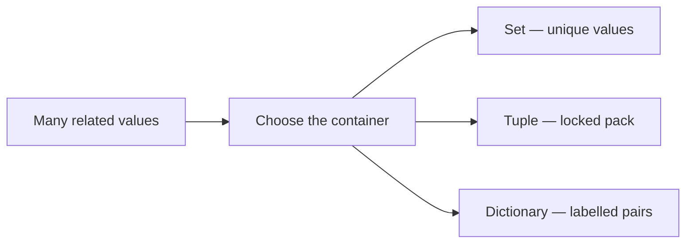
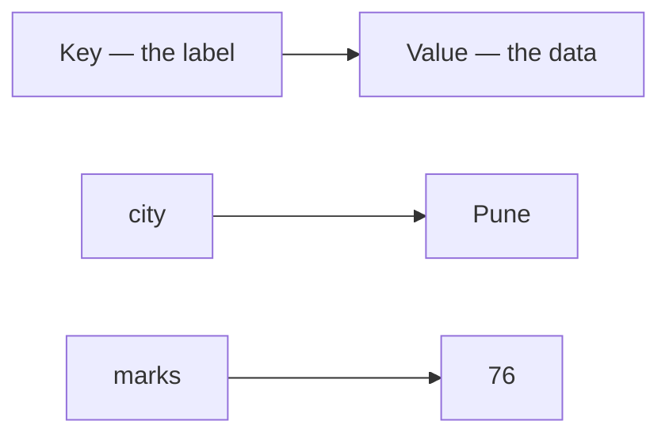

# Data Structures in Python — Sets, Tuples & Dictionaries

## What You Will Learn in This Lesson

You have already learnt how to store many values in a **list** and how to read **text** as a **string**. You can index a list, loop through it, measure it with **`len()`**, and add one item with **`append()`**. You can also index a string, slice it, loop through its characters, and join pieces of text.

Those two containers are not enough for every job. A list can repeat the same name twice. A list can also be edited by mistake when the values should stay locked. A list also finds items by **position**, not by a useful **label** such as `"city"` or `"phone"`.

In this lesson, you will use a **set** when each value should appear only once, a **tuple** when a pack of values should stay fixed, and a **dictionary** when you look up a value by a name.

By the end, you will be able to:

- Explain why a **set** keeps only unique values and why a **tuple** stays fixed after it is created
- Create a set and add one value with **`add()`**
- Create a tuple and read an item by its **index**
- Convert a list to a set to drop duplicates, and convert a list to a tuple to lock the values
- Explain a **dictionary** as **key–value pairs**, and why a key cannot be repeated
- Create a dictionary and read a value using its key
- Loop through the pairs in a dictionary
- Store a few pairs in a dictionary and change one value by its key

---

## Why Lists and Strings Are Not Always Enough

A list is an ordered row you can grow. A string is text you can read letter by letter. Both start counting at `0`.

- A workshop form may collect the same phone number twice. You still want **one** registration.
- A confirmed train seat — coach and berth — should not change if someone later edits a list by accident.
- A student record is easier to read as `"name"` and `"marks"` than as index `0` and index `1`.

- **Official Definition:** A **data structure** is a way of organising and storing data so that it can be accessed and modified efficiently.
- **In Simple Words:** Pick the container that matches the job — unique values, locked values, or labelled lookup.
- **Real-Life Example:** A **guest list** may repeat a name by mistake. A **printed hall ticket** should stay sealed. A **contacts app** finds a number by the person's name, not by "the third row."



You already know how to loop over a list. In this lesson you will still use lists as the **starting point**, then convert them when uniqueness or a lock is needed.

---

## Part 1 — Sets and Tuples

### Mutable and Immutable — Why It Matters

Before sets and tuples, name two ideas you already touched with lists and strings.

- **Official Definition:** A **mutable** object can be changed after it is created. An **immutable** object cannot.
- **In Simple Words:** Mutable means "you may edit this later." Immutable means "treat this as locked."
- **Real-Life Example:** A **whiteboard** timetable is mutable — you can wipe and rewrite it. A **printed hall ticket** is immutable for that exam day.


| Structure you already know | Mutable? | Quick reason |
|----------------------------|----------|--------------|
| **List** | Yes | `append()` and item assignment edit the same list |
| **String** | No | You build a **new** string with `+` and slicing |

Sets can grow with **`add()`**, so their contents are mutable. Tuples cannot be rewritten by index, so they are immutable. Dictionaries are mutable — you can change the value stored under a key.

---

### Sets — Unique Values Without Order

A list keeps **order** and **allows duplicates**. A set does the opposite job.

- **Official Definition:** A **set** is an unordered collection of unique elements written with curly braces `{}` or created with **`set()`**.
- **In Simple Words:** A set is a bag that automatically throws away duplicates. You care that a value appears once, not which seat it sits in.
- **Real-Life Example:** A workshop desk should accept each **phone number** only once, even if the same person submits the form twice.


### Creating a Set

Write unique values inside curly braces. If you write the same value twice, Python stores it **once**.

```python
# Create a set of city names
cities = {"Delhi", "Mumbai", "Delhi", "Pune"}  # Duplicate Delhi is ignored
print(cities)  # Unique cities only — order may vary
print(type(cities))  # Confirm the type is set
print(len(cities))  # Count unique values — 3, not 4
```

**How the code works:**

- Curly braces `{}` with comma-separated values create a set.
- The second `"Delhi"` does not become a second element.
- **`len()`** counts unique values, so the length is `3`.
- Sets do **not** support indexing like `cities[0]`, because they have no guaranteed order.
- **Common error:** Writing `cities[0]` raises **TypeError**. Read a set by looping, not by position.

An empty set must be written as **`set()`**. Empty curly braces `{}` create an empty **dictionary**, not an empty set.

```python
# Start with an empty set
tokens = set()  # Empty set — not {}
print(type(tokens))  # <class 'set'>
print(len(tokens))  # 0
```

**How the code works:**

- `set()` is a real set with no items yet.
- `{}` would be an empty dictionary. That is a different container.
- **Need:** You often start empty, then add values one by one as people register.

### Adding One Value with `add()`

**`add()`** inserts one element if it is new. If the value is already in the set, the set stays the same size.

```python
# Add roll numbers one by one
rolls = {101, 102, 103}  # Starting unique rolls
rolls.add(104)  # New value — the set grows
print(rolls)  # Includes 104
print(len(rolls))  # 4

rolls.add(102)  # Already present — no extra copy
print(len(rolls))  # Still 4
```

**How the code works:**

- `add(104)` grows the set by one unique value.
- `add(102)` does not create a second `102`.
- There is no "last index" after `add()`, because a set is not a numbered row.
- More set tools, such as removing a value, wait for a later lesson. Today, growing a set means **`add()`**.

### Loop Through a Set

You can visit every unique value with a `for` loop. Do not expect a fixed print order.

```python
# Visit every unique city
cities = {"Delhi", "Mumbai", "Pune"}  # Three unique names
for city in cities:  # Each unique value once
    print(city)  # One city per line
```

**How the code works:**

- Each city prints once.
- The order of the lines may differ from the order you wrote in the braces.
- **Common doubt:** Did Python lose a city? No — uniqueness is kept; only the display order is not promised.

### Convert a List to a Set to Drop Duplicates

When a list already has repeats, **`set(list)`** is the quick way to keep each value once.


```python
# Drop duplicate marks from a list
marks_list = [80, 90, 80, 70, 90]  # List with repeats
unique_marks = set(marks_list)  # Convert to a set
print(unique_marks)  # Unique scores only
print(len(marks_list))  # 5 values in the original list
print(len(unique_marks))  # 3 unique values
```

**How the code works:**

- `80` and `90` appear twice in the list, but only once in the set.
- The original list is **not** edited. `unique_marks` is a new set.
- Converting back with `list(unique_marks)` is possible if you later need a list again. The new list may not keep the old order.

```python
# Convert the unique set back to a list
marks_list = [80, 90, 80, 70, 90]  # Original list
unique_marks = set(marks_list)  # Unique values
clean_list = list(unique_marks)  # Back to a list
print(clean_list)  # A list without duplicates
```

**How the code works:**

- `list(...)` builds a list from the set's unique values.
- Use this when a later step needs a list, but you first needed uniqueness.
- **Why not stay with a list?** Checking duplicates by hand with nested loops is longer and easier to get wrong.

---

### Tuples — Ordered and Locked

A list can grow and change. Sometimes the pack of values should stay **fixed** after you create it.

- **Official Definition:** A **tuple** is an immutable ordered sequence written with parentheses `()`.
- **In Simple Words:** A tuple is a sealed packet. Order is kept. Contents should not change.
- **Real-Life Example:** A booked train seat **(train number, coach, berth)** stays fixed after confirmation.

### Creating a Tuple and Reading by Index

Parentheses create the tuple. Indexing works like a list, starting at `0`.

```python
# Store a point as a tuple
point = (10, 20)  # x and y together
print(point)  # (10, 20)
print(type(point))  # <class 'tuple'>
print(point[0])  # 10 — first value
print(point[1])  # 20 — second value
print(point[-1])  # 20 — last value
print(len(point))  # 2
```

**How the code works:**

- `point[0]` is the first item, just as in a list.
- Negative indexes work. `-1` is the last item.
- **`len()`** counts elements in the tuple.
- You **cannot** write `point[0] = 99`. That raises **TypeError**.
- You also cannot use **`append()`** on a tuple.

```python
# Show that a tuple cannot be rewritten by index
seat = ("Sleeper", "S5", 43)  # class, coach, berth
print(seat[0])  # Sleeper
print(seat[1])  # S5
print(seat[2])  # 43
# seat[2] = 44  # TypeError — leave this line commented
print(seat)  # Still ('Sleeper', 'S5', 43)
```

**How the code works:**

- Reading by index is allowed.
- Assigning a new berth into `seat[2]` is blocked.
- The variable still holds the original three values.

| Feature | List | Tuple |
|---------|------|-------|
| Brackets | `[]` | `()` |
| Change later? | Yes | No |
| `append()` | Yes | No |
| Indexing | Yes | Yes |
| `len()` | Yes | Yes |

**Need:** Use a tuple when the program should treat the pack as a fact, not as a shopping list.

A one-item tuple needs a **comma**. `(42)` is just the number 42 in brackets. `(42,)` is a tuple of one item.

```python
# A one-item tuple needs a comma
single = (42,)  # Tuple with one value
print(type(single))  # <class 'tuple'>
print(single[0])  # 42
```

**How the code works:**

- The comma is what makes a tuple, not the parentheses alone.
- **Common error:** Forgetting the comma and expecting a tuple.

### Convert a List to a Tuple to Lock the Values

When you first build values in a list, **`tuple(list)`** locks that snapshot.

```python
# Lock a colour list into a tuple
temp_list = ["red", "green", "blue"]  # Editable list
colour_tuple = tuple(temp_list)  # Lock into a tuple
print(colour_tuple)  # ('red', 'green', 'blue')
print(colour_tuple[0])  # red
# colour_tuple.append("yellow")  # Would fail — tuples have no append
```

**How the code works:**

- `tuple(...)` copies the current list values into a new tuple.
- The list `temp_list` can still change. The tuple does not change with it.
- If you truly need to edit again, convert **back** with `list(colour_tuple)`, edit the list, then lock with `tuple(...)` once more.

```python
# Unlock only when a rare correction is needed
ticket = ("12628", "S5", 43)  # train, coach, berth
print(ticket[2])  # 43
editable = list(ticket)  # Convert to a list
editable[2] = 44  # Edit is allowed on the list
locked = tuple(editable)  # Lock again
print(locked)  # ('12628', 'S5', 44)
print(ticket)  # Original tuple is unchanged
```

**How the code works:**

- The original `ticket` tuple stays as it was.
- `locked` is a **new** tuple with the corrected berth.
- This pattern says: lock by default, edit only on purpose.

Sets dropped duplicates. Tuples locked a pack. You often use both conversions in one small program.

### Activity: Unique Guests and a Fixed Seat

1. Make a list of guest names that accidentally repeats one name.
2. Convert it to a **set**, print the unique guests, then convert back to a **list**.
3. Create a tuple `seat = ("Sleeper", "B3", 42)` and print coach and berth with indexes.
4. Convert a short list of colours to a tuple and print the first colour.

One worked version:

```python
# Unique guests, then a locked seat
guests = ["Meera", "Rahul", "Meera", "Ananya"]  # One name repeats
unique_guests = set(guests)  # Drop duplicates
print(len(unique_guests))  # 3 unique names
guest_list = list(unique_guests)  # Back to a list if needed
print(guest_list)  # Unique names as a list

seat = ("Sleeper", "B3", 42)  # class, coach, berth
print(seat[1])  # B3
print(seat[2])  # 42

colours = ["red", "green", "blue"]  # Editable list
locked_colours = tuple(colours)  # Locked pack
print(locked_colours[0])  # red
```

**Expected facts to check:**

- `len(unique_guests)` is `3`, not `4`.
- `seat[1]` is `B3` and `seat[2]` is `42`.
- `locked_colours[0]` is `red`.

---

Sets gave you uniqueness. Tuples gave you a locked pack. The next part finds a value by a **label**, not by a seat number.

---

## Part 2 — Dictionaries

Lists, sets, and tuples still find values by **position** or by **presence**. A dictionary finds a value by a **name**.

- **Official Definition:** A **dictionary** is a mutable collection of **key–value pairs**, written with curly braces `{}`, where each key maps to a value and keys must be unique.
- **In Simple Words:** A dictionary stores labelled boxes. You ask for `"name"` or `"marks"`, not index `0` or `1`.
- **Real-Life Example:** A **hospital file** labelled by patient ID — you look up ID `A102`, not "the 17th paper in the stack."


### Keys, Values, and No Duplicate Keys

Each pair is written as `key: value`. If the same key appears twice, the **latest value wins**.

```python
# Student profile as a dictionary
student = {
    "name": "Meera",  # key name maps to Meera
    "age": 18,  # key age maps to 18
    "city": "Mumbai",  # key city maps to Mumbai
}  # End of the dictionary
print(student)  # Show all pairs
print(len(student))  # Number of pairs — 3
```

**How the code works:**

- Keys are usually strings that match real labels.
- `len(student)` counts **pairs**, not letters in `"Meera"`.
- Order of printing may follow insertion order in modern Python, but you still look up by **key**, not by a seat number.

```python
# Duplicate key demonstration
demo = {"a": 1, "a": 2}  # Second "a" overwrites the first
print(demo)  # {'a': 2}
print(len(demo))  # 1 pair, not 2
```

**How the code works:**

- Python does not keep two boxes both named `"a"`.
- The first value `1` is replaced by `2`.
- **Need:** Unique keys keep lookup unambiguous — one label, one answer.

### Creating a Dictionary and Reading by Key

You can start empty and add pairs with `dictionary[key] = value`. You read a value with `dictionary[key]`.

```python
# Build a canteen menu and read one price
menu = {}  # Start empty
menu["idli"] = 40  # Add key idli with price 40
menu["dosa"] = 60  # Add key dosa with price 60
menu["tea"] = 20  # Add key tea with price 20
print(menu)  # Full menu
print(menu["dosa"])  # 60
print(menu["tea"])  # 20
```

**How the code works:**

- `menu["dosa"]` is lookup by **label**, not `menu[1]`.
- A missing key such as `menu["pongal"]` raises **KeyError**.
- Prefer clear key names that match the real item.

```python
# Read a student field by its key
student = {"name": "Rahul", "marks": 88, "passed": True}  # Three pairs
print(student["name"])  # Rahul
print(student["marks"])  # 88
print(student["passed"])  # True
```

**How the code works:**

- Each print uses the key that names the field.
- You do not need to remember that marks sit in "the second box."
- **Common error:** Typing the wrong key, including a spelling difference such as `"Name"` versus `"name"`.

### Changing One Value by Its Key

A dictionary is mutable. Assigning to an **existing** key replaces the value. Assigning to a **new** key adds a pair.


```python
# Update one field in a student record
student = {"name": "Meera", "city": "Mumbai", "marks": 76}  # Starting record
print(student["city"])  # Mumbai
student["city"] = "Pune"  # Same key, new value
print(student["city"])  # Pune
print(len(student))  # Still 3 pairs

student["passed"] = True  # New key — a new pair is added
print(len(student))  # 4 pairs
print(student["passed"])  # True
```

**How the code works:**

- `student["city"] = "Pune"` does not add a second city key. It overwrites the value.
- `student["passed"] = True` grows the dictionary because `"passed"` was not there.
- **`len()`** grows only when a **new** key is added.

This is the dictionary version of list item assignment. The difference is the label: `"city"` instead of index `1`.

### Loop Through the Pairs

Looping a dictionary visits each **key**. Use the key to read the matching value.

```python
# Print every key and its value
shop = {
    "name": "City Stores",  # Shop name
    "open": True,  # Open or closed
    "rating": 4.5,  # Decimal rating
}

for key in shop:  # Each round gives one key
    print(key, "→", shop[key])  # Label, then the stored value
```

**How the code works:**

- `for key in shop` does **not** give the values first. It gives the keys.
- `shop[key]` reads the value for that key.
- Mixed value types are allowed: a string, a boolean, and a float can live in one dictionary.

A loop can also count how many pairs you visited.

```python
# Count pairs while printing
contact = {"name": "Ananya", "phone": "9876543210", "city": "Delhi"}  # Three pairs
count = 0  # Start a counter
for key in contact:  # Visit each key
    print(key, contact[key])  # Print the pair
    count = count + 1  # Count this pair
print("Pairs printed:", count)  # 3
print(len(contact))  # Also 3
```

**How the code works:**

- The counter and `len(contact)` should match if you visit every key.
- This is the same loop idea you used on lists, pointed at keys instead of positions.



Values can themselves be lists. `len(dictionary)` still counts **pairs**. `len(dictionary[key])` counts inside that one value.

```python
# Length of the dictionary versus length of one stored list
report = {
    "student": "Rahul",  # String value
    "subjects": ["Maths", "Science", "English"],  # List value
}

print(len(report))  # 2 pairs
print(len(report["subjects"]))  # 3 subject names
print(report["student"])  # Rahul
```

**How the code works:**

- `len(report)` is not `5`. It does not add letters and subjects together.
- `len(report["subjects"])` answers "how many subjects?"
- **Common doubt:** Does looping `for key in report` also loop inside the subjects list? No — that inner list is one value. Loop it separately if you need each subject.

### Activity: Mini Student Card

1. Create a dictionary with keys `"name"`, `"city"`, and `"marks"`.
2. Print the city using its key.
3. Change the city to another city and print it again.
4. Loop through the dictionary and print every key with its value.
5. Print `len()` of the dictionary.

One worked version:

```python
# A small student card
card = {"name": "Kabir", "city": "Delhi", "marks": 81}  # Three pairs
print(card["city"])  # Delhi
card["city"] = "Mumbai"  # Update by key
print(card["city"])  # Mumbai
for key in card:  # Visit each label
    print(key, "→", card[key])  # Print the pair
print(len(card))  # 3
```

**Expected facts to check:**

- First city print is `Delhi`. Second city print is `Mumbai`.
- The loop prints three pairs.
- `len(card)` is `3`.

---

## Choosing Set, Tuple, or Dictionary

You still use **lists** and **strings** from the previous lesson. Add these three rules of thumb.

| If you need… | Choose |
|--------------|--------|
| Unique values only | **Set** |
| Fixed ordered pack | **Tuple** |
| Look up by a label | **Dictionary** |
| Ordered items you will still edit | **List** (already known) |

```python
# One short program using set, tuple, and dictionary
join_requests = ["Asha", "Ravi", "Asha", "Neha"]  # Names may repeat
unique_names = set(join_requests)  # Unique names
print(len(unique_names))  # 3

venue = ("Mumbai", "Court-2")  # city, court — locked
print(venue[0])  # Mumbai

player = {"name": "Neha", "city": "Pune"}  # Labelled record
player["city"] = "Mumbai"  # Update by key
print(player["city"])  # Mumbai
```

**How the code works:**

- The **set** removes the duplicate `"Asha"`.
- The **tuple** keeps the venue details sealed.
- The **dictionary** stores Neha's city under a label you can update.

### Activity: Predict Before You Run

Read this program on paper first. Write the output, then run it to check.

```python
# Uniqueness, a lock, and a labelled update
raw = [101, 102, 101]  # Duplicate roll
unique_rolls = set(raw)  # Unique rolls
print(len(unique_rolls))  # How many unique rolls

pack = tuple(["red", "blue"])  # Lock two colours
print(pack[0])  # First colour

note = {"item": "tea", "price": 20}  # Two pairs
note["price"] = 25  # Change the price
print(note["price"])  # New price
print(len(note))  # How many pairs
```

**Expected output:**

- `2`
- `red`
- `25`
- `2`

---

## Debugging Sets, Tuples, and Dictionaries

| Problem | Likely Cause | Fix |
|---------|--------------|-----|
| `TypeError` on `cities[0]` | A set has no index | Loop the set, or convert to a list first |
| `{}` is a dictionary, not a set | Empty braces create a dict | Use `set()` for an empty set |
| Set length is smaller than the list | Duplicates were dropped | That is the job of a set — check with `len()` |
| `TypeError` on `seat[2] = 44` | A tuple cannot be rewritten | Convert to a list, edit, then lock with `tuple()` |
| `KeyError` | The key is missing or misspelt | Print the dictionary and use the exact key |
| `len(report)` looks too small | `len` counts pairs | Use `len(report[key])` to measure one stored list |
| Two keys did not both stay | Duplicate key on create | The latest value for that key wins |

---

## Key Takeaways

- A **set** stores unique values with no promised order. Create it with `{}` or `set()`, grow it with **`add()`**, and convert a list with **`set(list)`** to drop duplicates.
- A **tuple** is an ordered pack that stays fixed. Create it with `()`, read it by index, and convert a list with **`tuple(list)`** when the values should lock.
- A **dictionary** stores **key–value pairs**. Keys must be unique. Read and update a value with `dictionary[key]`.
- Loop a dictionary by its keys, then read each value. `len(dictionary)` counts pairs.
- In upcoming lessons you will name reusable jobs with functions, and you will meet more ready-made tools for these containers. The uniqueness, lock, and labelled lookup from this lesson stay the reason you pick each structure.

---

## Important Commands, Libraries & Terminologies

| Term / Command | What It Does |
|----------------|--------------|
| **Set (`{}` / `set()`)** | Unordered collection of unique values |
| **`add(x)`** | Insert one value into a set if it is new |
| **`set(list)`** | Build a set from a list and drop duplicates |
| **Tuple (`()`)** | Immutable ordered collection |
| **Tuple index** | Read one item with `pack[i]`, same idea as a list |
| **`tuple(list)`** | Lock the current list values into a tuple |
| **`list(set_or_tuple)`** | Convert back to a list when you need a list again |
| **Mutable / Immutable** | Can change after creation / cannot change after creation |
| **Dictionary** | Mutable collection of unique keys mapped to values |
| **Key–value pair** | One labelled entry, written `key: value` |
| **`dict[key]`** | Read the value stored under `key` |
| **`dict[key] = value`** | Add a new pair, or replace the value for an existing key |
| **`for key in dict`** | Visit each key, then read `dict[key]` |
| **`len(x)`** | Count unique set items, tuple items, or dictionary pairs |
| **`TypeError` on set index** | Raised when code uses `set[0]` |
| **`TypeError` on tuple assignment** | Raised when code tries `tuple[i] = value` |
| **`KeyError`** | Raised when a dictionary key is missing |
