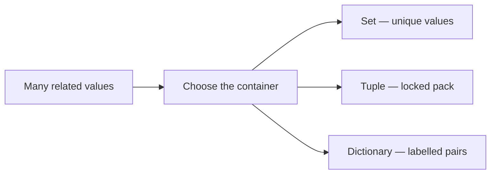
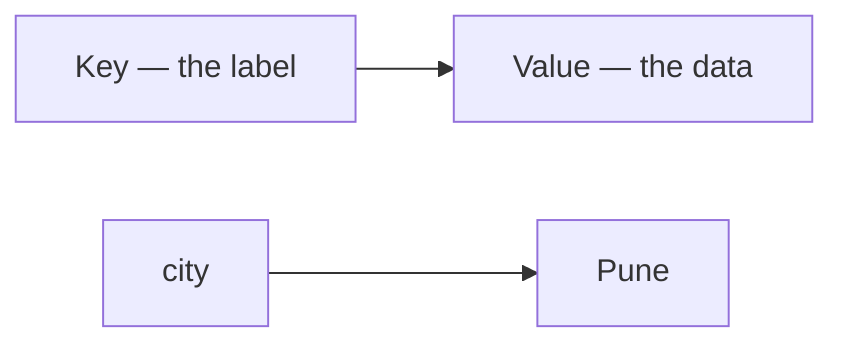

<style>
/* Fenced code: light panel, dark text */
pre[class*="language-"],
.markdown-body pre,
pre {
  background: #f1f5f9 !important;
  border: 1px solid #e2e8f0 !important;
  border-radius: 8px !important;
  color: #0f172a !important;
}

pre code,
.markdown-body pre code {
  background: transparent !important;
  color: #1e293b !important;
  opacity: 1 !important;
}

/* Syntax highlighting on light background (hljs / Prism / pygments) */

pre code .hljs-keyword,
pre code .hljs-selector-tag,
pre code .hljs-selector-class,
pre code .hljs-section { color: #5b21b6 !important; }

pre code .hljs-string,
pre code .hljs-regexp,
pre code .hljs-addition { color: #0f766e !important; }

pre code .hljs-number,
pre code .hljs-literal { color: #b45309 !important; }

pre code .hljs-built_in,
pre code .hljs-title.function_,
pre code .hljs-title.class_,
pre code .hljs-function,
pre code .hljs-title { color: #1d4ed8 !important; }

pre code .hljs-variable,
pre code .hljs-template-variable,
pre code .hljs-attr,
pre code .hljs-name,
pre code .hljs-params { color: #0f172a !important; }

pre code .hljs-type { color: #0369a1 !important; }

pre code .hljs-meta,
pre code .hljs-doctag { color: #475569 !important; }

pre code .token.keyword { color: #5b21b6 !important; }
pre code .token.string { color: #0f766e !important; }
pre code .token.number { color: #b45309 !important; }
pre code .token.function { color: #1d4ed8 !important; }
pre code .token.operator,
pre code .token.punctuation { color: #334155 !important; }
pre code .token.parameter,
pre code .token.property { color: #0f172a !important; }

/* F-strings / template literals: `{var}` must stay dark (fixes white/lost contrast on light bg) */
pre code .hljs-subst,
pre code .hljs-template-variable,
.markdown-body pre code .hljs-subst,
.markdown-body pre code .hljs-template-variable {
  color: #0f172a !important;
}

pre code .hljs-string .hljs-subst,
pre code .hljs-string .hljs-subst *,
pre code .hljs-string .hljs-variable,
pre code .hljs-string .hljs-built_in,
pre code .hljs-string .hljs-keyword,
.markdown-body pre code .hljs-string .hljs-subst,
.markdown-body pre code .hljs-string .hljs-subst * {
  color: #0f172a !important;
}

/* Prism-style interpolation */
pre code .token.interpolation,
pre code .token.interpolation-punctuation,
pre code .token.string .token.punctuation,
pre code .language-python .token.string .token,
pre code .token.string .token.builtin {
  color: #0f172a !important;
}

/* VS Code TextMate-style meta.embedded / source inside string */
pre code span[class*="embedded"],
pre code span[class*="interp"] {
  color: #0f172a !important;
}

/* Pygments: String.Interpol (f-string `{…}` regions) */
pre code .si {
  color: #0f172a !important;
}

/* Comments (all common highlighters) */
.hljs-comment,
.hljs-quote,
span[class*="hljs-comment"],
.token.comment,
.token.prolog,
.token.doctype,
.token.cdata,
.highlight .c,
.highlight .c1,
.highlight .cm,
.highlight .cp,
.highlight .cs,
.markdown-body pre code span.line > span[class*="block-comment"],
.markdown-body pre code span.line > span[class*="line-comment"] {
  color: #334155 !important;
  opacity: 1 !important;
}

/* Inline backticks in body text */
:not(pre) > code,
.markdown-body :not(pre) > code {
  color: #0f172a !important;
  background: rgba(30, 41, 59, 0.08) !important;
  opacity: 1 !important;
}

/* Mermaid edge labels (True / False): stop the text being clipped */
.edgeLabel,
span.edgeLabel,
.edgeLabel p,
foreignObject,
svg .label {
  overflow: visible !important;
}

span.edgeLabel,
.edgeLabel p {
  display: inline-block !important;
  box-sizing: content-box !important;
  padding: 6px 12px !important;
  line-height: 1.45 !important;
  background: #ffffff !important;
  border-radius: 4px;
}
</style>

<div markdown="1" style="color: #0f172a; border-left: 5px solid #1e40af; background: linear-gradient(135deg, #f4f7fb 0%, #eef2f8 100%); padding: 14px 18px; margin: 18px 0; border-radius: 0 10px 10px 0; box-shadow: 0 1px 2px rgba(0,0,0,0.04);">

# **Data Structures in Python — Sets, Tuples & Dictionaries**

Instructor notes. Brief points to teach from. Diagrams and images stay at original size. About two code snippets per concept.

</div>

<div markdown="1" style="color: #0f172a; border-left: 5px solid #475569; background: #f8fafc; padding: 14px 18px; margin: 18px 0; border-radius: 0 10px 10px 0; box-shadow: 0 1px 2px rgba(0,0,0,0.04);">

## **Quick Recap — Lists & Strings**

- Already: list index / loop / `len` / `append`; string index / slice / join
- Gaps: duplicates in a list; locked packs; lookup by **label** not position
- **Today:** **set**, **tuple**, **dictionary**
- **Part 1 — Sets and Tuples** · **Part 2 — Dictionaries**

</div>

<div markdown="1" style="color: #0f172a; border-left: 5px solid #2563eb; background: #eff6ff; padding: 14px 18px; margin: 18px 0; border-radius: 0 10px 10px 0; box-shadow: 0 1px 2px rgba(0,0,0,0.04);">

## **What You Will Learn**

- Set: unique values + `add()`; list → set to drop duplicates
- Tuple: fixed pack + index; list → tuple to lock
- Dictionary: key–value pairs; read / update by key; loop keys

</div>

<div markdown="1" style="color: #0f172a; border-left: 5px solid #7c3aed; background: #f5f3ff; padding: 14px 18px; margin: 18px 0; border-radius: 0 10px 10px 0; box-shadow: 0 1px 2px rgba(0,0,0,0.04);">

## **Why Lists and Strings Are Not Always Enough**

- Same phone twice → want **one** registration
- Confirmed seat should not change by accident
- Student fields easier as `"name"` / `"marks"` than index `0` / `1`



</div>

<div markdown="1" style="color: #0f172a; border-left: 5px solid #be123c; background: linear-gradient(135deg, #fff1f2 0%, #ffe4e6 100%); padding: 14px 18px; margin: 18px 0; border-radius: 0 10px 10px 0; box-shadow: 0 1px 2px rgba(0,0,0,0.04);">

## **Part 1 — Sets and Tuples**

### Mutable vs Immutable

- **Mutable:** can change after creation · **Immutable:** locked
- List yes · String no · Set contents yes · Tuple no · Dict yes


</div>

<div markdown="1" style="color: #0f172a; border-left: 5px solid #0d9488; background: #f0fdfa; padding: 14px 18px; margin: 18px 0; border-radius: 0 10px 10px 0; box-shadow: 0 1px 2px rgba(0,0,0,0.04);">

## **Sets — Unique Values**


- **Official:** unordered unique collection — `{}` or `set()`
- **Simple:** bag that throws away duplicates
- **Example:** each phone number once at a workshop desk

```python
cities = {"Delhi", "Mumbai", "Delhi", "Pune"}
print(cities)          # unique only — order may vary
print(len(cities))     # 3
```

```python
tokens = set()         # empty set — NOT {}
rolls = {101, 102, 103}
rolls.add(104)
rolls.add(102)         # no extra copy
print(len(rolls))      # 4
```

- No `cities[0]` → **TypeError** (unordered)
- `{}` alone = empty **dictionary**

</div>

<div markdown="1" style="color: #0f172a; border-left: 5px solid #b45309; background: #fffbeb; padding: 14px 18px; margin: 18px 0; border-radius: 0 10px 10px 0; box-shadow: 0 1px 2px rgba(0,0,0,0.04);">

## **List → Set · Loop a Set**


```python
marks_list = [80, 90, 80, 70, 90]
unique_marks = set(marks_list)
print(len(marks_list))      # 5
print(len(unique_marks))    # 3
clean_list = list(unique_marks)
```

```python
for city in {"Delhi", "Mumbai", "Pune"}:
    print(city)   # once each; order not promised
```

- Original list unchanged; back to list if you need indexing later
- `remove` / `union` etc. wait for built-ins lesson — today **`add()`**

</div>

<div markdown="1" style="color: #0f172a; border-left: 5px solid #c2410c; background: #fff7ed; padding: 14px 18px; margin: 18px 0; border-radius: 0 10px 10px 0; box-shadow: 0 1px 2px rgba(0,0,0,0.04);">

## **Tuples — Ordered and Locked**

- **Official:** immutable ordered sequence in `()`
- **Simple:** sealed packet
- **Example:** (train, coach, berth) after booking

```python
point = (10, 20)
print(point[0])     # 10
print(point[-1])    # 20
print(len(point))   # 2
# point[0] = 99     # TypeError
```

```python
seat = ("Sleeper", "S5", 43)
print(seat[1], seat[2])
single = (42,)      # comma required for one-item tuple
```

| | List | Tuple |
|--|------|-------|
| Brackets | `[]` | `()` |
| Change? | Yes | No |
| `append` | Yes | No |
| Index / `len` | Yes | Yes |

</div>

<div markdown="1" style="color: #0f172a; border-left: 5px solid #047857; background: #ecfdf5; padding: 14px 18px; margin: 18px 0; border-radius: 0 10px 10px 0; box-shadow: 0 1px 2px rgba(0,0,0,0.04);">

## **List → Tuple · Activity**

```python
temp_list = ["red", "green", "blue"]
colour_tuple = tuple(temp_list)
print(colour_tuple[0])   # red
```

```python
ticket = ("12628", "S5", 43)
editable = list(ticket)
editable[2] = 44
locked = tuple(editable)
print(locked)    # corrected new tuple
print(ticket)    # original unchanged
```

**Activity:** guests list with a repeat → `set` → `list`; `seat = ("Sleeper", "B3", 42)` print coach/berth

</div>

<div markdown="1" style="color: #0f172a; border-left: 5px solid #be123c; background: linear-gradient(135deg, #fff1f2 0%, #ffe4e6 100%); padding: 14px 18px; margin: 18px 0; border-radius: 0 10px 10px 0; box-shadow: 0 1px 2px rgba(0,0,0,0.04);">

## **Part 2 — Dictionaries**

Look up by **label**, not seat number.

- **Official:** mutable key–value pairs in `{}`; keys unique
- **Simple:** labelled boxes — ask for `"city"`, not index `2`
- **Example:** hospital file by patient ID


</div>

<div markdown="1" style="color: #0f172a; border-left: 5px solid #1d4ed8; background: #eff6ff; padding: 14px 18px; margin: 18px 0; border-radius: 0 10px 10px 0; box-shadow: 0 1px 2px rgba(0,0,0,0.04);">

## **Create · Read · No Duplicate Keys**

```python
student = {"name": "Meera", "age": 18, "city": "Mumbai"}
print(len(student))   # 3 pairs

demo = {"a": 1, "a": 2}
print(demo)           # {'a': 2} — latest wins
```

```python
menu = {}
menu["idli"] = 40
menu["dosa"] = 60
print(menu["dosa"])   # 60
# menu["pongal"] → KeyError if missing
```

- `len(dict)` counts **pairs**, not letters inside a value

</div>

<div markdown="1" style="color: #0f172a; border-left: 5px solid #a21caf; background: #faf5ff; padding: 14px 18px; margin: 18px 0; border-radius: 0 10px 10px 0; box-shadow: 0 1px 2px rgba(0,0,0,0.04);">

## **Update by Key · Loop Pairs**


```python
student = {"name": "Meera", "city": "Mumbai", "marks": 76}
student["city"] = "Pune"      # same key — replace value
print(len(student))           # still 3
student["passed"] = True      # new key — grows
print(len(student))           # 4
```

```python
shop = {"name": "City Stores", "open": True, "rating": 4.5}
for key in shop:
    print(key, "→", shop[key])
```



- `get` / `keys` / `pop` wait for built-ins lesson — today `dict[key]` read/write

</div>

<div markdown="1" style="color: #0f172a; border-left: 5px solid #0f766e; background: #f0fdfa; padding: 14px 18px; margin: 18px 0; border-radius: 0 10px 10px 0; box-shadow: 0 1px 2px rgba(0,0,0,0.04);">

## **Choose · Activity · Takeaways**

| Need | Choose |
|------|--------|
| Unique only | **Set** |
| Fixed ordered pack | **Tuple** |
| Look up by label | **Dictionary** |
| Ordered + still edit | **List** |

```python
unique_names = set(["Asha", "Ravi", "Asha", "Neha"])
venue = ("Mumbai", "Court-2")
player = {"name": "Neha", "city": "Pune"}
player["city"] = "Mumbai"
```

**Predict:** `set([101,102,101])` len → 2; `tuple(["red","blue"])[0]` → red; update price 20→25; `len` pairs → 2

| Term | Role |
|------|------|
| `set()` / `add` | Unique bag / grow |
| `set(list)` / `tuple(list)` | Dedupe / lock |
| `dict[key]` | Read or assign |
| `KeyError` / tuple assign error | Missing key / locked pack |

</div>

