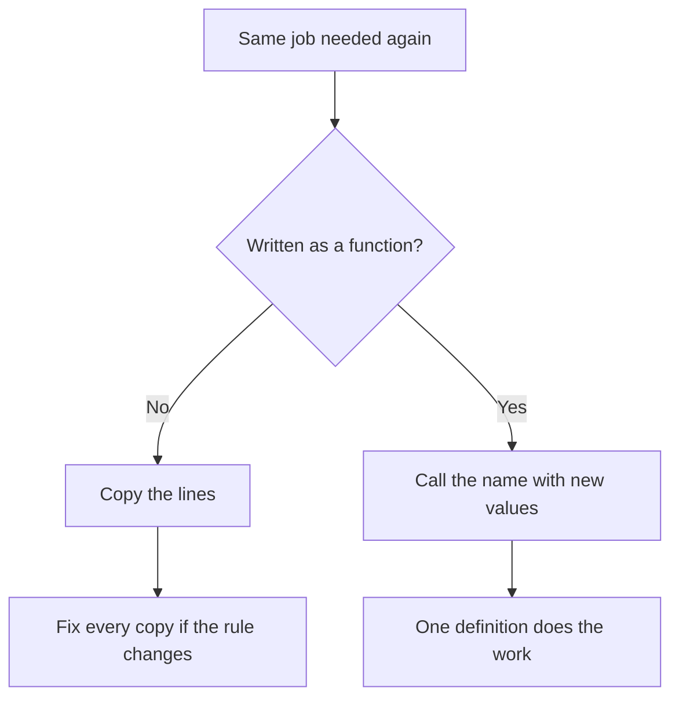

# Functions in Python

## What You Will Learn in This Lesson

You have already learnt how to store many values in **lists**, **strings**, **sets**, **tuples**, and **dictionaries**. You can also **decide** with `if` and `else`, and **repeat** with loops.

Those tools are enough to solve a small problem once, from top to bottom. They become tiring when the same job appears again. A greeting line, a GST total, or a pass-or-fail check should not be copied and pasted every time the inputs change.

In this lesson, you will give that job a **name**. You will define a function, call it, pass values in, and get a value back. You will also use more than one input, a default value, and a decision inside a function.

By the end, you will be able to:

- Explain why a function is used to name one job and reuse it
- Define a function with **`def`** and call it by its name
- Explain the difference between a **parameter** and an **argument**
- Send a result back with **`return`**
- Pass more than one value, including a **default** value
- Use **`if`** and **`else`** inside a function to choose a result
- Write a small bill-total function you can call with different numbers

---

## Why Programs Need Named Jobs

A program without functions is like a shop that rewrites the full bill formula on every slip. The formula is the same. Only the plate count changes.

- A mistake must be fixed in every copy.
- A reader sees a pile of lines, not one clear job.
- A later change, such as adding a packing charge, must be edited in many places.

- **Official Definition:** A **function** is a named block of code that performs one job and can be used whenever that job is needed.
- **In Simple Words:** A function is a labelled recipe. You write the steps once, then ask for the recipe by name.
- **Real-Life Example:** The canteen always does “plates × price”. Staff do not invent a new method for every student. They reuse the same job with new numbers.




---

## Part 1 — Defining and Calling a Function

This part builds the smallest useful function: write it once, call it by name, pass a value in, and send a result back.

### Defining a Function with `def`

- **Official Definition:** The **`def`** keyword starts a function definition. After `def` come the function name, parentheses, a colon, and an indented body.
- **In Simple Words:** `def` means “store these steps under this name.”
- **Real-Life Example:** Writing a recipe card titled **Make Tea** is the definition. Making tea later is the call.


```python
# Define a function that prints a greeting
def say_hello():  # def, name, empty parentheses, colon
    print("Hello")  # Body — indented under def

say_hello()  # Call the function by its name
```

**How the code works:**

- The lines under `def` do **not** run at definition time. They wait for a call.
- `say_hello()` runs the body once and prints `Hello`.
- Forgetting the parentheses in the call — writing only `say_hello` — does not run the body.
- **Common error:** Wrong indentation. The body must sit one level under `def`.

### Calling a Function by Name

A call is a request: “Run the named job now.”

```python
# Define once, call twice
def show_ready():  # One short job
    print("Order ready")  # Message for the counter

show_ready()  # First call
show_ready()  # Second call — same job again
```

**How the code works:**

- Each call runs the body from top to bottom.
- You do not rewrite the print line for the second customer.
- **Need:** Reuse without copy-paste.

### Parameters and Arguments

A function becomes useful when it can receive different values.

- **Official Definition:** A **parameter** is a name listed inside the parentheses in the `def` line. An **argument** is the actual value you pass when you call the function.
- **In Simple Words:** The parameter is the empty cup on the recipe card. The argument is the tea you pour in when you make the drink.
- **Real-Life Example:** The recipe says “use **cups** of water.” When you cook, you pour **2** cups. `cups` is the parameter. `2` is the argument.


```python
# Parameter name, argument value
def greet(person):  # person is the parameter
    print("Hello,", person)  # Use the received value

greet("Meera")  # "Meera" is the argument
greet("Rahul")  # A different argument, same function
```

**How the code works:**

- On `greet("Meera")`, `person` becomes `"Meera"` for that call.
- On the next call, `person` becomes `"Rahul"`.
- The parameter name is local to the function. It does not need to match any outer variable name.

| Word | Where you see it | Meaning |
|------|------------------|---------|
| **Parameter** | Inside `def greet(person):` | The placeholder name |
| **Argument** | Inside `greet("Meera")` | The real value passed in |

### Returning a Result with `return`

`print` shows a message. **`return`** sends a value back to the caller so the program can use it later.


- **Official Definition:** **`return`** ends the function and sends a value back to the place that called it.
- **In Simple Words:** `return` hands the answer to the caller. The caller can store it, print it, or use it in more maths.
- **Real-Life Example:** A calculator does not only flash a number on screen for show. It gives you a result you can write on your bill.

```python
# Return a doubled number
def double(n):  # Parameter n
    result = n * 2  # Work inside the function
    return result  # Send the answer back

answer = double(7)  # Store the returned value
print(answer)  # 14
print(double(10))  # 20 — use the return value directly
```

**How the code works:**

- `double(7)` returns `14`. That value is stored in `answer`.
- Code after `return` in the same function does not run.
- If a function has no `return`, it still returns `None`. Printing is not the same as returning.

```python
# Show the difference between print and return
def show_square(n):  # Only prints
    print(n * n)  # Shows 25 when n is 5

def get_square(n):  # Returns a value
    return n * n  # Caller can reuse this

show_square(5)  # Prints 25
value = get_square(5)  # value becomes 25
print(value + 1)  # 26 — possible because return gave a number
```

**How the code works:**

- `show_square(5)` displays `25`, but the caller does not receive a number to store.
- `get_square(5)` returns `25`, so `value + 1` works.
- **Common doubt:** Why use `return` if I can `print`? Use `return` when the next line of the program needs the answer.

### Trace a Call on Paper

Read this function, then predict the prints before you run it.

```python
# Trace parameter binding and return
def add_pair(a, b):  # Two parameters
    print("Inside:", a, b)  # Show what arrived
    return a + b  # Send the sum back

first = add_pair(4, 6)  # Arguments 4 and 6
print("Stored:", first)  # Should be 10
print(add_pair(1, 2) * 3)  # Return 3, then multiply → 9
```

**Expected output:**

- `Inside: 4 6`
- `Stored: 10`
- `Inside: 1 2`
- `9`

**How the reasoning works:**

- Each call binds fresh values to `a` and `b`.
- The returned number can be stored or used in more maths immediately.

### Activity: Name and Return

1. Define `add_ten(n)` that returns `n + 10`.
2. Call it with `15` and store the result.
3. Print the stored result.

```python
# Add ten and return the answer
def add_ten(n):  # Parameter n
    return n + 10  # Send n + 10 back

total = add_ten(15)  # Store the returned value
print(total)  # 25
```

**Expected output:**

- `25`

---

## Part 2 — Inputs, Defaults, and Decisions

Part 1 named one job and returned one result. This part lets a function take more than one value, skip an argument with a default, and choose a path with `if` and `else`.

### More Than One Parameter

List parameters in order. Pass arguments in the same order unless you use names.

```python
# Two parameters for a rectangle area
def area(length, breadth):  # Two placeholder names
    return length * breadth  # One returned product

print(area(5, 3))  # 15 — length 5, breadth 3
print(area(10, 2))  # 20
```

**How the code works:**

- The first argument binds to `length`. The second binds to `breadth`.
- Swapping arguments swaps the meaning if the order matters for your problem.
- You can also write `area(length=5, breadth=3)` to name the arguments in the call.

### Default Parameter Values

A default value is used when the caller leaves that argument out.

- **Official Definition:** A **default parameter** is a parameter that already has a value in the `def` line. The caller may omit that argument.
- **In Simple Words:** The recipe says “sugar is optional — if you skip it, use one spoon.”
- **Real-Life Example:** A taxi app may use **city = Mumbai** unless you type another city.


```python
# Default city when the caller does not pass one
def welcome(name, city="Mumbai"):  # city has a default
    print("Hello,", name, "from", city)  # Use both values

welcome("Meera")  # Uses default city Mumbai
welcome("Rahul", "Pune")  # Overrides the default
```

**How the code works:**

- `welcome("Meera")` sets `name` to `"Meera"` and `city` to `"Mumbai"`.
- `welcome("Rahul", "Pune")` overrides `city` with `"Pune"`.
- Parameters with defaults must come **after** parameters without defaults in the `def` line.
- **Common error:** Writing `def welcome(city="Mumbai", name):` — that order is invalid.

### Decisions Inside a Function

You already know `if` and `else`. Place them inside a function to choose what to return.


```python
# Return Pass or Fail from marks
def result_status(marks):  # One parameter
    if marks >= 40:  # Decision inside the function
        return "Pass"  # One possible answer
    else:
        return "Fail"  # Other possible answer

print(result_status(72))  # Pass
print(result_status(33))  # Fail
```

**How the code works:**

- The function receives marks, decides, and returns a string.
- The caller only prints the returned label.
- You can nest more branches with `elif` when you need more than two paths.

```python
# Grade bands with elif
def grade(marks):  # Parameter marks
    if marks >= 75:  # First check
        return "A"
    elif marks >= 60:  # Second check
        return "B"
    elif marks >= 40:  # Third check
        return "C"
    else:
        return "F"

print(grade(81))  # A
print(grade(55))  # C
print(grade(20))  # F
```

**How the code works:**

- Only one branch returns for each call.
- Order matters. Check the highest band first so 81 does not fall into `"C"`.

### Implement a Bill Total

A canteen bill is a natural function: take counts and prices, return the total.

```python
# Bill total with a default packing charge
def bill_total(plates, price, packing=0):  # packing defaults to 0
    food = plates * price  # Food cost
    total = food + packing  # Add packing if any
    return total  # Send the final amount

print(bill_total(3, 40))  # 120 — no packing
print(bill_total(3, 40, 10))  # 130 — packing overridden
```

**How the code works:**

- First call uses `packing=0`, so the total is `3 * 40`.
- Second call passes `10` for packing, so the total is `130`.
- The formula lives in one place. Change packing rules once, not in every print line.

```python
# GST-style bill with a decision
def payable(amount, member):  # amount and membership flag
    if member:  # Members get a small discount
        return amount * 0.9  # 10 percent off
    else:
        return amount  # Full amount

print(payable(200, True))  # 180.0
print(payable(200, False))  # 200
```

**How the code works:**

- `member` is a boolean argument.
- The function returns different numbers for the same amount based on the decision.
- **Need:** Keep the discount rule in one function instead of copying `if` blocks around the notebook.

### Named Arguments in a Call

When a call uses names, order can change safely.

```python
# Same function, named arguments
def travel(city, mode):  # Two parameters
    return city + " by " + mode  # Build one string

print(travel(mode="train", city="Pune"))  # Names make order flexible
print(travel("Delhi", mode="bus"))  # Mix one positional and one named
```

**How the code works:**

- `mode="train"` binds to `mode` even though it appears first in the call.
- After a named argument, you should not place a bare positional argument.
- Defaults and named calls together make optional inputs easy to read.

### Activity: Canteen Helper

1. Write `tea_bill(cups, price=15)` that returns `cups * price`.
2. Call it once with only `cups=2` and once with `cups=2, price=20`.
3. Write `label(score)` that returns `"Good"` if `score >= 50`, else `"Retry"`.

```python
# Canteen helper functions
def tea_bill(cups, price=15):  # Default price 15
    return cups * price  # Total for tea

def label(score):  # Decision helper
    if score >= 50:
        return "Good"
    else:
        return "Retry"

print(tea_bill(2))  # 30
print(tea_bill(2, 20))  # 40
print(label(62))  # Good
print(label(40))  # Retry
```

**Expected output:**

- `30`
- `40`
- `Good`
- `Retry`

### Activity: Predict Before You Run

```python
# Defaults and a decision together
def fee(amount, member=False):  # Default: not a member
    if member:
        return amount - 50  # Flat discount
    return amount  # Full fee

print(fee(500))  # Uses default member=False
print(fee(500, True))  # Override default
print(fee(amount=300, member=True))  # Named call
```

**Expected output:**

- `500`
- `450`
- `250`

---

## Debugging Functions

| Problem | Likely Cause | Fix |
|---------|--------------|-----|
| Function body never runs | You wrote the name without `()` | Call with `name()` |
| `NameError` for a parameter outside | Parameters are local | Use the returned value, not the parameter name outside |
| Always get `None` | Used `print` instead of `return` | `return` the answer, then print outside if needed |
| Wrong default used | Argument order mismatch | Put defaults last; pass overrides in order or by name |
| Syntax error on `def` | Default before required parameter | Write required parameters first |

---

## Key Takeaways

- A **function** names one job so you can reuse it without copying lines.
- **`def`** defines the job. A call with `()` runs it. **Parameters** are placeholders. **Arguments** are the real values.
- **`return`** sends a result back to the caller. Printing alone does not give the caller a reusable value.
- Defaults let a caller skip an argument. `if` and `else` inside a function choose which result to return.
- In upcoming lessons you will pass flexible groups of values into functions, and you will use ready-made tools Python already provides for lists, strings, and other containers.

---

## Important Commands, Libraries & Terminologies

| Term / Command | What It Does |
|----------------|--------------|
| **Function** | Named block that performs one job |
| **`def`** | Starts a function definition |
| **Call** | Runs a function with `name(...)` |
| **Parameter** | Placeholder name in the `def` line |
| **Argument** | Actual value passed in a call |
| **`return`** | Sends a value back to the caller and ends the function |
| **Default parameter** | Parameter with a ready value if the argument is omitted |
| **`if` / `else` in a function** | Chooses which value to return |
| **`None`** | Automatic result when a function has no `return` |
