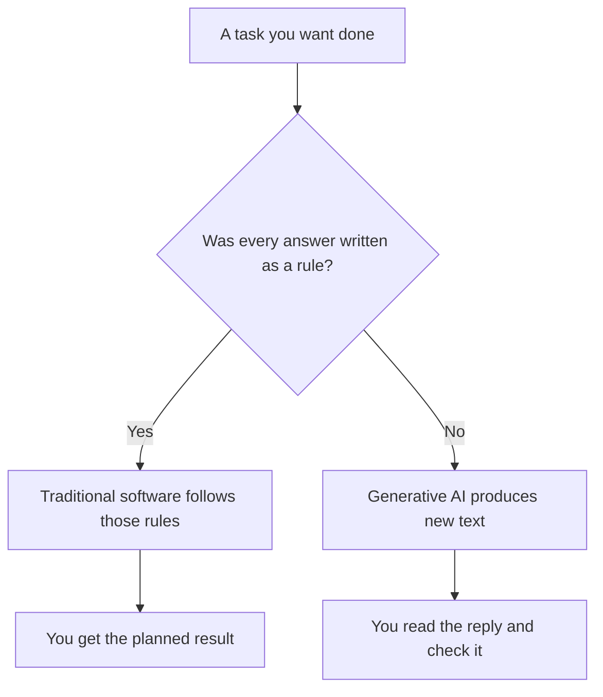
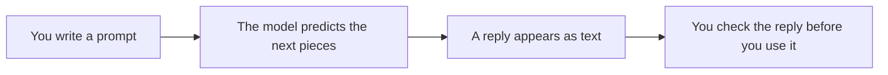

# AI — Introduction to GenAI & LLMs

## What You Will Learn in This Lesson

You have already practised Python data: lists of values, pieces of text, and dictionaries that store a name next to a value. That practice with text and stored facts is enough background for today. This lesson does not ask you to write Python programs.

Today you will see how ordinary software differs from software that **writes new text**. You will learn what **artificial intelligence**, **generative AI**, and a **large language model** mean in plain words.

You will also see how a model continues text, what a **prompt**, a **token**, and **temperature** are, why a confident reply can still be wrong, and how to check a reply before you trust it.

By the end, you will be able to:

- Explain what AI means with everyday examples such as a spam filter, face unlock, and a chatbot
- Separate rule-based software from software that generates new text
- Classify tools into traditional software, labelling AI, and generative AI
- Explain what an LLM is, and how a clearer prompt names the job, the reader, and the length
- Explain **token**, **temperature**, and **hallucination**, and check a demo reply for unsupported claims

---

## Part 1 — AI

This part names artificial intelligence and separates tools that only label from tools that write new text.

### What Artificial Intelligence Is

- **Official Definition:** **Artificial intelligence (AI)** is software that performs tasks which normally need human-like judgement, by following learned patterns or carefully designed decision steps.
- **In Simple Words:** The computer does a job that feels “smart,” such as spotting spam or drafting a sentence, without you writing every possible sentence yourself.
- **Real-Life Example:** Your phone suggesting the next word in a chat is a small AI feature. A calculator that only adds numbers is not judging language.

| Tool | What it does | Kind of AI behaviour |
|------|----------------|----------------------|
| Spam filter | Marks a mail as spam or not spam | Labels |
| Face unlock | Matches a face to a saved pattern | Recognises |
| Chatbot that writes a paragraph | Produces new sentences | Generates text |


- A label is not a new essay. “This mail is spam” is a decision.
- A generated paragraph did not exist as a stored sentence in your notes.
- **Common doubt:** Is every app AI? No. An app that only opens a fixed menu is ordinary software.

### Rule-Based Software Versus Generative Software

Most software you already use follows rules a person wrote in advance. A new kind of software can produce text that was not stored as a fixed answer.

| Question | Traditional software | Generative software |
|----------|----------------------|---------------------|
| Who decides the exact output? | A person, through rules | A model, by continuing likely text |
| Same input again | Usually the same planned result | Often a similar but not identical reply |
| Typical job | Calculate, store, look up, enforce a rule | Draft, rewrite, explain, brainstorm |
| When it is wrong | A rule was missing or a value was wrong | The text sounds smooth and can still be false |

- **Official Definition:** **Traditional software** carries out instructions a human wrote, so each allowed input maps to a result those instructions already define.
- **In Simple Words:** It is a strict recipe. If the recipe says “add the bill,” the program adds the bill.
- **Real-Life Example:** A UPI app checks a balance because a programmer wrote the steps for that check. A chatbot can draft a leave message you never stored on your phone.




### Label Versus New Text

A classifier returns a **label**. A generative tool returns **new wording**.

| You ask for | A labelling tool returns | A generative tool returns |
|-------------|--------------------------|---------------------------|
| Is this review angry? | Yes or no | Not required for this job |
| Rewrite this review politely | A label is not enough | A new polite paragraph |
| List three hostel rules in simple words | A yes/no cannot do this | Three freshly worded lines |

- Generative does not mean “true.” It means “newly written in a form that fits the request.”
- Two students can receive two different wordings for the same request. Both can be useful. Either can be wrong.

### Activity: Classify Everyday Tools

For each tool, write one label: **Traditional**, **Labelling AI**, or **Generative AI**.

1. Calculator that only adds and subtracts
2. Spam filter on email
3. Chat tool that drafts a polite complaint from your rough notes
4. Face unlock on a phone
5. Railway fare screen that applies a fixed price table

**Sample answers:**

1. Traditional  
2. Labelling AI  
3. Generative AI  
4. Labelling AI / recognising AI  
5. Traditional  

---

## Part 2 — LLMs and Prompting

Part 1 named AI and generative tools. This part names the text engine behind many chat products, and the message you type to steer it.

### What a Large Language Model Is

- **Official Definition:** A **large language model (LLM)** is a generative AI model trained on a very large amount of text so that it can continue and reshape language in response to what you type.
- **In Simple Words:** It is a text-prediction system that has read far more writing than one person could, and it uses that experience to draft a reply.
- **Real-Life Example:** The chat box inside a writing assistant, where you type “explain GST in simple words,” is an LLM product. The assistant is the shop window. The LLM is the engine that writes the reply.

| It is | It is not |
|-------|-----------|
| A system that continues text | A classmate who “knows” you |
| Trained on lots of public-style writing | A live copy of every website at this minute |
| Able to draft, explain, and rephrase | A guaranteed source of facts |

- “Large” refers to the huge amount of text used in training and the size of the model. You do not need the internal design for this lesson.
- A common doubt: Does it look up the answer like a library? In the basic picture of this lesson, it **continues text**. Some products add search on top. If you did not see a source, do not invent one.

### Next-Word Prediction in Plain Words

An LLM’s basic move is to guess a **likely next piece** of text, then another, then another, until a reply is long enough.


| Text so far | A likely next piece | An unlikely next piece |
|-------------|---------------------|------------------------|
| Good morning, | class / team | calculator |
| The shop is | open / closed | photosynthesis |
| I request leave | because / on | banana |

- “Likely” is not the same as “true today.” A likely sentence about a bus fare can still name the wrong fare.
- For this lesson, say the model **predicts text**. Do not describe a mind inside the computer.

### What a Prompt Is

- **Official Definition:** A **prompt** is the text you submit to a generative model to start or steer the text it produces.
- **In Simple Words:** It is your question, instruction, or pasted notes. The paragraph that comes back is the reply, not the prompt.
- **Real-Life Example:** Typing “Explain a primary key in three short lines for a beginner” is a prompt.

A clearer prompt usually gets a more usable reply. Name the **job**, the **reader**, and the **length**.


| Weak prompt | Clearer prompt | Why the second is easier |
|-------------|----------------|--------------------------|
| Tell me about AI | Explain AI in five short lines for a beginner | Length and reader are named |
| Write something | Write a polite two-line leave message for fever | Task and size are named |
| Fix this | Rewrite this sentence so a teacher can read it: … | Exact text is included |



### Activity: Vague Prompt Versus Clearer Prompt

Same job: ask for a leave message.

**Vague prompt:**

```text
Write a leave message.
```

**Clearer prompt:**

```text
Write a polite two-line leave message for a student named Kabir who has fever on Monday. Do not invent extra awards or approvals.
```

Compare two sample replies on paper:

- Reply A invents a gold medal and a principal’s approval.
- Reply B uses only the given name, reason, and day.

Keep Reply B. Delete unsupported claims from Reply A.

### Activity: Write One Clearer Prompt

Rewrite this weak prompt so the job, the reader, and the length are clear:

```text
Tell me about databases.
```

**One acceptable clearer version:**

```text
Explain what a database is in four short lines for a beginner who has not studied computers.
```

---

## Part 3 — Important LLM Terms, with a Practical Demo

Part 2 taught prompts. This part names three terms you will hear often — **token**, **temperature**, and **hallucination** — and practise checking a reply.

### Token

- **Official Definition:** A **token** is a small piece of text, often a whole word, a part of a word, a number, or a mark such as a comma, that the model reads and predicts.
- **In Simple Words:** Cut a sentence into small chunks. Each chunk is a token.
- **Real-Life Example:** In `The shop is open.` the pieces might be `The` / `shop` / `is` / `open` / `.`


- A token is not always one dictionary word.
- In this lesson, token does **not** mean a password or a coin.

### Temperature

- **Official Definition:** **Temperature** is a setting that controls how boldly the model picks among likely next pieces of text. Lower values stay closer to the most likely wording. Higher values allow more variety.
- **In Simple Words:** Low temperature is a careful, steady reply. High temperature is a more mixed, creative reply.
- **Real-Life Example:** Asking for a formal leave note works better at a low temperature. Brainstorming five unusual project titles may use a higher temperature.


| Setting | Typical behaviour | Better for |
|---------|-------------------|------------|
| Low temperature | More stable wording | Facts you must check, formal notes |
| High temperature | More varied wording | Brainstorming, creative drafts |

- Temperature does **not** guarantee truth. A steady wrong number is still wrong.
- Products hide the dial differently. The idea matters more than the exact product name.

### Hallucination

- **Official Definition:** A **hallucination** is model output presented as if it were factual, but invented, distorted, or unsupported by a source you can check.
- **In Simple Words:** The tool sounds sure, and the fact is made up or mixed up. Smooth grammar is not proof.
- **Real-Life Example:** A reply says a bus fare is exactly ₹17 since 2019, with no notice you can open. Treat that number as unchecked.

| Reply habit | What you should do |
|-------------|--------------------|
| A specific number, date, law, or quote | Check a real notice, book, or person |
| A name or award not in your prompt | Delete it unless you can verify it |
| A clear rewrite of text you pasted | Compare meaning with your source |

### Demo: Same Prompt, Two Temperatures

Use this prompt in a chat tool if you have access, or compare the sample replies below on paper.

```text
In one short paragraph, suggest a study plan for tomorrow evening for a beginner learning Python lists.
```

**Low-temperature style sample:**

```text
Spend 20 minutes revising list indexes, then 20 minutes writing three short list examples, then 10 minutes checking your answers against your notes.
```

**High-temperature style sample:**

```text
Turn your evening into a mini list carnival: race a shopping list against a marks list, invent silly snack names as list items, then reward yourself with a tiny reverse-loop puzzle before dinner.
```

**What to notice:**

- Both answer the job.
- The low-temperature reply is steadier and easier to follow as a plan.
- The high-temperature reply is more playful and varied.
- Neither reply should invent a fake exam date or a fake score.

### Demo: Spot a Hallucination

**Given facts only:**

- Student: Kabir  
- City: Pune  
- Leave day: Monday  
- Reason: fever  

**Model reply to check:**

```text
I, Kabir from Pune, request leave on Monday because of fever.
I also won the 2022 state gold medal, my attendance is 99.4 percent,
and the principal already approved this leave.
```

**Your check:**

1. Keep the first sentence — it uses only given facts.
2. Delete the gold medal — not in the prompt.
3. Delete the attendance percent — not in the prompt.
4. Delete the principal’s approval — not in the prompt.

**Safe rewrite:**

```text
I, Kabir, request leave on Monday because I have fever.
I study in Pune and will complete pending work after I return.
```

### Activity: Check a Demo Reply

A reply about a college bus says the fare is ₹17 since 2019. Your prompt did not include a fare, and you have no notice open.

1. Name the failure: **hallucination**.
2. State what you delete: the fare and the year claim.
3. State what you may keep: wording that still asks for bus timings if that was your real job, without the invented number.

---

## Words People Mix Up

| People say | Precise meaning here | Not the same as |
|------------|----------------------|-----------------|
| AI | A wide label for judgement-like software | Only chatbots |
| Generative AI | Software that creates new content | A spam label |
| LLM | The text model behind a writing tool | The whole phone app |
| Prompt | What you type in | The reply that comes out |
| Token | A small piece of text | A password or a fee |
| Temperature | How bold the next-word choices are | A guarantee of truth |
| Hallucination | A false confident claim | A grammar mistake only |

---

## Key Takeaways

- Traditional software follows written rules. Generative AI produces new text. An LLM is the text engine behind many writing tools.
- A clearer prompt names the job, the reader, and the length. The reply still needs a human check.
- Tokens are small text pieces. Temperature changes how varied the wording is. Hallucination is a confident unsupported claim.
- Use these tools to draft and explain. Check numbers, names, rules, and citations yourself before you rely on them.
- In upcoming lessons you will leave text prediction and work with other practical tools for data and applications.

---

## Important Commands, Libraries & Terminologies

| Term | What it means in this lesson |
|------|------------------------------|
| **Traditional software** | Software that follows rules a person wrote for a planned result |
| **Artificial intelligence (AI)** | Software that does a judgement-like task such as labelling or generating language |
| **Generative AI** | AI that creates new content, here new text |
| **Large language model (LLM)** | A text model that continues and reshapes language from a prompt |
| **Next-word prediction** | Choosing a likely next piece of text, then another |
| **Token** | A small piece of text the model reads and predicts |
| **Prompt** | The instruction or source text you submit |
| **Reply** | The text the model returns after the prompt |
| **Temperature** | A setting that affects how varied the wording is |
| **Hallucination** | A confident claim that is invented or unsupported |
| **Check** | Your step of comparing the reply with notes or a real source |
| **Classifier** | An AI tool that returns a label and does not write a new essay |
