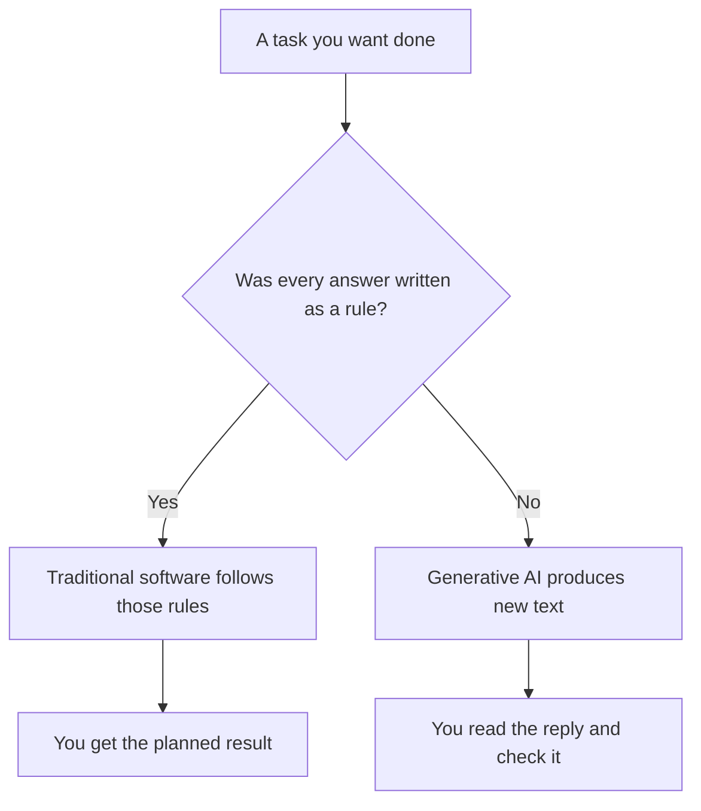
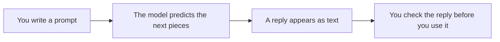

<style>
/* Fenced code: light panel, dark text */
pre[class*="language-"],
.markdown-body pre,
pre {
  background: #f1f5f9 !important;
  border: 1px solid #e2e8f0 !important;
  border-radius: 8px !important;
  color: #0f172a !important;
}

pre code,
.markdown-body pre code {
  background: transparent !important;
  color: #1e293b !important;
  opacity: 1 !important;
}

/* Syntax highlighting on light background (hljs / Prism / pygments) */

pre code .hljs-keyword,
pre code .hljs-selector-tag,
pre code .hljs-selector-class,
pre code .hljs-section { color: #5b21b6 !important; }

pre code .hljs-string,
pre code .hljs-regexp,
pre code .hljs-addition { color: #0f766e !important; }

pre code .hljs-number,
pre code .hljs-literal { color: #b45309 !important; }

pre code .hljs-built_in,
pre code .hljs-title.function_,
pre code .hljs-title.class_,
pre code .hljs-function,
pre code .hljs-title { color: #1d4ed8 !important; }

pre code .hljs-variable,
pre code .hljs-template-variable,
pre code .hljs-attr,
pre code .hljs-name,
pre code .hljs-params { color: #0f172a !important; }

pre code .hljs-type { color: #0369a1 !important; }

pre code .hljs-meta,
pre code .hljs-doctag { color: #475569 !important; }

pre code .token.keyword { color: #5b21b6 !important; }
pre code .token.string { color: #0f766e !important; }
pre code .token.number { color: #b45309 !important; }
pre code .token.function { color: #1d4ed8 !important; }
pre code .token.operator,
pre code .token.punctuation { color: #334155 !important; }
pre code .token.parameter,
pre code .token.property { color: #0f172a !important; }

/* F-strings / template literals: `{var}` must stay dark (fixes white/lost contrast on light bg) */
pre code .hljs-subst,
pre code .hljs-template-variable,
.markdown-body pre code .hljs-subst,
.markdown-body pre code .hljs-template-variable {
  color: #0f172a !important;
}

pre code .hljs-string .hljs-subst,
pre code .hljs-string .hljs-subst *,
pre code .hljs-string .hljs-variable,
pre code .hljs-string .hljs-built_in,
pre code .hljs-string .hljs-keyword,
.markdown-body pre code .hljs-string .hljs-subst,
.markdown-body pre code .hljs-string .hljs-subst * {
  color: #0f172a !important;
}

/* Prism-style interpolation */
pre code .token.interpolation,
pre code .token.interpolation-punctuation,
pre code .token.string .token.punctuation,
pre code .language-python .token.string .token,
pre code .token.string .token.builtin {
  color: #0f172a !important;
}

/* VS Code TextMate-style meta.embedded / source inside string */
pre code span[class*="embedded"],
pre code span[class*="interp"] {
  color: #0f172a !important;
}

/* Pygments: String.Interpol (f-string `{…}` regions) */
pre code .si {
  color: #0f172a !important;
}

/* Comments (all common highlighters) */
.hljs-comment,
.hljs-quote,
span[class*="hljs-comment"],
.token.comment,
.token.prolog,
.token.doctype,
.token.cdata,
.highlight .c,
.highlight .c1,
.highlight .cm,
.highlight .cp,
.highlight .cs,
.markdown-body pre code span.line > span[class*="block-comment"],
.markdown-body pre code span.line > span[class*="line-comment"] {
  color: #334155 !important;
  opacity: 1 !important;
}

/* Inline backticks in body text */
:not(pre) > code,
.markdown-body :not(pre) > code {
  color: #0f172a !important;
  background: rgba(30, 41, 59, 0.08) !important;
  opacity: 1 !important;
}

/* Mermaid edge labels (True / False): stop the text being clipped */
.edgeLabel,
span.edgeLabel,
.edgeLabel p,
foreignObject,
svg .label {
  overflow: visible !important;
}

span.edgeLabel,
.edgeLabel p {
  display: inline-block !important;
  box-sizing: content-box !important;
  padding: 6px 12px !important;
  line-height: 1.45 !important;
  background: #ffffff !important;
  border-radius: 4px;
}
</style>

<div markdown="1" style="color: #0f172a; border-left: 5px solid #1e40af; background: linear-gradient(135deg, #f4f7fb 0%, #eef2f8 100%); padding: 14px 18px; margin: 18px 0; border-radius: 0 10px 10px 0; box-shadow: 0 1px 2px rgba(0,0,0,0.04);">

# **AI — Introduction to GenAI & LLMs**

Instructor notes. Brief points to teach from. Theory + activities — no Python coding today. Diagrams stay at original size.

</div>

<div markdown="1" style="color: #0f172a; border-left: 5px solid #475569; background: #f8fafc; padding: 14px 18px; margin: 18px 0; border-radius: 0 10px 10px 0; box-shadow: 0 1px 2px rgba(0,0,0,0.04);">

## **Quick Recap — Why This Lesson**

- Already: lists, text, dictionaries — enough background for talking about language tools
- Today is **concepts + checking**, not writing programs
- **Part 1 — AI** · **Part 2 — LLMs & prompting** · **Part 3 — Token, temperature, hallucination + demo**

</div>

<div markdown="1" style="color: #0f172a; border-left: 5px solid #2563eb; background: #eff6ff; padding: 14px 18px; margin: 18px 0; border-radius: 0 10px 10px 0; box-shadow: 0 1px 2px rgba(0,0,0,0.04);">

## **What You Will Learn**

- AI with everyday examples · rule-based vs generative · label vs new text
- What an LLM is · clearer prompts (job, reader, length)
- Token · temperature · hallucination · check a demo reply before trusting it

</div>

<div markdown="1" style="color: #0f172a; border-left: 5px solid #be123c; background: linear-gradient(135deg, #fff1f2 0%, #ffe4e6 100%); padding: 14px 18px; margin: 18px 0; border-radius: 0 10px 10px 0; box-shadow: 0 1px 2px rgba(0,0,0,0.04);">

## **Part 1 — AI**

</div>

<div markdown="1" style="color: #0f172a; border-left: 5px solid #0d9488; background: #f0fdfa; padding: 14px 18px; margin: 18px 0; border-radius: 0 10px 10px 0; box-shadow: 0 1px 2px rgba(0,0,0,0.04);">

## **What Artificial Intelligence Is**

- **Official:** software that does tasks needing human-like judgement (learned patterns or designed steps)
- **Simple:** computer does a “smart” job — spam, face unlock, draft a sentence
- **Example:** next-word suggestion on a phone = small AI · plain calculator = not judging language

| Tool | What it does | Kind |
|------|----------------|------|
| Spam filter | Spam or not | Labels |
| Face unlock | Match a face | Recognises |
| Chatbot paragraph | New sentences | Generates text |


- Label ≠ new essay · Generated text was not a stored fixed sentence
- **Doubt:** Is every app AI? No — fixed menus are ordinary software

</div>

<div markdown="1" style="color: #0f172a; border-left: 5px solid #b45309; background: #fffbeb; padding: 14px 18px; margin: 18px 0; border-radius: 0 10px 10px 0; box-shadow: 0 1px 2px rgba(0,0,0,0.04);">

## **Rule-Based Versus Generative**

| Question | Traditional | Generative |
|----------|-------------|------------|
| Who decides output? | Person via rules | Model continues likely text |
| Same input again | Usually same planned result | Similar, not always identical |
| Typical job | Calculate, store, look up | Draft, rewrite, explain |
| When wrong | Missing rule / bad value | Smooth text can still be false |

 



- **UPI balance check** = traditional · **Draft a leave message** = generative

</div>

<div markdown="1" style="color: #0f172a; border-left: 5px solid #c2410c; background: #fff7ed; padding: 14px 18px; margin: 18px 0; border-radius: 0 10px 10px 0; box-shadow: 0 1px 2px rgba(0,0,0,0.04);">

## **Label Versus New Text · Classify Tools**

| You ask for | Labelling tool | Generative tool |
|-------------|----------------|-----------------|
| Is this review angry? | Yes / no | Not required |
| Rewrite politely | Label not enough | New polite paragraph |
| Three hostel rules in simple words | Yes/no cannot | Freshly worded lines |

- Generative ≠ true · Two wordings can both be useful or wrong

**Activity — label each: Traditional / Labelling AI / Generative AI**

1. Calculator (add/subtract only) → Traditional  
2. Spam filter → Labelling AI  
3. Chat drafts polite complaint → Generative AI  
4. Face unlock → Labelling / recognising AI  
5. Fixed railway fare table → Traditional

</div>

<div markdown="1" style="color: #0f172a; border-left: 5px solid #be123c; background: linear-gradient(135deg, #fff1f2 0%, #ffe4e6 100%); padding: 14px 18px; margin: 18px 0; border-radius: 0 10px 10px 0; box-shadow: 0 1px 2px rgba(0,0,0,0.04);">

## **Part 2 — LLMs and Prompting**

</div>

<div markdown="1" style="color: #0f172a; border-left: 5px solid #047857; background: #ecfdf5; padding: 14px 18px; margin: 18px 0; border-radius: 0 10px 10px 0; box-shadow: 0 1px 2px rgba(0,0,0,0.04);">

## **What an LLM Is · Next-Word Prediction**

- **Official:** generative model trained on huge text; continues / reshapes language from what you type
- **Simple:** text-prediction system that drafts a reply
- **Example:** chat box that writes “explain GST in simple words” — shop window = product; engine = LLM

| It is | It is not |
|-------|-----------|
| Continues text | A classmate who “knows” you |
| Trained on lots of writing | Live copy of every website now |
| Draft / explain / rephrase | Guaranteed facts |

| Text so far | Likely next | Unlikely next |
|-------------|-------------|----------------|
| Good morning, | class / team | calculator |
| The shop is | open / closed | photosynthesis |


- Likely ≠ true today · Say the model **predicts text** — not a mind inside the computer

</div>

<div markdown="1" style="color: #0f172a; border-left: 5px solid #1d4ed8; background: #eff6ff; padding: 14px 18px; margin: 18px 0; border-radius: 0 10px 10px 0; box-shadow: 0 1px 2px rgba(0,0,0,0.04);">

## **What a Prompt Is · Clearer Prompts**

- **Official:** text you submit to steer what the model produces
- **Simple:** your question / instruction / pasted notes · reply ≠ prompt
- Clearer prompt names **job**, **reader**, **length**

| Weak | Clearer | Why |
|------|---------|-----|
| Tell me about AI | Explain AI in five short lines for a beginner | Length + reader |
| Write something | Polite two-line leave message for fever | Task + size |
| Fix this | Rewrite so a teacher can read it: … | Exact text included |




</div>

<div markdown="1" style="color: #0f172a; border-left: 5px solid #a21caf; background: #faf5ff; padding: 14px 18px; margin: 18px 0; border-radius: 0 10px 10px 0; box-shadow: 0 1px 2px rgba(0,0,0,0.04);">

## **Activity — Vague vs Clearer · Write One Prompt**

**Vague:**

```text
Write a leave message.
```

**Clearer:**

```text
Write a polite two-line leave message for a student named Kabir who has fever on Monday. Do not invent extra awards or approvals.
```

- Reply A invents gold medal + principal approval → delete unsupported claims  
- Reply B uses only name, reason, day → keep  

**Rewrite this weak prompt** (job + reader + length):

```text
Tell me about databases.
```

**Acceptable clearer version:**

```text
Explain what a database is in four short lines for a beginner who has not studied computers.
```

</div>

<div markdown="1" style="color: #0f172a; border-left: 5px solid #be123c; background: linear-gradient(135deg, #fff1f2 0%, #ffe4e6 100%); padding: 14px 18px; margin: 18px 0; border-radius: 0 10px 10px 0; box-shadow: 0 1px 2px rgba(0,0,0,0.04);">

## **Part 3 — Important LLM Terms, with a Practical Demo**

</div>

<div markdown="1" style="color: #0f172a; border-left: 5px solid #0d9488; background: #f0fdfa; padding: 14px 18px; margin: 18px 0; border-radius: 0 10px 10px 0; box-shadow: 0 1px 2px rgba(0,0,0,0.04);">

## **Token · Temperature · Hallucination**


**Token** — small piece of text (word / part of word / number / comma) the model reads and predicts  
- Example: `The shop is open.` → `The` / `shop` / `is` / `open` / `.`  
- Not a password or a coin


**Temperature** — how boldly the model picks among likely next pieces  
| Setting | Behaviour | Better for |
|---------|-----------|------------|
| Low | More stable wording | Facts to check, formal notes |
| High | More varied wording | Brainstorming, creative drafts |

- Temperature ≠ guarantee of truth

**Hallucination** — confident output that is invented / distorted / unsupported  
- Example: exact bus fare ₹17 since 2019 with no notice you can open  
- Numbers, dates, laws, quotes, awards not in the prompt → check or delete

</div>

<div markdown="1" style="color: #0f172a; border-left: 5px solid #b45309; background: #fffbeb; padding: 14px 18px; margin: 18px 0; border-radius: 0 10px 10px 0; box-shadow: 0 1px 2px rgba(0,0,0,0.04);">

## **Demo — Same Prompt, Two Temperatures**

```text
In one short paragraph, suggest a study plan for tomorrow evening for a beginner learning Python lists.
```

**Low-temperature style:**

```text
Spend 20 minutes revising list indexes, then 20 minutes writing three short list examples, then 10 minutes checking your answers against your notes.
```

**High-temperature style:**

```text
Turn your evening into a mini list carnival: race a shopping list against a marks list, invent silly snack names as list items, then reward yourself with a tiny reverse-loop puzzle before dinner.
```

- Both answer the job · low = steadier plan · high = more playful  
- Neither should invent a fake exam date or score

</div>

<div markdown="1" style="color: #0f172a; border-left: 5px solid #c2410c; background: #fff7ed; padding: 14px 18px; margin: 18px 0; border-radius: 0 10px 10px 0; box-shadow: 0 1px 2px rgba(0,0,0,0.04);">

## **Demo — Spot a Hallucination · Check Activity**

**Given only:** Kabir · Pune · Monday · fever

**Model reply to check:**

```text
I, Kabir from Pune, request leave on Monday because of fever.
I also won the 2022 state gold medal, my attendance is 99.4 percent,
and the principal already approved this leave.
```

**Check:** keep first sentence · delete medal · delete attendance % · delete principal approval

**Safe rewrite:**

```text
I, Kabir, request leave on Monday because I have fever.
I study in Pune and will complete pending work after I return.
```

**Activity:** reply invents bus fare ₹17 since 2019 (not in prompt, no notice open)  
1. Name failure → **hallucination**  
2. Delete → fare + year claim  
3. Keep → wording that still asks for timings if that was the real job

</div>

<div markdown="1" style="color: #0f172a; border-left: 5px solid #0f766e; background: #f0fdfa; padding: 14px 18px; margin: 18px 0; border-radius: 0 10px 10px 0; box-shadow: 0 1px 2px rgba(0,0,0,0.04);">

## **Words People Mix Up · Takeaways**

| People say | Precise meaning here | Not the same as |
|------------|----------------------|-----------------|
| AI | Judgement-like software | Only chatbots |
| Generative AI | Creates new content | A spam label |
| LLM | Text model behind a writing tool | The whole phone app |
| Prompt | What you type in | The reply |
| Token | Small piece of text | Password / fee |
| Temperature | How bold next-word choices are | Guarantee of truth |
| Hallucination | False confident claim | Grammar mistake only |

- Traditional = rules · Generative = new text · LLM = text engine  
- Clearer prompt = job + reader + length · reply still needs a human check  
- Use to draft and explain · check numbers, names, rules yourself

</div>

